# BÁO CÁO THIẾT KẾ CƠ SỞ DỮ LIỆU & TỪ ĐIỂN DỮ LIỆU
## TASK-02: DATABASE SPECIFICATION & DATA DICTIONARY

> **Dự án**: Hệ Thống Thương Mại Điện Tử & Hệ Chuyên Gia Tư Vấn Lắp Ráp Máy Tính (PC Mall & Smart PC Builder)  
> **Cơ sở dữ liệu**: MySQL 8.0 (Database name: `cnm_mk_hb` / `cnm_ecommerce`)  
> **Công nghệ quản lý CSDL & ORM**: Prisma ORM v5 / Node.js TypeScript API  
> **Tài liệu phục vụ**: Báo cáo Đồ án / Khóa luận tốt nghiệp chuyên ngành Kỹ thuật Phần mềm / Công nghệ Thông tin  
> **Ngày cập nhật**: 2026-11-04  

---

## MỤC LỤC TỔNG QUAN

1. [PHẦN 1: NGUYÊN VĂN SCHEMA PRISMA (PHYSICAL DATABASE SCHEMA)](#phần-1-nguyên-văn-schema-prisma)
   - 1.1. Cấu hình Datasource & Generator Client
   - 1.2. Chiến lược định nghĩa kiểu dữ liệu & Enum trong MySQL
   - 1.3. Nguyên văn toàn bộ Model trong `schema.prisma`
2. [PHẦN 2: BẢNG ÁNH XẠ THỰC THỂ (ENTITY MAPPING TABLE)](#phần-2-bảng-ánh-xạ-thực-thể)
   - 2.1. Bảng đối chiếu 11 nhóm thực thể trong đề cương KLTN
   - 2.2. Bảng ánh xạ các phân hệ mở rộng thực tế (Warranties, Serials, Carts, Payments, AI, Logs)
3. [PHẦN 3: TỪ ĐIỂN DỮ LIỆU CHI TIẾT (DATA DICTIONARY - 38 BẢNG)](#phần-3-từ-điển-dữ-liệu-chi-tiết)
   - 3.1. Phân hệ 1: Tài khoản, Xác thực & Địa chỉ (`roles`, `users`, `addresses`, `token_blacklist`)
   - 3.2. Phân hệ 2: Danh mục, Thương hiệu & Danh mục Sản phẩm (`categories`, `brands`, `products`, `product_skus`, `product_reviews`)
   - 3.3. Phân hệ 3: Thuộc tính & Thông số Kỹ thuật Linh kiện (`attributes`, `attribute_values`, `sku_attributes`)
   - 3.4. Phân hệ 4: Hệ Chuyên gia Tư vấn Tương thích & Cấu hình PC (`compatibility_rules`, `pc_builds`, `pc_build_items`)
   - 3.5. Phân hệ 5: Giỏ hàng, Mã Khuyến mãi & Voucher (`carts`, `cart_items`, `coupons`, `coupon_usages`)
   - 3.6. Phân hệ 6: Đơn hàng, Chi tiết Đơn hàng & Quản lý Kho theo Số Serial (`orders`, `order_items`, `order_item_serials`)
   - 3.7. Phân hệ 7: Thanh toán Trực tuyến & Cổng Giao dịch (`payments`)
   - 3.8. Phân hệ 8: Quản lý Vận chuyển & Giao nhận (`shipments`)
   - 3.9. Phân hệ 9: Bảo hành Điện tử & Xử lý Yêu cầu RMA (`warranties`, `warranty_requests`, `warranty_request_events`, `warranty_request_attachments`, `warranty_notifications`)
   - 3.10. Phân hệ 10: Hỗ trợ Khách hàng (Helpdesk Ticket) & Chat Realtime/AI (`tickets`, `ticket_messages`, `chat_sessions`, `chat_messages`, `ai_chats`, `ai_messages`)
   - 3.11. Phân hệ 11: Nhật ký Kiểm toán, Thông báo & Cấu hình Hệ thống (`notifications`, `audit_logs`, `system_settings`)
4. [PHẦN 4: MÃ VẼ SƠ ĐỒ ERD TỰ ĐỘNG (AUTOMATIC ERD CODE GENERATION)](#phần-4-mã-vẽ-sơ-đồ-erd-tự-động)
   - 4.1. Mã nguồn DBML cho công cụ dbdiagram.io
   - 4.2. Mã nguồn Mermaid `erDiagram` trực quan

---

<a name="phần-1-nguyên-văn-schema-prisma"></a>
## PHẦN 1: NGUYÊN VĂN SCHEMA PRISMA

### 1.1. Cấu hình Datasource & Generator Client
- **Hệ quản trị CSDL**: MySQL phiên bản 8.0.
- **Charset & Collation**: `utf8mb4` / `utf8mb4_unicode_ci` hỗ trợ đầy đủ tiếng Việt có dấu, ký tự toán học, biểu tượng linh kiện máy tính và emoji.
- **Prisma Client Engine**: Được cấu hình đa nền tảng (`native` cho môi trường phát triển Windows/macOS và `linux-musl-openssl-3.0.x` cho môi trường đóng gói container Docker Alpine Linux production).
- **Chuỗi kết nối (Database URL)**: Quản lý qua biến môi trường `DATABASE_URL` theo định dạng chuẩn:  
  `mysql://<username>:<password>@<host>:<port>/<database_name>?charset=utf8mb4&parseTime=true`

### 1.2. Chiến lược định nghĩa kiểu dữ liệu & Enum trong MySQL
Trong thiết kế CSDL của dự án, các trường trạng thái (status), phân loại (type, role, priority) được chuẩn hóa theo giải pháp **Application-Level Enums kết hợp VARCHAR(50)** thay vì sử dụng kiểu `ENUM()` bản địa của MySQL vì các lý do kỹ thuật sau:
1. **Khả năng mở rộng không downtime (Zero-downtime Schema Migration)**: Trong MySQL, việc thêm một giá trị mới vào kiểu `ENUM` đòi hỏi khóa bảng (`ALTER TABLE ... MODIFY`), gây gián đoạn dịch vụ khi hệ thống có hàng trăm nghìn bản ghi.
2. **Khả năng đồng bộ với TypeScript & Zod Schema**: Trạng thái được kiểm soát chặt chẽ ở tầng Application logic thông qua các hằng số TypeScript và Zod Validator tại API Gateway, vừa đảm bảo tính toàn vẹn dữ liệu, vừa linh hoạt khi mở rộng.
3. **Danh sách các Domain Values chuẩn trong hệ thống**:
   - `Role.name`: `ADMIN`, `CUSTOMER`, `SALES`, `TECH`.
   - `Order.status`: `PENDING`, `CONFIRMED`, `PROCESSING`, `SHIPPING`, `COMPLETED`, `CANCELLED`.
   - `Order.payment_status`: `UNPAID`, `PAID`, `REFUNDED`, `FAILED`.
   - `Order.payment_method`: `COD`, `VNPAY`, `BANKING`.
   - `Shipment.status`: `CREATED`, `PICKED_UP`, `DELIVERING`, `DELIVERED`, `CANCELLED`.
   - `Ticket.status`: `OPEN`, `IN_PROGRESS`, `RESOLVED`, `CLOSED`.
   - `Ticket.priority`: `LOW`, `MEDIUM`, `HIGH`, `URGENT`.
   - `TicketMessage.visibility`: `PUBLIC`, `INTERNAL`.
   - `WarrantyItem.status`: `ACTIVE`, `EXPIRED`, `CLAIMED`, `VOID`.
   - `OrderItemSerial.status`: `ASSIGNED`, `ACTIVE`, `RETURNED`, `REPLACED`.
   - `WarrantyRequest.status`: `RECEIVED`, `PROCESSING`, `APPROVED`, `REJECTED`, `COMPLETED`.
   - `Coupon.discount_type`: `FIXED_AMOUNT`, `PERCENTAGE`.
   - `Payment.status`: `PENDING_GATEWAY`, `SUCCESS`, `FAILED`, `CANCELLED`.

### 1.3. Nguyên văn toàn bộ Model trong `schema.prisma`
Dưới đây là nguyên văn toàn bộ nội dung file cấu hình `services/api/prisma/schema.prisma` của dự án:

```prisma

generator client {
  provider      = "prisma-client-js"
  binaryTargets = ["native", "linux-musl-openssl-3.0.x"]
}

datasource db {
  provider = "mysql"
  url      = env("DATABASE_URL")
}

model Address {
  id           Int      @id @default(autoincrement())
  user_id      Int
  full_name    String?  @db.VarChar(255)
  phone        String?  @db.VarChar(30)
  address_line String?  @db.VarChar(255)
  ward         String?  @db.VarChar(255)
  district     String?  @db.VarChar(255)
  province     String?  @db.VarChar(255)
  created_at   DateTime @default(now()) @db.Timestamp(0)
  User        User    @relation(fields: [user_id], references: [id], onUpdate: Restrict, map: "fk_addresses_user")

  @@index([user_id], map: "user_id")
  @@map("addresses")
}

model AiChat {
  id          Int           @id @default(autoincrement())
  user_id     Int?
  created_at  DateTime      @default(now()) @db.Timestamp(0)
  User       User?        @relation(fields: [user_id], references: [id], onDelete: Restrict, onUpdate: Restrict, map: "fk_ai_chats_user")
  AiMessage AiMessage[]

  @@index([user_id], map: "user_id")
  @@map("ai_chats")
}

model ChatSession {
  id            Int          @id @default(autoincrement())
  session_id    String       @unique(map: "session_id") @db.VarChar(255)
  status        String       @default("waiting") @db.VarChar(50)
  customer_name String       @default("Khách hàng") @db.VarChar(255)
  staff_name    String?      @db.VarChar(255)
  linked_order_id Int?
  created_at    DateTime     @default(now()) @db.Timestamp(0)
  updated_at    DateTime     @default(now()) @db.Timestamp(0)
  messages      ChatMessage[]

  @@index([status], map: "idx_chat_sessions_status")
  @@index([linked_order_id], map: "idx_chat_sessions_order")
  @@map("chat_sessions")
}

model ChatMessage {
  id         Int         @id @default(autoincrement())
  session_id Int
  sender     String      @db.VarChar(50)
  text       String      @db.Text
  build_data String?     @db.Text
  created_at DateTime    @default(now()) @db.Timestamp(0)
  session    ChatSession @relation(fields: [session_id], references: [id], onDelete: Cascade, onUpdate: Restrict, map: "fk_chat_messages_session")

  @@index([session_id], map: "fk_chat_messages_session")
  @@index([session_id, created_at], map: "idx_chat_messages_session_created")
  @@map("chat_messages")
}

model AiMessage {
  id         Int       @id @default(autoincrement())
  chat_id    Int?
  sender     String?   @db.VarChar(20)
  message    String?   @db.Text
  created_at DateTime  @default(now()) @db.Timestamp(0)
  AiChat   AiChat? @relation(fields: [chat_id], references: [id], onDelete: Restrict, onUpdate: Restrict, map: "fk_ai_messages_chat")

  @@index([chat_id], map: "chat_id")
  @@map("ai_messages")
}

model AttributeValue {
  id                                                                          Int                   @id @default(autoincrement())
  attribute_id                                                                Int?
  value                                                                       String?               @db.VarChar(100)
  Attribute                                                                  Attribute?           @relation(fields: [attribute_id], references: [id], onDelete: Restrict, onUpdate: Restrict, map: "fk_attribute_values_attribute")
  compatibility_rules_compatibility_rules_attribute_value_1Toattribute_values CompatibilityRule[] @relation("compatibility_rules_attribute_value_1Toattribute_values")
  compatibility_rules_compatibility_rules_attribute_value_2Toattribute_values CompatibilityRule[] @relation("compatibility_rules_attribute_value_2Toattribute_values")
  SkuAttribute                                                              SkuAttribute[]

  @@index([attribute_id], map: "attribute_id")
  @@map("attribute_values")
}

model Attribute {
  id               Int                @id @default(autoincrement())
  name             String?            @db.VarChar(100)
  AttributeValue AttributeValue[]
  @@map("attributes")
}

model Brand {
  id         Int        @id @default(autoincrement())
  name       String     @db.VarChar(255)
  slug       String?    @db.VarChar(255)
  logo_url   String?    @db.VarChar(255)
  status     String?    @default("ACTIVE") @db.VarChar(50)
  is_active  Boolean?   @default(true)
  created_at DateTime?  @default(now()) @db.Timestamp(0)
  updated_at DateTime?  @default(now()) @db.Timestamp(0)
  Product   Product[]
  @@map("brands")
}

model CartItem {
  id                 Int          @id @default(autoincrement())
  cart_id            Int
  product_variant_id Int
  quantity           Int          @default(1)
  created_at         DateTime     @default(now()) @db.Timestamp(0)
  updated_at         DateTime     @default(now()) @db.Timestamp(0)
  Cart              Cart        @relation(fields: [cart_id], references: [id], onUpdate: Restrict, map: "fk_cart_items_cart")
  ProductSku       ProductSku @relation(fields: [product_variant_id], references: [id], onUpdate: Restrict, map: "fk_cart_items_sku")

  @@index([cart_id], map: "cart_id")
  @@index([product_variant_id], map: "product_variant_id")
  @@map("cart_items")
}

model Cart {
  id         Int          @id @default(autoincrement())
  user_id    Int
  created_at DateTime     @default(now()) @db.Timestamp(0)
  updated_at DateTime     @default(now()) @db.Timestamp(0)
  CartItem CartItem[]
  User      User        @relation(fields: [user_id], references: [id], onUpdate: Restrict, map: "fk_carts_user")

  @@index([user_id], map: "user_id")
  @@map("carts")
}

model Category {
  id       Int        @id @default(autoincrement())
  name     String?    @db.VarChar(100)
  Product Product[]
  @@map("categories")
}

model CompatibilityRule {
  id                                                                       Int               @id @default(autoincrement())
  name                                                                     String?           @db.VarChar(255)
  attribute_value_1                                                        Int?
  attribute_value_2                                                        Int?
  is_compatible                                                            Boolean?
  source_category_id                                                       Int?
  target_category_id                                                       Int?
  source_attribute_key                                                     String?           @db.VarChar(255)
  target_attribute_key                                                     String?           @db.VarChar(255)
  operator                                                                 String?           @default("EQ") @db.VarChar(20)
  description                                                              String?           @db.Text
  status                                                                   String?           @default("ACTIVE") @db.VarChar(50)
  is_active                                                                Boolean?          @default(true)
  created_at                                                               DateTime?         @default(now()) @db.Timestamp(0)
  updated_at                                                               DateTime?         @default(now()) @db.Timestamp(0)
  attribute_values_compatibility_rules_attribute_value_1Toattribute_values AttributeValue? @relation("compatibility_rules_attribute_value_1Toattribute_values", fields: [attribute_value_1], references: [id], onDelete: Restrict, onUpdate: Restrict, map: "fk_compatibility_rules_attribute_value_1")
  attribute_values_compatibility_rules_attribute_value_2Toattribute_values AttributeValue? @relation("compatibility_rules_attribute_value_2Toattribute_values", fields: [attribute_value_2], references: [id], onDelete: Restrict, onUpdate: Restrict, map: "fk_compatibility_rules_attribute_value_2")

  @@index([attribute_value_1], map: "attribute_value_1")
  @@index([attribute_value_2], map: "attribute_value_2")
  @@map("compatibility_rules")
}

model OrderItem {
  id                 Int          @id @default(autoincrement())
  order_id           Int
  product_variant_id Int
  quantity           Int          @default(1)
  unit_price         Decimal      @default(0.00) @db.Decimal(12, 2)
  line_total         Decimal      @default(0.00) @db.Decimal(12, 2)
  product_id         Int?
  sku_snapshot       String?      @db.VarChar(255)
  name_snapshot      String?      @db.VarChar(255)
  serial_numbers     String?      @db.Text
  created_at         DateTime?    @default(now()) @db.Timestamp(0)
  updated_at         DateTime?    @default(now()) @db.Timestamp(0)
  Order             Order       @relation(fields: [order_id], references: [id], onUpdate: Restrict, map: "fk_order_items_order")
  ProductSku       ProductSku @relation(fields: [product_variant_id], references: [id], onUpdate: Restrict, map: "fk_order_items_sku")
  WarrantyItem     WarrantyItem[]
  OrderItemSerial  OrderItemSerial[]

  @@index([order_id], map: "order_id")
  @@index([product_variant_id], map: "product_variant_id")
  @@map("order_items")
}

model Order {
  id               Int           @id @default(autoincrement())
  user_id          Int?
  total_price      Decimal?      @db.Decimal(12, 2)
  status           String?       @db.VarChar(50)
  created_at       DateTime      @default(now()) @db.Timestamp(0)
  address_id       Int?
  total_amount     Decimal?      @db.Decimal(12, 2)
  shipping_fee     Decimal?      @default(0.00) @db.Decimal(12, 2)
  final_amount     Decimal?      @db.Decimal(12, 2)
  shipping_address String?       @db.Text
  payment_method   String?       @default("COD") @db.VarChar(50)
  payment_status   String?       @default("UNPAID") @db.VarChar(50)
  payment_proof    String?       @db.VarChar(255)
  note             String?       @db.Text
  updated_at       DateTime?     @default(now()) @db.Timestamp(0)
  coupon_id        Int?
  coupon_code      String?       @db.VarChar(50)
  discount_amount  Decimal?      @default(0.00) @db.Decimal(12, 2)
  User             User?         @relation(fields: [user_id], references: [id], onDelete: SetNull, onUpdate: Restrict, map: "fk_orders_user")
  Coupon           Coupon?       @relation(fields: [coupon_id], references: [id], onDelete: SetNull, onUpdate: Restrict, map: "fk_orders_coupon")
  OrderItem        OrderItem[]
  Shipment         Shipment[]
  WarrantyItem     WarrantyItem[]
  CouponUsage      CouponUsage[]
  OrderItemSerial  OrderItemSerial[]
  Payment          Payment[]
  ProductReview    ProductReview[]
  @@index([user_id], map: "user_id")
  @@index([coupon_id], map: "coupon_id")
  @@map("orders")
}

model PcBuildItem {
  id             Int           @id @default(autoincrement())
  build_id       Int?
  sku_id         Int?
  component_type String?       @db.VarChar(50)
  quantity       Int?          @default(1)
  PcBuild      PcBuild?    @relation(fields: [build_id], references: [id], onDelete: Restrict, onUpdate: Restrict, map: "fk_pc_build_items_build")
  ProductSku   ProductSku? @relation(fields: [sku_id], references: [id], onDelete: Restrict, onUpdate: Restrict, map: "fk_pc_build_items_sku")

  @@index([build_id], map: "build_id")
  @@index([sku_id], map: "sku_id")
  @@map("pc_build_items")
}

model PcBuild {
  id             Int              @id @default(autoincrement())
  user_id        Int?
  name           String?          @db.VarChar(100)
  share_token    String?          @unique(map: "share_token") @db.VarChar(36)
  is_public      Boolean?         @default(false)
  description    String?          @db.Text
  use_case       String?          @db.VarChar(50)
  budget         Decimal?         @db.Decimal(12, 2)
  created_at     DateTime         @default(now()) @db.Timestamp(0)
  updated_at     DateTime?        @default(now()) @db.Timestamp(0)
  status         String?          @default("DRAFT") @db.VarChar(50)
  is_saved       Boolean?         @default(false)
  total_price    Decimal?         @default(0.00) @db.Decimal(12, 2)
  PcBuildItem    PcBuildItem[]
  User           User?            @relation(fields: [user_id], references: [id], onDelete: Restrict, onUpdate: Restrict, map: "fk_pc_builds_user")

  @@index([user_id], map: "user_id")
  @@map("pc_builds")
}

model ProductSku {
  id             Int              @id @default(autoincrement())
  product_id     Int?
  price          Decimal?         @db.Decimal(10, 2)
  stock          Int?
  sku            String?          @db.VarChar(255)
  image_url      String?          @db.VarChar(255)
  warranty_months Int?
  status         String?          @default("ACTIVE") @db.VarChar(50)
  is_active      Boolean?         @default(true)
  created_at     DateTime?        @default(now()) @db.Timestamp(0)
  updated_at     DateTime?        @default(now()) @db.Timestamp(0)
  CartItem     CartItem[]
  OrderItem    OrderItem[]
  PcBuildItem PcBuildItem[]
  Product       Product?        @relation(fields: [product_id], references: [id], onDelete: Restrict, onUpdate: Restrict, map: "fk_product_skus_product")
  SkuAttribute SkuAttribute[]

  @@index([product_id], map: "product_id")
  @@map("product_skus")
}

model Product {
  id               Int                @id @default(autoincrement())
  name             String?            @db.VarChar(255)
  description      String?            @db.Text
  price            Decimal?           @db.Decimal(10, 2)
  category_id      Int?
  brand_id         Int?
  warranty_months  Int?               @default(24)
  created_at       DateTime           @default(now()) @db.Timestamp(0)
  slug             String?            @db.VarChar(255)
  status           String?            @default("ACTIVE") @db.VarChar(50)
  is_active        Boolean?           @default(true)
  updated_at       DateTime?          @default(now()) @db.Timestamp(0)
  ProductSku     ProductSku[]
  ProductReview  ProductReview[]
  Brand           Brand?            @relation(fields: [brand_id], references: [id], onDelete: Restrict, onUpdate: Restrict, map: "fk_products_brand")
  Category       Category?        @relation(fields: [category_id], references: [id], onDelete: Restrict, onUpdate: Restrict, map: "fk_products_category")

  @@index([brand_id], map: "brand_id")
  @@index([category_id], map: "category_id")
  @@map("products")
}

model Role {
  id    Int     @id @default(autoincrement())
  name  String? @unique(map: "name") @db.VarChar(50)
  User User[]
  @@map("roles")
}

model Shipment {
  id            Int     @id @default(autoincrement())
  order_id      Int?
  status        String? @db.VarChar(50)
  tracking_code String? @db.VarChar(100)
  Order        Order? @relation(fields: [order_id], references: [id], onDelete: Restrict, onUpdate: Restrict, map: "fk_shipments_order")

  @@index([order_id], map: "order_id")
  @@map("shipments")
}

model AuditLog {
  id          Int      @id @default(autoincrement())
  actor_user_id Int?
  actor_role  String?  @db.VarChar(50)
  action      String   @db.VarChar(100)
  entity_type String   @db.VarChar(100)
  entity_id   String?  @db.VarChar(100)
  description String?  @db.Text
  metadata_json String? @db.Text
  created_at  DateTime @default(now()) @db.Timestamp(0)

  @@index([created_at], map: "idx_audit_logs_created_at")
  @@index([actor_user_id], map: "idx_audit_logs_actor_user")
  @@index([entity_type, entity_id], map: "idx_audit_logs_entity")
  @@map("audit_logs")
}

model SkuAttribute {
  id                 Int               @id @default(autoincrement())
  sku_id             Int?
  attribute_value_id Int?
  ProductSku       ProductSku?     @relation(fields: [sku_id], references: [id], onDelete: Restrict, onUpdate: Restrict, map: "fk_sku_attributes_sku")
  AttributeValue   AttributeValue? @relation(fields: [attribute_value_id], references: [id], onDelete: Restrict, onUpdate: Restrict, map: "fk_sku_attributes_attribute_value")

  @@index([attribute_value_id], map: "attribute_value_id")
  @@index([sku_id], map: "sku_id")
  @@map("sku_attributes")
}

model TicketMessage {
  id         Int      @id @default(autoincrement())
  ticket_id  Int
  user_id    Int
  message    String   @db.Text
  visibility String   @default("PUBLIC") @db.VarChar(20)
  created_at DateTime @default(now()) @db.Timestamp(0)
  updated_at DateTime @default(now()) @db.Timestamp(0)
  Ticket    Ticket  @relation(fields: [ticket_id], references: [id], onDelete: Cascade, onUpdate: Restrict, map: "fk_ticket_messages_ticket")
  User      User    @relation(fields: [user_id], references: [id], onUpdate: Restrict, map: "fk_ticket_messages_user")

  @@index([ticket_id, created_at], map: "idx_ticket_messages_ticket_created")
  @@index([user_id], map: "fk_ticket_messages_user")
  @@map("ticket_messages")
}

model Ticket {
  id                                  Int               @id @default(autoincrement())
  user_id                             Int
  title                               String            @db.VarChar(255)
  description                         String            @db.Text
  status                              String            @default("OPEN") @db.VarChar(50)
  priority                            String            @default("MEDIUM") @db.VarChar(50)
  assigned_to_id                      Int?
  created_at                          DateTime          @default(now()) @db.Timestamp(0)
  updated_at                          DateTime          @default(now()) @db.Timestamp(0)
  TicketMessage                     TicketMessage[]
  users_tickets_assigned_to_idTousers User?            @relation("tickets_assigned_to_idTousers", fields: [assigned_to_id], references: [id], onDelete: Restrict, onUpdate: Restrict, map: "fk_tickets_assigned_user")
  users_tickets_user_idTousers        User             @relation("tickets_user_idTousers", fields: [user_id], references: [id], onUpdate: Restrict, map: "fk_tickets_user")

  @@index([assigned_to_id, status], map: "idx_tickets_assigned_status")
  @@index([user_id, status], map: "idx_tickets_user_status")
  @@map("tickets")
}

model User {
  id                                    Int               @id @default(autoincrement())
  email                                 String?           @unique(map: "email") @db.VarChar(100)
  password                              String?           @db.VarChar(255)
  full_name                             String?           @db.VarChar(100)
  role_id                               Int?
  created_at                            DateTime          @default(now()) @db.Timestamp(0)
  status                                String?           @default("ACTIVE") @db.VarChar(50)
  updated_at                            DateTime?         @default(now()) @db.Timestamp(0)
  phone                                 String?           @db.VarChar(30)
  Address                             Address[]
  AiChat                              AiChat[]
  Cart                                 Cart[]
  PcBuild                             PcBuild[]
  TicketMessage                       TicketMessage[]
  tickets_tickets_assigned_to_idTousers Ticket[]         @relation("tickets_assigned_to_idTousers")
  tickets_tickets_user_idTousers        Ticket[]         @relation("tickets_user_idTousers")
  Role                                 Role?            @relation(fields: [role_id], references: [id], onDelete: Restrict, onUpdate: Restrict, map: "fk_users_role")
  WarrantyItem                            WarrantyItem[]
  Order                                Order[]
  CouponUsage                          CouponUsage[]
  Notification                         Notification[]
  ProductReview                        ProductReview[]

  @@index([role_id], map: "role_id")
  @@map("users")
}

model WarrantyItem {
  id              Int               @id @default(autoincrement())
  user_id         Int
  order_id        Int?
  order_item_id   Int?
  sku_id          Int?
  serial_number   String?           @db.VarChar(100)
  warranty_code   String            @unique(map: "warranty_code") @db.VarChar(100)
  status          String            @default("ACTIVE") @db.VarChar(50)
  note            String?           @db.VarChar(255)
  activated_at    DateTime?         @db.DateTime(0)
  expires_at      DateTime?         @db.DateTime(0)
  created_at      DateTime          @default(now()) @db.Timestamp(0)
  Order           Order?            @relation(fields: [order_id], references: [id], onDelete: Restrict, onUpdate: Restrict, map: "fk_warranties_order")
  OrderItem       OrderItem?        @relation(fields: [order_item_id], references: [id], onDelete: Restrict, onUpdate: Restrict, map: "fk_warranties_order_item")
  User            User              @relation(fields: [user_id], references: [id], onUpdate: Restrict, map: "fk_warranties_user")
  OrderItemSerial OrderItemSerial[]

  @@index([order_id], map: "order_id")
  @@index([user_id], map: "user_id")
  @@index([serial_number], map: "idx_warranties_serial")
  @@index([order_item_id], map: "idx_warranties_order_item")
  @@map("warranties")
}

model OrderItemSerial {
  id            Int           @id @default(autoincrement())
  order_id      Int
  order_item_id Int
  sku_id        Int
  serial_number String        @unique(map: "serial_number") @db.VarChar(100)
  status        String        @default("ASSIGNED") @db.VarChar(50)
  warranty_id   Int?
  assigned_by   Int?
  assigned_at   DateTime      @default(now()) @db.DateTime(0)
  created_at    DateTime      @default(now()) @db.Timestamp(0)
  updated_at    DateTime      @default(now()) @db.Timestamp(0)
  Order         Order         @relation(fields: [order_id], references: [id], onDelete: Cascade, onUpdate: Restrict, map: "fk_ois_order")
  OrderItem     OrderItem     @relation(fields: [order_item_id], references: [id], onDelete: Cascade, onUpdate: Restrict, map: "fk_ois_order_item")
  WarrantyItem  WarrantyItem? @relation(fields: [warranty_id], references: [id], onDelete: SetNull, onUpdate: Restrict, map: "fk_ois_warranty")

  @@index([order_id], map: "idx_ois_order_id")
  @@index([order_item_id], map: "idx_ois_order_item_id")
  @@index([sku_id], map: "idx_ois_sku_id")
  @@index([serial_number], map: "idx_ois_serial")
  @@map("order_item_serials")
}

model WarrantyRequest {
  id                BigInt    @id @default(autoincrement())
  warranty_id       Int?
  user_id           Int?
  lookup_value      String?   @db.VarChar(255)
  customer_name     String?   @db.VarChar(255)
  customer_phone    String?   @db.VarChar(50)
  customer_email    String?   @db.VarChar(255)
  product_name      String?   @db.VarChar(255)
  serial_number     String?   @db.VarChar(255)
  order_id          Int?
  severity          String    @default("MEDIUM") @db.VarChar(50)
  issue_description String    @db.Text
  extra_note        String?   @db.Text
  status            String    @default("RECEIVED") @db.VarChar(50)
  last_staff_note   String?   @db.Text
  last_email_mock   String?   @db.Text
  created_at        DateTime  @default(now()) @db.Timestamp(0)
  updated_at        DateTime  @default(now()) @db.Timestamp(0)

  @@map("warranty_requests")
}

model WarrantyRequestEvent {
  id         Int      @id @default(autoincrement())
  request_id Int
  status     String   @db.VarChar(50)
  note       String?  @db.Text
  actor_role String?  @db.VarChar(50)
  actor_name String?  @db.VarChar(255)
  created_at DateTime @default(now()) @db.Timestamp(0)

  @@map("warranty_request_events")
}

model WarrantyRequestAttachment {
  id         Int      @id @default(autoincrement())
  request_id Int
  source     String   @default("CUSTOMER") @db.VarChar(50)
  file_url   String   @db.VarChar(255)
  mime_type  String?  @db.VarChar(120)
  created_at DateTime @default(now()) @db.Timestamp(0)

  @@map("warranty_request_attachments")
}

model WarrantyNotification {
  id         Int      @id @default(autoincrement())
  user_id    Int
  request_id Int?
  title      String   @db.VarChar(255)
  message    String   @db.Text
  is_read    Int      @default(0) @db.SmallInt
  created_at DateTime @default(now()) @db.Timestamp(0)

  @@index([user_id], map: "idx_warranty_notifications_user")
  @@map("warranty_notifications")
}

model Coupon {
  id                    Int           @id @default(autoincrement())
  code                  String        @unique(map: "code") @db.VarChar(50)
  name                  String        @db.VarChar(255)
  description           String?       @db.Text
  discount_type         String        @default("FIXED_AMOUNT") @db.VarChar(20)
  discount_value        Decimal       @db.Decimal(12, 2)
  max_discount_amount   Decimal?      @db.Decimal(12, 2)
  min_order_value       Decimal?      @default(0.00) @db.Decimal(12, 2)
  target_type           String        @default("ALL") @db.VarChar(20)
  target_ids            String?       @db.Text
  usage_limit           Int?
  used_count            Int           @default(0)
  usage_limit_per_user  Int?          @default(1)
  start_date            DateTime      @db.Timestamp(0)
  end_date              DateTime      @db.Timestamp(0)
  is_active             Boolean       @default(true)
  created_at            DateTime      @default(now()) @db.Timestamp(0)
  updated_at            DateTime?     @default(now()) @db.Timestamp(0)

  Order                 Order[]
  CouponUsage           CouponUsage[]

  @@map("coupons")
}

model CouponUsage {
  id              Int       @id @default(autoincrement())
  coupon_id       Int
  user_id         Int
  order_id        Int
  discount_amount Decimal   @db.Decimal(12, 2)
  created_at      DateTime  @default(now()) @db.Timestamp(0)

  Coupon          Coupon    @relation(fields: [coupon_id], references: [id], onDelete: Cascade, map: "fk_coupon_usages_coupon")
  User            User      @relation(fields: [user_id], references: [id], onDelete: Cascade, map: "fk_coupon_usages_user")
  Order           Order     @relation(fields: [order_id], references: [id], onDelete: Cascade, map: "fk_coupon_usages_order")

  @@index([coupon_id], map: "idx_coupon_usages_coupon")
  @@index([user_id], map: "idx_coupon_usages_user")
  @@index([order_id], map: "idx_coupon_usages_order")
  @@map("coupon_usages")
}

model Notification {
  id             Int       @id @default(autoincrement())
  user_id        Int
  type           String    @default("SYSTEM") @db.VarChar(50)
  title          String    @db.VarChar(255)
  message        String    @db.Text
  reference_id   String?   @db.VarChar(100)
  reference_type String?   @db.VarChar(50)
  link           String?   @db.VarChar(255)
  is_read        Boolean   @default(false)
  created_at     DateTime  @default(now()) @db.Timestamp(0)

  User           User      @relation(fields: [user_id], references: [id], onDelete: Cascade, map: "fk_notifications_user")

  @@index([user_id, is_read], map: "idx_notifications_user_read")
  @@index([created_at(sort: Desc)], map: "idx_notifications_created")
  @@map("notifications")
}

model Payment {
  id               Int       @id @default(autoincrement())
  order_id         Int
  user_id          Int?
  provider         String?   @default("VNPAY_SANDBOX_MOCK") @db.VarChar(50)
  payment_method   String?   @default("VNPAY") @db.VarChar(50)
  amount           Decimal   @db.Decimal(12, 2)
  status           String    @default("PENDING_GATEWAY") @db.VarChar(50)
  transaction_code String?   @db.VarChar(255)
  redirect_url     String?   @db.VarChar(500)
  note             String?   @db.Text
  created_at       DateTime  @default(now()) @db.Timestamp(0)
  updated_at       DateTime? @default(now()) @db.Timestamp(0)
  Order            Order     @relation(fields: [order_id], references: [id], onDelete: Cascade, map: "fk_payments_order")

  @@index([order_id], map: "idx_payments_order")
  @@index([user_id], map: "idx_payments_user")
  @@index([status], map: "idx_payments_status")
  @@map("payments")
}

model SystemSetting {
  id            Int       @id @default(autoincrement())
  setting_key   String    @unique(map: "setting_key") @db.VarChar(100)
  setting_value String?   @db.Text
  description   String?   @db.VarChar(255)
  created_at    DateTime  @default(now()) @db.Timestamp(0)
  updated_at    DateTime? @default(now()) @db.Timestamp(0)

  @@map("system_settings")
}

model ProductReview {
  id                Int       @id @default(autoincrement())
  product_id        Int
  user_id           Int
  order_id          Int?
  rating            Int       @db.TinyInt
  comment           String?   @db.Text
  is_verified_buyer Boolean?  @default(true)
  created_at        DateTime  @default(now()) @db.Timestamp(0)
  updated_at        DateTime  @default(now()) @db.Timestamp(0)
  Product           Product   @relation(fields: [product_id], references: [id], onDelete: Cascade, onUpdate: Restrict, map: "fk_product_reviews_product")
  User              User      @relation(fields: [user_id], references: [id], onDelete: Cascade, onUpdate: Restrict, map: "fk_product_reviews_user")
  Order             Order?    @relation(fields: [order_id], references: [id], onDelete: SetNull, onUpdate: Restrict, map: "fk_product_reviews_order")

  @@index([product_id], map: "idx_product_reviews_product")
  @@index([user_id], map: "idx_product_reviews_user")
  @@index([order_id], map: "idx_product_reviews_order")
  @@map("product_reviews")
}

model TokenBlacklist {
  id         Int       @id @default(autoincrement())
  token      String    @unique @db.VarChar(500)
  user_id    Int?
  expires_at DateTime? @db.Timestamp(0)
  created_at DateTime  @default(now()) @db.Timestamp(0)

  @@index([token], map: "idx_token")
  @@index([expires_at], map: "idx_expires_at")
  @@map("token_blacklist")
}

```

---

<a name="phần-2-bảng-ánh-xạ-thực-thể"></a>
## PHẦN 2: BẢNG ÁNH XẠ THỰC THỂ (ENTITY MAPPING TABLE)

Bảng dưới đây đối chiếu chi tiết giữa **11 nhóm thực thể logic** đã được phác thảo trong Đề cương Khóa luận tốt nghiệp với **38 bảng vật lý thực tế trong MySQL** (thông qua khai báo `@map` / `@@map` trong Prisma Schema), đồng thời làm rõ các phân hệ chức năng nâng cao đã được bổ sung nhằm đáp ứng toàn diện một hệ thống thương mại điện tử phần cứng máy tính chuẩn doanh nghiệp.

### 2.1. Đối chiếu 11 nhóm thực thể cốt lõi theo đề cương KLTN

| STT | Nhóm thực thể đề cương | Tên Model Prisma | Tên Bảng vật lý MySQL (`@@map`) | Khóa chính | Vai trò & Diễn giải nghiệp vụ trong Đồ án |
| :---: | :--- | :--- | :--- | :---: | :--- |
| **1** | **Users** | `User` | `users` | `id` (INT) | Quản lý thông tin tài khoản người dùng, bao gồm cả khách hàng mua sắm và nhân viên hệ thống (Admin, Sales, Kỹ thuật viên Tech). |
| **2** | **Roles** | `Role` | `roles` | `id` (INT) | Định nghĩa các vai trò phân quyền người dùng trong hệ thống RBAC: `ADMIN`, `CUSTOMER`, `SALES`, `TECH`. |
| **3** | **Categories** | `Category` | `categories` | `id` (INT) | Phân loại danh mục phần cứng máy tính: CPU, Mainboard, RAM, GPU, Nguồn (PSU), Ổ cứng (SSD/HDD), Tản nhiệt, Vỏ Case, Màn hình, Bàn phím... |
| **4** | **Products** | `Product`<br>`ProductSku`<br>`Brand`<br>`ProductReview` | `products`<br>`product_skus`<br>`brands`<br>`product_reviews` | `id` (INT)<br>`id` (INT)<br>`id` (INT)<br>`id` (INT) | Quản lý sản phẩm đa biến thể (Master-Variant Pattern). Bảng `products` lưu thông tin chung và thương hiệu `brands`; `product_skus` lưu giá, tồn kho, mã vạch của từng biến thể cụ thể; `product_reviews` lưu đánh giá xếp hạng sao. |
| **5** | **Specifications** | `Attribute`<br>`AttributeValue`<br>`SkuAttribute` | `attributes`<br>`attribute_values`<br>`sku_attributes` | `id` (INT)<br>`id` (INT)<br>`id` (INT) | Quản lý thông số kỹ thuật động theo mô hình EAV (Entity-Attribute-Value). Bảng `attributes` định nghĩa tên thông số (Socket, Bus RAM, Kích thước tản); `attribute_values` lưu các giá trị rời rạc (LGA1700, AM5, DDR5-6000); `sku_attributes` liên kết thông số với SKU sản phẩm. |
| **6** | **Compatibility_Rules** | `CompatibilityRule` | `compatibility_rules` | `id` (INT) | Cơ sở tri thức của Hệ Chuyên gia (Knowledge Base). Lưu trữ 441+ luật tương thích phần cứng giữa các cặp thuộc tính linh kiện (Socket CPU khớp Socket Main, Chuẩn RAM khớp Khe RAM, Kích thước GPU khớp Khoang Case...). |
| **7** | **Builds** | `PcBuild`<br>`PcBuildItem` | `pc_builds`<br>`pc_build_items` | `id` (INT)<br>`id` (INT) | Quản lý các bộ cấu hình PC do khách hàng hoặc chuyên gia xây dựng (Smart PC Builder). `pc_builds` lưu thông tin chung, ngân sách, mục đích sử dụng (Gaming, Đồ họa, Văn phòng), mã chia sẻ `share_token`; `pc_build_items` lưu danh sách linh kiện được chọn. |
| **8** | **Orders** | `Order` | `orders` | `id` (INT) | Quản lý vòng đời đơn đặt hàng: thông tin khách, địa chỉ nhận hàng, tổng tiền hàng, phí ship, chiết khấu voucher, tổng tiền thanh toán, trạng thái đơn hàng và phương thức thanh toán. |
| **9** | **Order_Items** | `OrderItem` | `order_items` | `id` (INT) | Lưu trữ chi tiết từng dòng sản phẩm trong đơn hàng. Áp dụng kỹ thuật Snapshot (`sku_snapshot`, `name_snapshot`, `unit_price`) để bảo toàn giá trị lịch sử kể cả khi giá sản phẩm trên website thay đổi sau này. |
| **10** | **Tickets** | `Ticket`<br>`TicketMessage` | `tickets`<br>`ticket_messages` | `id` (INT)<br>`id` (INT) | Hệ thống Helpdesk tiếp nhận và xử lý sự cố kỹ thuật. Khách hàng gửi yêu cầu hỗ trợ; nhân viên kỹ thuật (Tech) và bán hàng (Sales) tiếp nhận, phân công xử lý và phản hồi tin nhắn giải quyết sự cố. |
| **11** | **Shipments** | `Shipment` | `shipments` | `id` (INT) | Quản lý tiến trình đóng gói và vận chuyển đơn hàng, lưu mã vận đơn `tracking_code` và liên kết trực tiếp với hãng vận chuyển. |

---

### 2.2. Bảng ánh xạ các phân hệ mở rộng thực tế trong hệ thống

Nhằm đáp ứng tiêu chuẩn khắt khe của một sàn TMĐT chuyên nghiệp về thiết bị phần cứng điện tử đắt tiền, hệ thống đã mở rộng thêm các nhóm thực thể sau:

| STT | Nhóm Phân hệ Mở rộng | Tên Model Prisma | Tên Bảng vật lý MySQL (`@@map`) | Vai trò nghiệp vụ trong Hệ thống |
| :---: | :--- | :--- | :--- | :--- |
| **12** | **Quản lý Serial & Bảo hành Điện tử (Warranties & Serials)** | `WarrantyItem`<br>`OrderItemSerial`<br>`WarrantyRequest`<br>`WarrantyRequestEvent`<br>`WarrantyRequestAttachment`<br>`WarrantyNotification` | `warranties`<br>`order_item_serials`<br>`warranty_requests`<br>`warranty_request_events`<br>`warranty_request_attachments`<br>`warranty_notifications` | - **Bảo hành tự động**: Khi đơn hàng hoàn thành, hệ thống tự sinh mã bảo hành điện tử e-Warranty cho từng linh kiện.<br>- **Quản lý số Serial**: Mỗi sản phẩm xuất kho được gán số Serial vật lý duy nhất (`order_item_serials`).<br>- **Quy trình RMA**: Khách gửi yêu cầu bảo hành/đổi trả online, đính kèm hình ảnh lỗi, nhân viên duyệt và cập nhật timeline nhật ký xử lý. |
| **13** | **Giỏ hàng & Đặt hàng (Carts & Cart Items)** | `Cart`<br>`CartItem` | `carts`<br>`cart_items` | Quản lý giỏ hàng mua sắm trực tuyến của người dùng đăng nhập, tự động tính tổng tiền tạm tính và kiểm tra tồn kho theo thời gian thực. |
| **14** | **Sổ địa chỉ người dùng (Addresses)** | `Address` | `addresses` | Lưu trữ danh bạ địa chỉ giao hàng của khách hàng (Họ tên, SĐT, Tỉnh/Thành phố, Quận/Huyện, Phường/Xã, Số nhà), phục vụ tự động điền khi thanh toán. |
| **15** | **Cổng Thanh toán Trực tuyến (Payments)** | `Payment` | `payments` | Ghi nhận các giao dịch thanh toán trực tuyến qua cổng VNPay Sandbox, lưu mã giao dịch ngân hàng `transaction_code`, đường dẫn thanh toán `redirect_url` và trạng thái đối soát. |
| **16** | **Khuyến mãi & Mã giảm giá (Coupons & Marketing)** | `Coupon`<br>`CouponUsage` | `coupons`<br>`coupon_usages` | Quản lý mã giảm giá theo số tiền cố định hoặc phần trăm, điều kiện giá trị đơn hàng tối thiểu, giới hạn số lần sử dụng và lưu vết lịch sử người dùng đã áp mã. |
| **17** | **Tư vấn Trực tuyến & Trợ lý ảo AI (Live Chat & AI Bot)** | `ChatSession`<br>`ChatMessage`<br>`AiChat`<br>`AiMessage` | `chat_sessions`<br>`chat_messages`<br>`ai_chats`<br>`ai_messages` | - **CSKH Trực tuyến**: Cho phép khách hàng chat trực tiếp với nhân viên bán hàng/kỹ thuật, gửi kèm cấu hình PC đang chọn.<br>- **AI Assistant**: Tích hợp trợ lý trí tuệ nhân tạo (LLM / Gemini Engine) tư vấn lựa chọn linh kiện thông minh và giải đáp thắc mắc người dùng 24/7. |
| **18** | **Vận hành, An ninh & Cấu hình (Operations & Security)** | `AuditLog`<br>`SystemSetting`<br>`Notification`<br>`TokenBlacklist` | `audit_logs`<br>`system_settings`<br>`notifications`<br>`token_blacklist` | - **Audit Logs**: Ghi nhận toàn bộ nhật ký thao tác nghiệp vụ quan trọng của Admin/Nhân viên.<br>- **System Settings**: Quản lý cấu hình động (tên cửa hàng, phí ship, email CSKH...).<br>- **Notifications**: Hệ thống thông báo đẩy trên giao diện web.<br>- **Token Blacklist**: Thu hồi JWT khi người dùng đăng xuất để chống tấn công Replay Attack. |

---

<a name="phần-3-từ-điển-dữ-liệu-chi-tiết"></a>
## PHẦN 3: TỪ ĐIỂN DỮ LIỆU CHI TIẾT (DATA DICTIONARY - 38 BẢNG)

Dưới đây là đặc tả chi tiết của toàn bộ **38 bảng vật lý** trong cơ sở dữ liệu `cnm_mk_hb`, bao gồm tên cột vật lý, kiểu dữ liệu MySQL, ràng buộc, giá trị mặc định, quan hệ khóa ngoại và mô tả ngữ nghĩa nghiệp vụ.

---

### 3.1. Phân hệ 1: Tài khoản, Xác thực & Địa chỉ

#### Bảng 1: `roles` (Model Prisma: `Role`)
> Quản lý các vai trò phân quyền người dùng trong hệ thống (RBAC).

| STT | Tên cột (Field) | Kiểu dữ liệu MySQL | Nullable | Ràng buộc / Khóa | Mặc định | Khóa ngoại (Tham chiếu) | Diễn giải nghiệp vụ |
| :---: | :--- | :--- | :---: | :---: | :---: | :--- | :--- |
| 1 | `id` | INT | NOT NULL | PRIMARY KEY | AUTO_INCREMENT | - | Khóa chính tự tăng |
| 2 | `name` | VARCHAR(50) | NULL | UNIQUE | NULL | - | Tên định danh vai trò: `ADMIN`, `CUSTOMER`, `SALES`, `TECH` |

#### Bảng 2: `users` (Model Prisma: `User`)
> Lưu trữ thông tin tài khoản của khách hàng, nhân viên bán hàng, kỹ thuật viên và quản trị viên.

| STT | Tên cột (Field) | Kiểu dữ liệu MySQL | Nullable | Ràng buộc / Khóa | Mặc định | Khóa ngoại (Tham chiếu) | Diễn giải nghiệp vụ |
| :---: | :--- | :--- | :---: | :---: | :---: | :--- | :--- |
| 1 | `id` | INT | NOT NULL | PRIMARY KEY | AUTO_INCREMENT | - | Khóa chính tự tăng định danh tài khoản |
| 2 | `email` | VARCHAR(100) | NULL | UNIQUE | NULL | - | Email đăng nhập của người dùng |
| 3 | `password` | VARCHAR(255) | NULL | - | NULL | - | Mật khẩu đã được băm an toàn bằng thuật toán bcrypt |
| 4 | `full_name` | VARCHAR(100) | NULL | - | NULL | - | Họ và tên hiển thị của người dùng |
| 5 | `phone` | VARCHAR(30) | NULL | - | NULL | - | Số điện thoại liên hệ |
| 6 | `role_id` | INT | NULL | FK, INDEX | NULL | `roles(id)` | Khóa ngoại nối tới vai trò phân quyền |
| 7 | `status` | VARCHAR(50) | NULL | - | `'ACTIVE'` | - | Trạng thái tài khoản: `ACTIVE`, `LOCKED`, `INACTIVE` |
| 8 | `created_at` | TIMESTAMP | NOT NULL | - | `CURRENT_TIMESTAMP` | - | Thời điểm tạo tài khoản |
| 9 | `updated_at` | TIMESTAMP | NULL | - | `CURRENT_TIMESTAMP` | - | Thời điểm cập nhật thông tin lần cuối |

#### Bảng 3: `addresses` (Model Prisma: `Address`)
> Lưu sổ địa chỉ giao hàng của người dùng.

| STT | Tên cột (Field) | Kiểu dữ liệu MySQL | Nullable | Ràng buộc / Khóa | Mặc định | Khóa ngoại (Tham chiếu) | Diễn giải nghiệp vụ |
| :---: | :--- | :--- | :---: | :---: | :---: | :--- | :--- |
| 1 | `id` | INT | NOT NULL | PRIMARY KEY | AUTO_INCREMENT | - | Khóa chính tự tăng |
| 2 | `user_id` | INT | NOT NULL | FK, INDEX | - | `users(id)` | Khóa ngoại nối tới chủ sở hữu địa chỉ |
| 3 | `full_name` | VARCHAR(255) | NULL | - | NULL | - | Họ tên người nhận hàng |
| 4 | `phone` | VARCHAR(30) | NULL | - | NULL | - | Số điện thoại người nhận hàng |
| 5 | `address_line` | VARCHAR(255) | NULL | - | NULL | - | Địa chỉ chi tiết (số nhà, tên đường, tòa nhà) |
| 6 | `ward` | VARCHAR(255) | NULL | - | NULL | - | Phường / Xã |
| 7 | `district` | VARCHAR(255) | NULL | - | NULL | - | Quận / Huyện |
| 8 | `province` | VARCHAR(255) | NULL | - | NULL | - | Tỉnh / Thành phố trực thuộc trung ương |
| 9 | `created_at` | TIMESTAMP | NOT NULL | - | `CURRENT_TIMESTAMP` | - | Thời điểm thêm địa chỉ |

#### Bảng 4: `token_blacklist` (Model Prisma: `TokenBlacklist`)
> Danh sách thu hồi JSON Web Token (JWT) khi người dùng chủ động đăng xuất.

| STT | Tên cột (Field) | Kiểu dữ liệu MySQL | Nullable | Ràng buộc / Khóa | Mặc định | Khóa ngoại (Tham chiếu) | Diễn giải nghiệp vụ |
| :---: | :--- | :--- | :---: | :---: | :---: | :--- | :--- |
| 1 | `id` | INT | NOT NULL | PRIMARY KEY | AUTO_INCREMENT | - | Khóa chính tự tăng |
| 2 | `token` | VARCHAR(500) | NOT NULL | UNIQUE, INDEX | - | - | Chuỗi Access Token JWT bị vô hiệu hóa |
| 3 | `user_id` | INT | NULL | - | NULL | - | ID người dùng sở hữu token |
| 4 | `expires_at` | TIMESTAMP | NULL | INDEX | NULL | - | Thời gian hết hạn gốc của Token (phục vụ cron dọn rác) |
| 5 | `created_at` | TIMESTAMP | NOT NULL | - | `CURRENT_TIMESTAMP` | - | Thời điểm token bị đưa vào blacklist (lúc logout) |

---

### 3.2. Phân hệ 2: Danh mục, Thương hiệu & Danh mục Sản phẩm

#### Bảng 5: `categories` (Model Prisma: `Category`)
> Danh mục phân loại linh kiện phần cứng máy tính và phụ kiện.

| STT | Tên cột (Field) | Kiểu dữ liệu MySQL | Nullable | Ràng buộc / Khóa | Mặc định | Khóa ngoại (Tham chiếu) | Diễn giải nghiệp vụ |
| :---: | :--- | :--- | :---: | :---: | :---: | :--- | :--- |
| 1 | `id` | INT | NOT NULL | PRIMARY KEY | AUTO_INCREMENT | - | Khóa chính tự tăng định danh danh mục |
| 2 | `name` | VARCHAR(100) | NULL | - | NULL | - | Tên danh mục (CPU, Mainboard, RAM, VGA, SSD...) |

#### Bảng 6: `brands` (Model Prisma: `Brand`)
> Danh sách các thương hiệu / hãng sản xuất linh kiện máy tính.

| STT | Tên cột (Field) | Kiểu dữ liệu MySQL | Nullable | Ràng buộc / Khóa | Mặc định | Khóa ngoại (Tham chiếu) | Diễn giải nghiệp vụ |
| :---: | :--- | :--- | :---: | :---: | :---: | :--- | :--- |
| 1 | `id` | INT | NOT NULL | PRIMARY KEY | AUTO_INCREMENT | - | Khóa chính tự tăng |
| 2 | `name` | VARCHAR(255) | NOT NULL | - | - | - | Tên thương hiệu (Intel, AMD, ASUS, MSI, Corsair...) |
| 3 | `slug` | VARCHAR(255) | NULL | - | NULL | - | Đường dẫn tĩnh thân thiện SEO (vd: intel, asus) |
| 4 | `logo_url` | VARCHAR(255) | NULL | - | NULL | - | Đường dẫn hình ảnh logo thương hiệu |
| 5 | `status` | VARCHAR(50) | NULL | - | `'ACTIVE'` | - | Trạng thái hiển thị (`ACTIVE`, `INACTIVE`) |
| 6 | `is_active` | BOOLEAN | NULL | - | `true` | - | Cờ kích hoạt (1: kích hoạt, 0: tạm ẩn) |
| 7 | `created_at` | TIMESTAMP | NULL | - | `CURRENT_TIMESTAMP` | - | Thời điểm tạo |
| 8 | `updated_at` | TIMESTAMP | NULL | - | `CURRENT_TIMESTAMP` | - | Thời điểm cập nhật gần nhất |

#### Bảng 7: `products` (Model Prisma: `Product`)
> Lưu trữ thông tin sản phẩm phần cứng gốc (Master Product).

| STT | Tên cột (Field) | Kiểu dữ liệu MySQL | Nullable | Ràng buộc / Khóa | Mặc định | Khóa ngoại (Tham chiếu) | Diễn giải nghiệp vụ |
| :---: | :--- | :--- | :---: | :---: | :---: | :--- | :--- |
| 1 | `id` | INT | NOT NULL | PRIMARY KEY | AUTO_INCREMENT | - | Khóa chính tự tăng định danh sản phẩm |
| 2 | `name` | VARCHAR(255) | NULL | - | NULL | - | Tên thương mại của sản phẩm |
| 3 | `slug` | VARCHAR(255) | NULL | - | NULL | - | Đường dẫn URL chuẩn SEO |
| 4 | `description` | TEXT | NULL | - | NULL | - | Bài viết mô tả chi tiết sản phẩm và tính năng |
| 5 | `price` | DECIMAL(10,2) | NULL | - | NULL | - | Giá niêm yết tham chiếu cơ bản (VNĐ) |
| 6 | `category_id` | INT | NULL | FK, INDEX | NULL | `categories(id)` | Khóa ngoại nối tới danh mục linh kiện |
| 7 | `brand_id` | INT | NULL | FK, INDEX | NULL | `brands(id)` | Khóa ngoại nối tới thương hiệu sản xuất |
| 8 | `warranty_months` | INT | NULL | - | `24` | - | Thời gian bảo hành tiêu chuẩn mặc định (tháng) |
| 9 | `status` | VARCHAR(50) | NULL | - | `'ACTIVE'` | - | Trạng thái kinh doanh (`ACTIVE`, `OUT_OF_STOCK`, `DISCONTINUED`) |
| 10 | `is_active` | BOOLEAN | NULL | - | `true` | - | Trạng thái hiển thị trên storefront |
| 11 | `created_at` | TIMESTAMP | NOT NULL | - | `CURRENT_TIMESTAMP` | - | Thời điểm tạo sản phẩm |
| 12 | `updated_at` | TIMESTAMP | NULL | - | `CURRENT_TIMESTAMP` | - | Thời điểm cập nhật sản phẩm gần nhất |

#### Bảng 8: `product_skus` (Model Prisma: `ProductSku`)
> Biến thể sản phẩm (SKU) đại diện cho sản phẩm thực tế có giá và tồn kho cụ thể.

| STT | Tên cột (Field) | Kiểu dữ liệu MySQL | Nullable | Ràng buộc / Khóa | Mặc định | Khóa ngoại (Tham chiếu) | Diễn giải nghiệp vụ |
| :---: | :--- | :--- | :---: | :---: | :---: | :--- | :--- |
| 1 | `id` | INT | NOT NULL | PRIMARY KEY | AUTO_INCREMENT | - | Khóa chính tự tăng |
| 2 | `product_id` | INT | NULL | FK, INDEX | NULL | `products(id)` | Khóa ngoại nối tới sản phẩm mẹ |
| 3 | `sku` | VARCHAR(255) | NULL | - | NULL | - | Mã định danh đơn vị lưu kho (vd: CPU-INTEL-14700K) |
| 4 | `price` | DECIMAL(10,2) | NULL | - | NULL | - | Giá bán chính thức của biến thể SKU (VNĐ) |
| 5 | `stock` | INT | NULL | - | NULL | - | Số lượng tồn kho khả dụng hiện tại |
| 6 | `image_url` | VARCHAR(255) | NULL | - | NULL | - | Hình ảnh đặc trưng của biến thể SKU |
| 7 | `warranty_months` | INT | NULL | - | NULL | - | Số tháng bảo hành thực tế của biến thể |
| 8 | `status` | VARCHAR(50) | NULL | - | `'ACTIVE'` | - | Trạng thái kinh doanh SKU |
| 9 | `is_active` | BOOLEAN | NULL | - | `true` | - | Cờ kích hoạt bán hàng |
| 10 | `created_at` | TIMESTAMP | NULL | - | `CURRENT_TIMESTAMP` | - | Thời điểm khởi tạo biến thể |
| 11 | `updated_at` | TIMESTAMP | NULL | - | `CURRENT_TIMESTAMP` | - | Thời điểm cập nhật biến thể |

#### Bảng 9: `product_reviews` (Model Prisma: `ProductReview`)
> Đánh giá chất lượng và nhận xét sản phẩm từ người mua hàng.

| STT | Tên cột (Field) | Kiểu dữ liệu MySQL | Nullable | Ràng buộc / Khóa | Mặc định | Khóa ngoại (Tham chiếu) | Diễn giải nghiệp vụ |
| :---: | :--- | :--- | :---: | :---: | :---: | :--- | :--- |
| 1 | `id` | INT | NOT NULL | PRIMARY KEY | AUTO_INCREMENT | - | Khóa chính tự tăng |
| 2 | `product_id` | INT | NOT NULL | FK, INDEX | - | `products(id)` | Khóa ngoại tới sản phẩm được đánh giá |
| 3 | `user_id` | INT | NOT NULL | FK, INDEX | - | `users(id)` | Khóa ngoại tới người dùng đánh giá |
| 4 | `order_id` | INT | NULL | FK, INDEX | NULL | `orders(id)` | Khóa ngoại tới đơn hàng (xác minh mua hàng) |
| 5 | `rating` | TINYINT | NOT NULL | - | - | - | Điểm số đánh giá từ 1 đến 5 sao |
| 6 | `comment` | TEXT | NULL | - | NULL | - | Nội dung nhận xét chi tiết |
| 7 | `is_verified_buyer` | BOOLEAN | NULL | - | `true` | - | Cờ xác nhận người đánh giá đã thực sự mua hàng |
| 8 | `created_at` | TIMESTAMP | NOT NULL | - | `CURRENT_TIMESTAMP` | - | Thời điểm đánh giá |
| 9 | `updated_at` | TIMESTAMP | NOT NULL | - | `CURRENT_TIMESTAMP` | - | Thời điểm sửa đánh giá |

---

### 3.3. Phân hệ 3: Thuộc tính & Thông số Kỹ thuật Linh kiện (EAV Model)

#### Bảng 10: `attributes` (Model Prisma: `Attribute`)
> Danh mục các loại thuộc tính / thông số kỹ thuật phần cứng (EAV Attribute).

| STT | Tên cột (Field) | Kiểu dữ liệu MySQL | Nullable | Ràng buộc / Khóa | Mặc định | Khóa ngoại (Tham chiếu) | Diễn giải nghiệp vụ |
| :---: | :--- | :--- | :---: | :---: | :---: | :--- | :--- |
| 1 | `id` | INT | NOT NULL | PRIMARY KEY | AUTO_INCREMENT | - | Khóa chính tự tăng |
| 2 | `name` | VARCHAR(100) | NULL | - | NULL | - | Tên loại thuộc tính (Socket, Memory Type, Form Factor, TDP...) |

#### Bảng 11: `attribute_values` (Model Prisma: `AttributeValue`)
> Giá trị cụ thể của các thuộc tính kỹ thuật phần cứng.

| STT | Tên cột (Field) | Kiểu dữ liệu MySQL | Nullable | Ràng buộc / Khóa | Mặc định | Khóa ngoại (Tham chiếu) | Diễn giải nghiệp vụ |
| :---: | :--- | :--- | :---: | :---: | :---: | :--- | :--- |
| 1 | `id` | INT | NOT NULL | PRIMARY KEY | AUTO_INCREMENT | - | Khóa chính tự tăng định danh giá trị thông số |
| 2 | `attribute_id` | INT | NULL | FK, INDEX | NULL | `attributes(id)` | Khóa ngoại nối tới định nghĩa thuộc tính |
| 3 | `value` | VARCHAR(100) | NULL | - | NULL | - | Giá trị cụ thể (vd: `LGA1700`, `AM5`, `DDR5`, `ATX`, `750W`...) |

#### Bảng 12: `sku_attributes` (Model Prisma: `SkuAttribute`)
> Bảng liên kết nhiều - nhiều giữa biến thể linh kiện SKU và giá trị thông số kỹ thuật tương ứng.

| STT | Tên cột (Field) | Kiểu dữ liệu MySQL | Nullable | Ràng buộc / Khóa | Mặc định | Khóa ngoại (Tham chiếu) | Diễn giải nghiệp vụ |
| :---: | :--- | :--- | :---: | :---: | :---: | :--- | :--- |
| 1 | `id` | INT | NOT NULL | PRIMARY KEY | AUTO_INCREMENT | - | Khóa chính tự tăng |
| 2 | `sku_id` | INT | NULL | FK, INDEX | NULL | `product_skus(id)` | Khóa ngoại nối tới biến thể SKU |
| 3 | `attribute_value_id` | INT | NULL | FK, INDEX | NULL | `attribute_values(id)` | Khóa ngoại nối tới giá trị thông số kỹ thuật |

---

### 3.4. Phân hệ 4: Hệ Chuyên gia Tư vấn Tương thích & Cấu hình PC

#### Bảng 13: `compatibility_rules` (Model Prisma: `CompatibilityRule`)
> Cơ sở tri thức của Hệ Chuyên gia (Knowledge Base) định nghĩa các luật kiểm tra tương thích linh kiện PC.

| STT | Tên cột (Field) | Kiểu dữ liệu MySQL | Nullable | Ràng buộc / Khóa | Mặc định | Khóa ngoại (Tham chiếu) | Diễn giải nghiệp vụ |
| :---: | :--- | :--- | :---: | :---: | :---: | :--- | :--- |
| 1 | `id` | INT | NOT NULL | PRIMARY KEY | AUTO_INCREMENT | - | Khóa chính tự tăng định danh quy tắc |
| 2 | `name` | VARCHAR(255) | NULL | - | NULL | - | Tên diễn giải quy tắc tương thích |
| 3 | `attribute_value_1` | INT | NULL | FK, INDEX | NULL | `attribute_values(id)` | Khóa ngoại tới giá trị thông số nguồn (Linh kiện A) |
| 4 | `attribute_value_2` | INT | NULL | FK, INDEX | NULL | `attribute_values(id)` | Khóa ngoại tới giá trị thông số đích (Linh kiện B) |
| 5 | `is_compatible` | BOOLEAN | NULL | - | NULL | - | Cờ tương thích: `true` (Hợp lệ), `false` (Xung đột/Incompatible) |
| 6 | `source_category_id` | INT | NULL | - | NULL | - | ID danh mục linh kiện nguồn (vd: CPU) |
| 7 | `target_category_id` | INT | NULL | - | NULL | - | ID danh mục linh kiện đích (vd: Bo mạch chủ) |
| 8 | `source_attribute_key` | VARCHAR(255) | NULL | - | NULL | - | Khóa thuộc tính nguồn (vd: `cpu_socket`) |
| 9 | `target_attribute_key` | VARCHAR(255) | NULL | - | NULL | - | Khóa thuộc tính đích (vd: `motherboard_socket`) |
| 10 | `operator` | VARCHAR(20) | NULL | - | `'EQ'` | - | Toán tử so sánh logic (`EQ`, `LTE`, `GTE`, `IN`, `CONTAINS`) |
| 11 | `description` | TEXT | NULL | - | NULL | - | Mô tả giải thích nguyên lý kỹ thuật cho người dùng |
| 12 | `status` | VARCHAR(50) | NULL | - | `'ACTIVE'` | - | Trạng thái áp dụng quy tắc (`ACTIVE`, `INACTIVE`) |
| 13 | `is_active` | BOOLEAN | NULL | - | `true` | - | Cờ kích hoạt kiểm tra trong PC Builder Engine |
| 14 | `created_at` | TIMESTAMP | NULL | - | `CURRENT_TIMESTAMP` | - | Thời điểm tạo quy tắc |
| 15 | `updated_at` | TIMESTAMP | NULL | - | `CURRENT_TIMESTAMP` | - | Thời điểm sửa đổi quy tắc gần nhất |

#### Bảng 14: `pc_builds` (Model Prisma: `PcBuild`)
> Lưu trữ bộ cấu hình máy tính hoàn chỉnh được tạo từ chức năng Smart PC Builder.

| STT | Tên cột (Field) | Kiểu dữ liệu MySQL | Nullable | Ràng buộc / Khóa | Mặc định | Khóa ngoại (Tham chiếu) | Diễn giải nghiệp vụ |
| :---: | :--- | :--- | :---: | :---: | :---: | :--- | :--- |
| 1 | `id` | INT | NOT NULL | PRIMARY KEY | AUTO_INCREMENT | - | Khóa chính tự tăng |
| 2 | `user_id` | INT | NULL | FK, INDEX | NULL | `users(id)` | Khóa ngoại người dùng tạo cấu hình (NULL nếu khách vãng lai) |
| 3 | `name` | VARCHAR(100) | NULL | - | NULL | - | Tên bộ cấu hình máy tính (vd: "PC Gaming 4K Ultra") |
| 4 | `share_token` | VARCHAR(36) | NULL | UNIQUE | NULL | - | Mã UUID chia sẻ công khai qua liên kết |
| 5 | `is_public` | BOOLEAN | NULL | - | `false` | - | Cờ cho phép người khác xem và sao chép cấu hình |
| 6 | `description` | TEXT | NULL | - | NULL | - | Ghi chú mục đích dựng máy hoặc hướng dẫn lắp đặt |
| 7 | `use_case` | VARCHAR(50) | NULL | - | NULL | - | Nhu cầu sử dụng: `GAMING`, `OFFICE`, `WORKSTATION`, `AI` |
| 8 | `budget` | DECIMAL(12,2) | NULL | - | NULL | - | Ngân sách dự kiến của khách hàng (VNĐ) |
| 9 | `total_price` | DECIMAL(12,2) | NULL | - | `0.00` | - | Tổng giá tiền thực tế của các linh kiện đã chọn (VNĐ) |
| 10 | `status` | VARCHAR(50) | NULL | - | `'DRAFT'` | - | Trạng thái cấu hình: `DRAFT`, `COMPLETED`, `ORDERED` |
| 11 | `is_saved` | BOOLEAN | NULL | - | `false` | - | Đã lưu vào danh sách yêu thích của người dùng chưa |
| 12 | `created_at` | TIMESTAMP | NOT NULL | - | `CURRENT_TIMESTAMP` | - | Thời điểm tạo cấu hình |
| 13 | `updated_at` | TIMESTAMP | NULL | - | `CURRENT_TIMESTAMP` | - | Thời điểm cập nhật cấu hình lần cuối |

#### Bảng 15: `pc_build_items` (Model Prisma: `PcBuildItem`)
> Chi tiết từng linh kiện phần cứng được chọn trong một cấu hình PC.

| STT | Tên cột (Field) | Kiểu dữ liệu MySQL | Nullable | Ràng buộc / Khóa | Mặc định | Khóa ngoại (Tham chiếu) | Diễn giải nghiệp vụ |
| :---: | :--- | :--- | :---: | :---: | :---: | :--- | :--- |
| 1 | `id` | INT | NOT NULL | PRIMARY KEY | AUTO_INCREMENT | - | Khóa chính tự tăng |
| 2 | `build_id` | INT | NULL | FK, INDEX | NULL | `pc_builds(id)` | Khóa ngoại nối tới cấu hình PC cha |
| 3 | `sku_id` | INT | NULL | FK, INDEX | NULL | `product_skus(id)` | Khóa ngoại nối tới linh kiện SKU được chọn |
| 4 | `component_type` | VARCHAR(50) | NULL | - | NULL | - | Loại linh kiện: `CPU`, `MAINBOARD`, `RAM`, `GPU`, `SSD`, `PSU`, `CASE`, `COOLER` |
| 5 | `quantity` | INT | NULL | - | `1` | - | Số lượng linh kiện được chọn (vd: 2 thanh RAM, 6 quạt fan) |

---

### 3.5. Phân hệ 5: Giỏ hàng, Mã Khuyến mãi & Voucher

#### Bảng 16: `carts` (Model Prisma: `Cart`)
> Giỏ hàng mua sắm trực tuyến của người dùng.

| STT | Tên cột (Field) | Kiểu dữ liệu MySQL | Nullable | Ràng buộc / Khóa | Mặc định | Khóa ngoại (Tham chiếu) | Diễn giải nghiệp vụ |
| :---: | :--- | :--- | :---: | :---: | :---: | :--- | :--- |
| 1 | `id` | INT | NOT NULL | PRIMARY KEY | AUTO_INCREMENT | - | Khóa chính tự tăng định danh giỏ hàng |
| 2 | `user_id` | INT | NOT NULL | FK, INDEX | - | `users(id)` | Khóa ngoại người sở hữu giỏ hàng |
| 3 | `created_at` | TIMESTAMP | NOT NULL | - | `CURRENT_TIMESTAMP` | - | Thời điểm tạo giỏ hàng |
| 4 | `updated_at` | TIMESTAMP | NOT NULL | - | `CURRENT_TIMESTAMP` | - | Thời điểm cập nhật giỏ hàng gần nhất |

#### Bảng 17: `cart_items` (Model Prisma: `CartItem`)
> Các mặt hàng cụ thể được lưu trong giỏ hàng.

| STT | Tên cột (Field) | Kiểu dữ liệu MySQL | Nullable | Ràng buộc / Khóa | Mặc định | Khóa ngoại (Tham chiếu) | Diễn giải nghiệp vụ |
| :---: | :--- | :--- | :---: | :---: | :---: | :--- | :--- |
| 1 | `id` | INT | NOT NULL | PRIMARY KEY | AUTO_INCREMENT | - | Khóa chính tự tăng |
| 2 | `cart_id` | INT | NOT NULL | FK, INDEX | - | `carts(id)` | Khóa ngoại nối tới giỏ hàng cha |
| 3 | `product_variant_id` | INT | NOT NULL | FK, INDEX | - | `product_skus(id)` | Khóa ngoại nối tới biến thể SKU linh kiện |
| 4 | `quantity` | INT | NOT NULL | - | `1` | - | Số lượng mua của mặt hàng này |
| 5 | `created_at` | TIMESTAMP | NOT NULL | - | `CURRENT_TIMESTAMP` | - | Thời điểm thêm vào giỏ |
| 6 | `updated_at` | TIMESTAMP | NOT NULL | - | `CURRENT_TIMESTAMP` | - | Thời điểm thay đổi số lượng |

#### Bảng 18: `coupons` (Model Prisma: `Coupon`)
> Quản lý mã giảm giá, voucher khuyến mãi áp dụng khi thanh toán.

| STT | Tên cột (Field) | Kiểu dữ liệu MySQL | Nullable | Ràng buộc / Khóa | Mặc định | Khóa ngoại (Tham chiếu) | Diễn giải nghiệp vụ |
| :---: | :--- | :--- | :---: | :---: | :---: | :--- | :--- |
| 1 | `id` | INT | NOT NULL | PRIMARY KEY | AUTO_INCREMENT | - | Khóa chính tự tăng |
| 2 | `code` | VARCHAR(50) | NOT NULL | UNIQUE | - | - | Mã voucher khách nhập (vd: `GIAM500K`, `SUMMERSALE`) |
| 3 | `name` | VARCHAR(255) | NOT NULL | - | - | - | Tên chương trình ưu đãi |
| 4 | `description` | TEXT | NULL | - | NULL | - | Mô tả thể lệ chương trình khuyến mãi |
| 5 | `discount_type` | VARCHAR(20) | NOT NULL | - | `'FIXED_AMOUNT'` | - | Phân loại giảm: `FIXED_AMOUNT` (tiền mặt), `PERCENTAGE` (%) |
| 6 | `discount_value` | DECIMAL(12,2) | NOT NULL | - | - | - | Giá trị giảm (vd: 500,000đ hoặc 10%) |
| 7 | `max_discount_amount` | DECIMAL(12,2) | NULL | - | NULL | - | Mức giảm tối đa khi áp dụng voucher theo % (VNĐ) |
| 8 | `min_order_value` | DECIMAL(12,2) | NULL | - | `0.00` | - | Giá trị đơn hàng tối thiểu để được kích hoạt mã |
| 9 | `target_type` | VARCHAR(20) | NOT NULL | - | `'ALL'` | - | Phạm vi áp dụng: `ALL` (toàn sàn), `CATEGORY`, `PRODUCT` |
| 10 | `target_ids` | TEXT | NULL | - | NULL | - | Danh sách ID danh mục hoặc sản phẩm được áp dụng |
| 11 | `usage_limit` | INT | NULL | - | NULL | - | Tổng số lượt dùng tối đa trên toàn hệ thống |
| 12 | `used_count` | INT | NOT NULL | - | `0` | - | Số lượt đã được khách hàng sử dụng thực tế |
| 13 | `usage_limit_per_user`| INT | NULL | - | `1` | - | Giới hạn số lần dùng tối đa trên một tài khoản khách |
| 14 | `start_date` | TIMESTAMP | NOT NULL | - | - | - | Thời điểm bắt đầu hiệu lực mã |
| 15 | `end_date` | TIMESTAMP | NOT NULL | - | - | - | Thời điểm hết hạn mã |
| 16 | `is_active` | BOOLEAN | NOT NULL | - | `true` | - | Trạng thái kích hoạt mã voucher |
| 17 | `created_at` | TIMESTAMP | NOT NULL | - | `CURRENT_TIMESTAMP` | - | Thời điểm tạo mã |
| 18 | `updated_at` | TIMESTAMP | NULL | - | `CURRENT_TIMESTAMP` | - | Thời điểm chỉnh sửa mã |

#### Bảng 19: `coupon_usages` (Model Prisma: `CouponUsage`)
> Lịch sử chi tiết việc sử dụng mã giảm giá theo từng đơn hàng.

| STT | Tên cột (Field) | Kiểu dữ liệu MySQL | Nullable | Ràng buộc / Khóa | Mặc định | Khóa ngoại (Tham chiếu) | Diễn giải nghiệp vụ |
| :---: | :--- | :--- | :---: | :---: | :---: | :--- | :--- |
| 1 | `id` | INT | NOT NULL | PRIMARY KEY | AUTO_INCREMENT | - | Khóa chính tự tăng |
| 2 | `coupon_id` | INT | NOT NULL | FK, INDEX | - | `coupons(id)` | Khóa ngoại tới mã giảm giá |
| 3 | `user_id` | INT | NOT NULL | FK, INDEX | - | `users(id)` | Khóa ngoại tới người dùng áp dụng mã |
| 4 | `order_id` | INT | NOT NULL | FK, INDEX | - | `orders(id)` | Khóa ngoại tới đơn hàng được giảm giá |
| 5 | `discount_amount` | DECIMAL(12,2) | NOT NULL | - | - | - | Số tiền thực tế được giảm trừ trong đơn (VNĐ) |
| 6 | `created_at` | TIMESTAMP | NOT NULL | - | `CURRENT_TIMESTAMP` | - | Thời điểm áp dụng mã |

---

### 3.6. Phân hệ 6: Đơn hàng & Quản lý Kho theo Số Serial (Traceability)

#### Bảng 20: `orders` (Model Prisma: `Order`)
> Quản lý đơn đặt hàng của khách hàng.

| STT | Tên cột (Field) | Kiểu dữ liệu MySQL | Nullable | Ràng buộc / Khóa | Mặc định | Khóa ngoại (Tham chiếu) | Diễn giải nghiệp vụ |
| :---: | :--- | :--- | :---: | :---: | :---: | :--- | :--- |
| 1 | `id` | INT | NOT NULL | PRIMARY KEY | AUTO_INCREMENT | - | Khóa chính tự tăng định danh đơn hàng |
| 2 | `user_id` | INT | NULL | FK, INDEX | NULL | `users(id)` | Khóa ngoại người đặt hàng (NULL nếu mua không tài khoản) |
| 3 | `address_id` | INT | NULL | - | NULL | - | ID địa chỉ nhận hàng đã chọn |
| 4 | `shipping_address` | TEXT | NULL | - | NULL | - | Địa chỉ giao hàng đầy đủ (Snapshot nguyên văn lúc đặt) |
| 5 | `total_price` | DECIMAL(12,2) | NULL | - | NULL | - | Tổng tiền hàng ban đầu (chưa trừ voucher / chưa cộng ship) |
| 6 | `total_amount` | DECIMAL(12,2) | NULL | - | NULL | - | Tổng tiền sản phẩm |
| 7 | `shipping_fee` | DECIMAL(12,2) | NULL | - | `0.00` | - | Phí vận chuyển giao hàng (VNĐ) |
| 8 | `coupon_id` | INT | NULL | FK, INDEX | NULL | `coupons(id)` | Khóa ngoại mã voucher áp dụng |
| 9 | `coupon_code` | VARCHAR(50) | NULL | - | NULL | - | Mã coupon lưu lại dưới dạng snapshot |
| 10 | `discount_amount` | DECIMAL(12,2) | NULL | - | `0.00` | - | Số tiền được khấu trừ từ coupon |
| 11 | `final_amount` | DECIMAL(12,2) | NULL | - | NULL | - | Số tiền thực thanh toán cuối cùng (`total + ship - discount`) |
| 12 | `payment_method` | VARCHAR(50) | NULL | - | `'COD'` | - | Hình thức: `COD` (tiền mặt khi nhận), `VNPAY`, `BANKING` |
| 13 | `payment_status` | VARCHAR(50) | NULL | - | `'UNPAID'` | - | Trạng thái thanh toán: `UNPAID`, `PAID`, `FAILED` |
| 14 | `payment_proof` | VARCHAR(255) | NULL | - | NULL | - | Đường dẫn ảnh ủy nhiệm chi chuyển khoản (nếu có) |
| 15 | `status` | VARCHAR(50) | NULL | - | NULL | - | Trạng thái đơn: `PENDING`, `CONFIRMED`, `PROCESSING`, `SHIPPING`, `COMPLETED`, `CANCELLED` |
| 16 | `note` | TEXT | NULL | - | NULL | - | Ghi chú dặn dò của khách hàng khi giao nhận |
| 17 | `created_at` | TIMESTAMP | NOT NULL | - | `CURRENT_TIMESTAMP` | - | Thời điểm tạo đơn hàng |
| 18 | `updated_at` | TIMESTAMP | NULL | - | `CURRENT_TIMESTAMP` | - | Thời điểm cập nhật trạng thái đơn gần nhất |

#### Bảng 21: `order_items` (Model Prisma: `OrderItem`)
> Lưu danh sách các dòng sản phẩm linh kiện có trong từng đơn hàng.

| STT | Tên cột (Field) | Kiểu dữ liệu MySQL | Nullable | Ràng buộc / Khóa | Mặc định | Khóa ngoại (Tham chiếu) | Diễn giải nghiệp vụ |
| :---: | :--- | :--- | :---: | :---: | :---: | :--- | :--- |
| 1 | `id` | INT | NOT NULL | PRIMARY KEY | AUTO_INCREMENT | - | Khóa chính tự tăng |
| 2 | `order_id` | INT | NOT NULL | FK, INDEX | - | `orders(id)` | Khóa ngoại nối tới đơn hàng cha |
| 3 | `product_variant_id` | INT | NOT NULL | FK, INDEX | - | `product_skus(id)` | Khóa ngoại nối tới biến thể SKU linh kiện bán |
| 4 | `product_id` | INT | NULL | - | NULL | - | ID sản phẩm gốc lưu tham chiếu |
| 5 | `sku_snapshot` | VARCHAR(255) | NULL | - | NULL | - | Mã SKU tại thời điểm mua (bảo toàn lịch sử) |
| 6 | `name_snapshot` | VARCHAR(255) | NULL | - | NULL | - | Tên sản phẩm tại thời điểm mua |
| 7 | `unit_price` | DECIMAL(12,2) | NOT NULL | - | `0.00` | - | Đơn giá bán tại thời điểm đặt hàng (VNĐ) |
| 8 | `quantity` | INT | NOT NULL | - | `1` | - | Số lượng mặt hàng đặt mua |
| 9 | `line_total` | DECIMAL(12,2) | NOT NULL | - | `0.00` | - | Thành tiền (`unit_price * quantity`) |
| 10 | `serial_numbers` | TEXT | NULL | - | NULL | - | Chuỗi danh sách số serial xuất kho cho mục hàng này |
| 11 | `created_at` | TIMESTAMP | NULL | - | `CURRENT_TIMESTAMP` | - | Thời điểm tạo |
| 12 | `updated_at` | TIMESTAMP | NULL | - | `CURRENT_TIMESTAMP` | - | Thời điểm cập nhật |

#### Bảng 22: `order_item_serials` (Model Prisma: `OrderItemSerial`)
> Quản lý truy xuất nguồn gốc số Serial Number thực tế của từng linh kiện xuất kho.

| STT | Tên cột (Field) | Kiểu dữ liệu MySQL | Nullable | Ràng buộc / Khóa | Mặc định | Khóa ngoại (Tham chiếu) | Diễn giải nghiệp vụ |
| :---: | :--- | :--- | :---: | :---: | :---: | :--- | :--- |
| 1 | `id` | INT | NOT NULL | PRIMARY KEY | AUTO_INCREMENT | - | Khóa chính tự tăng |
| 2 | `order_id` | INT | NOT NULL | FK, INDEX | - | `orders(id)` | Khóa ngoại nối tới đơn hàng xuất |
| 3 | `order_item_id` | INT | NOT NULL | FK, INDEX | - | `order_items(id)` | Khóa ngoại nối tới dòng đơn hàng |
| 4 | `sku_id` | INT | NOT NULL | INDEX | - | - | ID linh kiện SKU tương ứng |
| 5 | `serial_number` | VARCHAR(100) | NOT NULL | UNIQUE, INDEX | - | - | Mã Serial Number vật lý in trên sản phẩm/hộp |
| 6 | `status` | VARCHAR(50) | NOT NULL | - | `'ASSIGNED'` | - | Trạng thái: `ASSIGNED`, `ACTIVE`, `RETURNED`, `REPLACED` |
| 7 | `warranty_id` | INT | NULL | FK | NULL | `warranties(id)` | Khóa ngoại nối tới sổ bảo hành điện tử đã kích hoạt |
| 8 | `assigned_by` | INT | NULL | - | NULL | - | ID nhân viên kho/kỹ thuật quét gán mã serial này |
| 9 | `assigned_at` | DATETIME | NOT NULL | - | `CURRENT_TIMESTAMP` | - | Thời điểm quét barcode xuất kho |
| 10 | `created_at` | TIMESTAMP | NOT NULL | - | `CURRENT_TIMESTAMP` | - | Thời điểm tạo bản ghi |
| 11 | `updated_at` | TIMESTAMP | NOT NULL | - | `CURRENT_TIMESTAMP` | - | Thời điểm cập nhật trạng thái |

---

### 3.7. Phân hệ 7: Thanh toán Trực tuyến & Cổng Giao dịch

#### Bảng 23: `payments` (Model Prisma: `Payment`)
> Quản lý các giao dịch thanh toán qua cổng điện tử VNPay hoặc đối soát COD.

| STT | Tên cột (Field) | Kiểu dữ liệu MySQL | Nullable | Ràng buộc / Khóa | Mặc định | Khóa ngoại (Tham chiếu) | Diễn giải nghiệp vụ |
| :---: | :--- | :--- | :---: | :---: | :---: | :--- | :--- |
| 1 | `id` | INT | NOT NULL | PRIMARY KEY | AUTO_INCREMENT | - | Khóa chính tự tăng |
| 2 | `order_id` | INT | NOT NULL | FK, INDEX | - | `orders(id)` | Khóa ngoại nối tới đơn hàng được thanh toán |
| 3 | `user_id` | INT | NULL | INDEX | NULL | - | ID người thực hiện giao dịch thanh toán |
| 4 | `provider` | VARCHAR(50) | NULL | - | `'VNPAY_SANDBOX_MOCK'` | - | Nhà cung cấp cổng thanh toán (`VNPAY`, `MOMO`, `COD`) |
| 5 | `payment_method` | VARCHAR(50) | NULL | - | `'VNPAY'` | - | Phương thức thực tế (`VNPAY`, `ATM`, `QR_PAY`, `COD`) |
| 6 | `amount` | DECIMAL(12,2) | NOT NULL | - | - | - | Số tiền giao dịch gửi sang cổng thanh toán (VNĐ) |
| 7 | `status` | VARCHAR(50) | NOT NULL | INDEX | `'PENDING_GATEWAY'` | - | Trạng thái: `PENDING_GATEWAY`, `SUCCESS`, `FAILED`, `CANCELLED` |
| 8 | `transaction_code` | VARCHAR(255) | NULL | - | NULL | - | Mã giao dịch đối soát do cổng VNPay trả về |
| 9 | `redirect_url` | VARCHAR(500) | NULL | - | NULL | - | Đường dẫn thanh toán được sinh ra để điều hướng khách |
| 10 | `note` | TEXT | NULL | - | NULL | - | Thông báo phản hồi hoặc lý do thanh toán thất bại |
| 11 | `created_at` | TIMESTAMP | NOT NULL | - | `CURRENT_TIMESTAMP` | - | Thời điểm khởi tạo giao dịch |
| 12 | `updated_at` | TIMESTAMP | NULL | - | `CURRENT_TIMESTAMP` | - | Thời điểm cổng thanh toán gửi IPN xác nhận kết quả |

---

### 3.8. Phân hệ 8: Quản lý Vận chuyển & Giao nhận

#### Bảng 24: `shipments` (Model Prisma: `Shipment`)
> Quản lý quá trình giao vận, giao nhận hàng hóa cho đơn hàng.

| STT | Tên cột (Field) | Kiểu dữ liệu MySQL | Nullable | Ràng buộc / Khóa | Mặc định | Khóa ngoại (Tham chiếu) | Diễn giải nghiệp vụ |
| :---: | :--- | :--- | :---: | :---: | :---: | :--- | :--- |
| 1 | `id` | INT | NOT NULL | PRIMARY KEY | AUTO_INCREMENT | - | Khóa chính tự tăng |
| 2 | `order_id` | INT | NULL | FK, INDEX | NULL | `orders(id)` | Khóa ngoại nối tới đơn hàng được vận chuyển |
| 3 | `status` | VARCHAR(50) | NULL | - | NULL | - | Trạng thái: `CREATED`, `PICKED_UP`, `DELIVERING`, `DELIVERED`, `CANCELLED` |
| 4 | `tracking_code` | VARCHAR(100) | NULL | - | NULL | - | Mã vận đơn của đối tác chuyển phát (GHTK, GHN, ViettelPost) |

---

### 3.9. Phân hệ 9: Bảo hành Điện tử & Xử lý Yêu cầu RMA

#### Bảng 25: `warranties` (Model Prisma: `WarrantyItem`)
> Sổ bảo hành điện tử (e-Warranty) kích hoạt tự động theo từng linh kiện được mua.

| STT | Tên cột (Field) | Kiểu dữ liệu MySQL | Nullable | Ràng buộc / Khóa | Mặc định | Khóa ngoại (Tham chiếu) | Diễn giải nghiệp vụ |
| :---: | :--- | :--- | :---: | :---: | :---: | :--- | :--- |
| 1 | `id` | INT | NOT NULL | PRIMARY KEY | AUTO_INCREMENT | - | Khóa chính tự tăng |
| 2 | `user_id` | INT | NOT NULL | FK, INDEX | - | `users(id)` | Khóa ngoại người sở hữu quyền bảo hành |
| 3 | `order_id` | INT | NULL | FK, INDEX | NULL | `orders(id)` | Khóa ngoại đơn hàng mua sản phẩm |
| 4 | `order_item_id` | INT | NULL | FK, INDEX | NULL | `order_items(id)` | Khóa ngoại dòng linh kiện tương ứng |
| 5 | `sku_id` | INT | NULL | - | NULL | - | ID biến thể SKU của linh kiện bảo hành |
| 6 | `serial_number` | VARCHAR(100) | NULL | INDEX | NULL | - | Số Serial vật lý của thiết bị |
| 7 | `warranty_code` | VARCHAR(100) | NOT NULL | UNIQUE | - | - | Mã tra cứu bảo hành điện tử duy nhất (vd: `WAR-2026-X89J`) |
| 8 | `status` | VARCHAR(50) | NOT NULL | - | `'ACTIVE'` | - | Trạng thái bảo hành: `ACTIVE`, `EXPIRED`, `CLAIMED`, `VOID` |
| 9 | `note` | VARCHAR(255) | NULL | - | NULL | - | Ghi chú điều kiện bảo hành đặc thù |
| 10 | `activated_at` | DATETIME | NULL | - | NULL | - | Thời điểm kích hoạt bảo hành (khi giao hàng thành công) |
| 11 | `expires_at` | DATETIME | NULL | - | NULL | - | Ngày hết hạn bảo hành |
| 12 | `created_at` | TIMESTAMP | NOT NULL | - | `CURRENT_TIMESTAMP` | - | Thời điểm sinh phiếu bảo hành |

#### Bảng 26: `warranty_requests` (Model Prisma: `WarrantyRequest`)
> Tiếp nhận yêu cầu bảo hành, sửa chữa, đổi trả (RMA) do khách hàng gửi lên.

| STT | Tên cột (Field) | Kiểu dữ liệu MySQL | Nullable | Ràng buộc / Khóa | Mặc định | Khóa ngoại (Tham chiếu) | Diễn giải nghiệp vụ |
| :---: | :--- | :--- | :---: | :---: | :---: | :--- | :--- |
| 1 | `id` | BIGINT | NOT NULL | PRIMARY KEY | AUTO_INCREMENT | - | Khóa chính tự tăng |
| 2 | `warranty_id` | INT | NULL | - | NULL | - | ID phiếu bảo hành điện tử tương ứng |
| 3 | `user_id` | INT | NULL | - | NULL | - | ID người dùng gửi yêu cầu |
| 4 | `lookup_value` | VARCHAR(255) | NULL | - | NULL | - | Giá trị tra cứu nhanh (Mã đơn hàng, Serial hoặc Số ĐT) |
| 5 | `customer_name` | VARCHAR(255) | NULL | - | NULL | - | Họ tên người gửi yêu cầu |
| 6 | `customer_phone`| VARCHAR(50) | NULL | - | NULL | - | Số điện thoại liên hệ xác nhận lỗi |
| 7 | `customer_email`| VARCHAR(255) | NULL | - | NULL | - | Email gửi thông báo kết quả kiểm tra |
| 8 | `product_name` | VARCHAR(255) | NULL | - | NULL | - | Tên linh kiện bị sự cố |
| 9 | `serial_number` | VARCHAR(255) | NULL | - | NULL | - | Số Serial của thiết bị gửi bảo hành |
| 10 | `order_id` | INT | NULL | - | NULL | - | ID đơn hàng liên quan |
| 11 | `severity` | VARCHAR(50) | NOT NULL | - | `'MEDIUM'` | - | Mức độ nghiêm trọng (`LOW`, `MEDIUM`, `HIGH`, `CRITICAL`) |
| 12 | `issue_description` | TEXT | NOT NULL | - | - | - | Mô tả chi tiết hiện tượng lỗi phần cứng |
| 13 | `extra_note` | TEXT | NULL | - | NULL | - | Thông tin phụ trợ (phụ kiện gửi kèm: box, cáp, adapter...) |
| 14 | `status` | VARCHAR(50) | NOT NULL | - | `'RECEIVED'` | - | Tiến độ RMA: `RECEIVED`, `PROCESSING`, `APPROVED`, `REJECTED`, `COMPLETED` |
| 15 | `last_staff_note` | TEXT | NULL | - | NULL | - | Ghi chú chẩn đoán gần nhất của kỹ thuật viên |
| 16 | `last_email_mock` | TEXT | NULL | - | NULL | - | Bản ghi nội dung email thông báo gửi cho khách |
| 17 | `created_at` | TIMESTAMP | NOT NULL | - | `CURRENT_TIMESTAMP` | - | Thời điểm tạo phiếu yêu cầu |
| 18 | `updated_at` | TIMESTAMP | NOT NULL | - | `CURRENT_TIMESTAMP` | - | Thời điểm cập nhật tiến độ RMA |

#### Bảng 27: `warranty_request_events` (Model Prisma: `WarrantyRequestEvent`)
> Nhật ký dòng sự kiện (Timeline Audit) ghi nhận từng bước xử lý phiếu bảo hành RMA.

| STT | Tên cột (Field) | Kiểu dữ liệu MySQL | Nullable | Ràng buộc / Khóa | Mặc định | Khóa ngoại (Tham chiếu) | Diễn giải nghiệp vụ |
| :---: | :--- | :--- | :---: | :---: | :---: | :--- | :--- |
| 1 | `id` | INT | NOT NULL | PRIMARY KEY | AUTO_INCREMENT | - | Khóa chính tự tăng |
| 2 | `request_id` | INT | NOT NULL | - | - | - | ID phiếu yêu cầu bảo hành tương ứng |
| 3 | `status` | VARCHAR(50) | NOT NULL | - | - | - | Trạng thái chuyển dịch của quy trình |
| 4 | `note` | TEXT | NULL | - | NULL | - | Biên bản kiểm tra kỹ thuật tại bước này |
| 5 | `actor_role` | VARCHAR(50) | NULL | - | NULL | - | Vai trò người thực hiện (`TECH`, `ADMIN`, `CUSTOMER`) |
| 6 | `actor_name` | VARCHAR(255) | NULL | - | NULL | - | Tên người xử lý |
| 7 | `created_at` | TIMESTAMP | NOT NULL | - | `CURRENT_TIMESTAMP` | - | Thời điểm phát sinh sự kiện xử lý |

#### Bảng 28: `warranty_request_attachments` (Model Prisma: `WarrantyRequestAttachment`)
> Lưu hình ảnh, video clip bằng chứng linh kiện bị cháy nổ/hỏng hóc do khách hàng hoặc kỹ thuật viên tải lên.

| STT | Tên cột (Field) | Kiểu dữ liệu MySQL | Nullable | Ràng buộc / Khóa | Mặc định | Khóa ngoại (Tham chiếu) | Diễn giải nghiệp vụ |
| :---: | :--- | :--- | :---: | :---: | :---: | :--- | :--- |
| 1 | `id` | INT | NOT NULL | PRIMARY KEY | AUTO_INCREMENT | - | Khóa chính tự tăng |
| 2 | `request_id` | INT | NOT NULL | - | - | - | ID phiếu yêu cầu bảo hành đính kèm |
| 3 | `source` | VARCHAR(50) | NOT NULL | - | `'CUSTOMER'` | - | Nguồn tải lên: `CUSTOMER` hoặc `STAFF` |
| 4 | `file_url` | VARCHAR(255) | NOT NULL | - | - | - | Đường dẫn tập tin lưu trữ (ảnh chụp mạch, clip lỗi) |
| 5 | `mime_type` | VARCHAR(120) | NULL | - | NULL | - | Định dạng file (`image/jpeg`, `image/png`, `video/mp4`) |
| 6 | `created_at` | TIMESTAMP | NOT NULL | - | `CURRENT_TIMESTAMP` | - | Thời điểm tải lên |

#### Bảng 29: `warranty_notifications` (Model Prisma: `WarrantyNotification`)
> Thông báo tự động gửi đến tài khoản khách hàng về tiến độ bảo hành linh kiện.

| STT | Tên cột (Field) | Kiểu dữ liệu MySQL | Nullable | Ràng buộc / Khóa | Mặc định | Khóa ngoại (Tham chiếu) | Diễn giải nghiệp vụ |
| :---: | :--- | :--- | :---: | :---: | :---: | :--- | :--- |
| 1 | `id` | INT | NOT NULL | PRIMARY KEY | AUTO_INCREMENT | - | Khóa chính tự tăng |
| 2 | `user_id` | INT | NOT NULL | INDEX | - | - | ID khách hàng nhận thông báo |
| 3 | `request_id` | INT | NULL | - | NULL | - | ID yêu cầu bảo hành liên quan |
| 4 | `title` | VARCHAR(255) | NOT NULL | - | - | - | Tiêu đề thông báo (vd: "Đã tiếp nhận linh kiện bảo hành") |
| 5 | `message` | TEXT | NOT NULL | - | - | - | Chi tiết nội dung thông báo |
| 6 | `is_read` | SMALLINT | NOT NULL | - | `0` | - | Trạng thái đọc (0: chưa đọc, 1: đã xem) |
| 7 | `created_at` | TIMESTAMP | NOT NULL | - | `CURRENT_TIMESTAMP` | - | Thời điểm gửi thông báo |

---

### 3.10. Phân hệ 10: Hỗ trợ Khách hàng (Helpdesk Ticket) & Chat Realtime/AI

#### Bảng 30: `tickets` (Model Prisma: `Ticket`)
> Quản lý các phiếu hỗ trợ kỹ thuật và khiếu nại (Helpdesk Ticket).

| STT | Tên cột (Field) | Kiểu dữ liệu MySQL | Nullable | Ràng buộc / Khóa | Mặc định | Khóa ngoại (Tham chiếu) | Diễn giải nghiệp vụ |
| :---: | :--- | :--- | :---: | :---: | :---: | :--- | :--- |
| 1 | `id` | INT | NOT NULL | PRIMARY KEY | AUTO_INCREMENT | - | Khóa chính tự tăng định danh Ticket |
| 2 | `user_id` | INT | NOT NULL | FK, INDEX | - | `users(id)` | Khóa ngoại khách hàng mở ticket |
| 3 | `title` | VARCHAR(255) | NOT NULL | - | - | - | Tiêu đề tóm tắt sự cố cần hỗ trợ |
| 4 | `description` | TEXT | NOT NULL | - | - | - | Nội dung mô tả chi tiết yêu cầu hỗ trợ |
| 5 | `status` | VARCHAR(50) | NOT NULL | - | `'OPEN'` | - | Trạng thái xử lý: `OPEN`, `IN_PROGRESS`, `RESOLVED`, `CLOSED` |
| 6 | `priority` | VARCHAR(50) | NOT NULL | - | `'MEDIUM'` | - | Mức ưu tiên: `LOW`, `MEDIUM`, `HIGH`, `URGENT` |
| 7 | `assigned_to_id` | INT | NULL | FK, INDEX | NULL | `users(id)` | Khóa ngoại kỹ thuật viên (Tech) được phân công tiếp nhận |
| 8 | `created_at` | TIMESTAMP | NOT NULL | - | `CURRENT_TIMESTAMP` | - | Thời điểm tạo ticket |
| 9 | `updated_at` | TIMESTAMP | NOT NULL | - | `CURRENT_TIMESTAMP` | - | Thời điểm cập nhật tiến độ xử lý gần nhất |

#### Bảng 31: `ticket_messages` (Model Prisma: `TicketMessage`)
> Lưu trữ nội dung trao đổi qua lại giữa khách hàng và kỹ thuật viên trong từng Ticket.

| STT | Tên cột (Field) | Kiểu dữ liệu MySQL | Nullable | Ràng buộc / Khóa | Mặc định | Khóa ngoại (Tham chiếu) | Diễn giải nghiệp vụ |
| :---: | :--- | :--- | :---: | :---: | :---: | :--- | :--- |
| 1 | `id` | INT | NOT NULL | PRIMARY KEY | AUTO_INCREMENT | - | Khóa chính tự tăng |
| 2 | `ticket_id` | INT | NOT NULL | FK, INDEX | - | `tickets(id)` | Khóa ngoại tới ticket cha (ON DELETE CASCADE) |
| 3 | `user_id` | INT | NOT NULL | FK, INDEX | - | `users(id)` | Khóa ngoại người viết phản hồi |
| 4 | `message` | TEXT | NOT NULL | - | - | - | Nội dung tin nhắn trao đổi |
| 5 | `visibility` | VARCHAR(20) | NOT NULL | - | `'PUBLIC'` | - | Phạm vi: `PUBLIC` (khách thấy được) hoặc `INTERNAL` (ghi chú nội bộ nhân viên) |
| 6 | `created_at` | TIMESTAMP | NOT NULL | - | `CURRENT_TIMESTAMP` | - | Thời điểm gửi phản hồi |
| 7 | `updated_at` | TIMESTAMP | NOT NULL | - | `CURRENT_TIMESTAMP` | - | Thời điểm chỉnh sửa |

#### Bảng 32: `chat_sessions` (Model Prisma: `ChatSession`)
> Phiên hội thoại trực tuyến (Live Chat) thời gian thực giữa khách hàng và tư vấn viên.

| STT | Tên cột (Field) | Kiểu dữ liệu MySQL | Nullable | Ràng buộc / Khóa | Mặc định | Khóa ngoại (Tham chiếu) | Diễn giải nghiệp vụ |
| :---: | :--- | :--- | :---: | :---: | :---: | :--- | :--- |
| 1 | `id` | INT | NOT NULL | PRIMARY KEY | AUTO_INCREMENT | - | Khóa chính tự tăng |
| 2 | `session_id` | VARCHAR(255) | NOT NULL | UNIQUE | - | - | Chuỗi định danh phiên làm việc Web/Socket duy nhất |
| 3 | `status` | VARCHAR(50) | NOT NULL | INDEX | `'waiting'` | - | Trạng thái phòng chat: `waiting`, `active`, `closed` |
| 4 | `customer_name` | VARCHAR(255) | NOT NULL | - | `'Khách hàng'` | - | Tên hiển thị của khách hàng chat |
| 5 | `staff_name` | VARCHAR(255) | NULL | - | NULL | - | Tên nhân viên tiếp nhận tư vấn |
| 6 | `linked_order_id`| INT | NULL | INDEX | NULL | - | ID đơn hàng liên quan nếu khách hỏi về đơn |
| 7 | `created_at` | TIMESTAMP | NOT NULL | - | `CURRENT_TIMESTAMP` | - | Thời điểm bắt đầu phiên chat |
| 8 | `updated_at` | TIMESTAMP | NOT NULL | - | `CURRENT_TIMESTAMP` | - | Thời điểm có tin nhắn mới |

#### Bảng 33: `chat_messages` (Model Prisma: `ChatMessage`)
> Lưu trữ nội dung tin nhắn trao đổi trực tiếp trong phiên live chat.

| STT | Tên cột (Field) | Kiểu dữ liệu MySQL | Nullable | Ràng buộc / Khóa | Mặc định | Khóa ngoại (Tham chiếu) | Diễn giải nghiệp vụ |
| :---: | :--- | :--- | :---: | :---: | :---: | :--- | :--- |
| 1 | `id` | INT | NOT NULL | PRIMARY KEY | AUTO_INCREMENT | - | Khóa chính tự tăng |
| 2 | `session_id` | INT | NOT NULL | FK, INDEX | - | `chat_sessions(id)` | Khóa ngoại tới phiên chat (ON DELETE CASCADE) |
| 3 | `sender` | VARCHAR(50) | NOT NULL | - | - | - | Đối tượng gửi: `customer`, `staff`, `system` |
| 4 | `text` | TEXT | NOT NULL | - | - | - | Nội dung văn bản tin nhắn |
| 5 | `build_data` | TEXT | NULL | - | NULL | - | Dữ liệu cấu hình PC dạng JSON nếu khách gửi chia sẻ cấu hình |
| 6 | `created_at` | TIMESTAMP | NOT NULL | INDEX | `CURRENT_TIMESTAMP` | - | Thời điểm gửi tin nhắn |

#### Bảng 34: `ai_chats` (Model Prisma: `AiChat`)
> Phiên hội thoại với Trợ lý ảo AI (Gemini / LLM Assistant).

| STT | Tên cột (Field) | Kiểu dữ liệu MySQL | Nullable | Ràng buộc / Khóa | Mặc định | Khóa ngoại (Tham chiếu) | Diễn giải nghiệp vụ |
| :---: | :--- | :--- | :---: | :---: | :---: | :--- | :--- |
| 1 | `id` | INT | NOT NULL | PRIMARY KEY | AUTO_INCREMENT | - | Khóa chính tự tăng |
| 2 | `user_id` | INT | NULL | FK, INDEX | NULL | `users(id)` | Khóa ngoại người dùng tương tác với AI Bot |
| 3 | `created_at` | TIMESTAMP | NOT NULL | - | `CURRENT_TIMESTAMP` | - | Thời điểm bắt đầu trò chuyện với AI |

#### Bảng 35: `ai_messages` (Model Prisma: `AiMessage`)
> Lưu trữ các đoạn tin nhắn đối thoại giữa người dùng và Trợ lý AI.

| STT | Tên cột (Field) | Kiểu dữ liệu MySQL | Nullable | Ràng buộc / Khóa | Mặc định | Khóa ngoại (Tham chiếu) | Diễn giải nghiệp vụ |
| :---: | :--- | :--- | :---: | :---: | :---: | :--- | :--- |
| 1 | `id` | INT | NOT NULL | PRIMARY KEY | AUTO_INCREMENT | - | Khóa chính tự tăng |
| 2 | `chat_id` | INT | NULL | FK, INDEX | NULL | `ai_chats(id)` | Khóa ngoại nối tới phiên trò chuyện AI |
| 3 | `sender` | VARCHAR(20) | NULL | - | NULL | - | Đối tượng gửi: `user` (người dùng) hoặc `assistant` (AI) |
| 4 | `message` | TEXT | NULL | - | NULL | - | Nội dung câu hỏi của khách hoặc câu trả lời của AI |
| 5 | `created_at` | TIMESTAMP | NOT NULL | - | `CURRENT_TIMESTAMP` | - | Thời điểm gửi thông điệp |

---

### 3.11. Phân hệ 11: Nhật ký Kiểm toán, Thông báo & Cấu hình Hệ thống

#### Bảng 36: `notifications` (Model Prisma: `Notification`)
> Quản lý hệ thống chuông thông báo (In-App Notification) cho người dùng trên website.

| STT | Tên cột (Field) | Kiểu dữ liệu MySQL | Nullable | Ràng buộc / Khóa | Mặc định | Khóa ngoại (Tham chiếu) | Diễn giải nghiệp vụ |
| :---: | :--- | :--- | :---: | :---: | :---: | :--- | :--- |
| 1 | `id` | INT | NOT NULL | PRIMARY KEY | AUTO_INCREMENT | - | Khóa chính tự tăng |
| 2 | `user_id` | INT | NOT NULL | FK, INDEX | - | `users(id)` | Khóa ngoại người nhận thông báo |
| 3 | `type` | VARCHAR(50) | NOT NULL | - | `'SYSTEM'` | - | Phân loại thông báo: `ORDER`, `WARRANTY`, `PROMOTION`, `SYSTEM` |
| 4 | `title` | VARCHAR(255) | NOT NULL | - | - | - | Tiêu đề ngắn gọn hiển thị ở thanh thông báo |
| 5 | `message` | TEXT | NOT NULL | - | - | - | Nội dung chi tiết của thông báo |
| 6 | `reference_id` | VARCHAR(100) | NULL | - | NULL | - | ID của đối tượng tham chiếu (vd: mã đơn hàng, ID ticket) |
| 7 | `reference_type`| VARCHAR(50) | NULL | - | NULL | - | Loại đối tượng tham chiếu: `ORDER`, `TICKET`, `WARRANTY` |
| 8 | `link` | VARCHAR(255) | NULL | - | NULL | - | Đường dẫn URL chuyển hướng khi người dùng bấm vào xem |
| 9 | `is_read` | BOOLEAN | NOT NULL | INDEX | `false` | - | Trạng thái đã xem (true: đã đọc, false: chưa đọc) |
| 10 | `created_at` | TIMESTAMP | NOT NULL | INDEX | `CURRENT_TIMESTAMP` | - | Thời điểm phát sinh thông báo |

#### Bảng 37: `audit_logs` (Model Prisma: `AuditLog`)
> Nhật ký kiểm toán an ninh (Audit Trail) ghi vết mọi thay đổi trọng yếu của quản trị viên và nhân viên.

| STT | Tên cột (Field) | Kiểu dữ liệu MySQL | Nullable | Ràng buộc / Khóa | Mặc định | Khóa ngoại (Tham chiếu) | Diễn giải nghiệp vụ |
| :---: | :--- | :--- | :---: | :---: | :---: | :--- | :--- |
| 1 | `id` | INT | NOT NULL | PRIMARY KEY | AUTO_INCREMENT | - | Khóa chính tự tăng |
| 2 | `actor_user_id`| INT | NULL | INDEX | NULL | - | ID của nhân viên hoặc Admin thực hiện hành động |
| 3 | `actor_role` | VARCHAR(50) | NULL | - | NULL | - | Vai trò của người thực hiện (`ADMIN`, `SALES`, `TECH`) |
| 4 | `action` | VARCHAR(100) | NOT NULL | - | - | - | Hành động nghiệp vụ (vd: `UPDATE_ORDER_STATUS`, `ASSIGN_SERIAL`, `DELETE_PRODUCT`) |
| 5 | `entity_type` | VARCHAR(100) | NOT NULL | INDEX | - | - | Tên bảng/thực thể bị tác động (`Order`, `Product`, `Serial`, `Ticket`) |
| 6 | `entity_id` | VARCHAR(100) | NULL | INDEX | NULL | - | ID của bản ghi dữ liệu bị thay đổi |
| 7 | `description` | TEXT | NULL | - | NULL | - | Mô tả tóm lược hành động thực hiện |
| 8 | `metadata_json`| TEXT | NULL | - | NULL | - | Dữ liệu cũ và mới lưu dưới dạng JSON (Diff) phục vụ truy vết |
| 9 | `created_at` | TIMESTAMP | NOT NULL | INDEX | `CURRENT_TIMESTAMP` | - | Thời điểm phát sinh thao tác |

#### Bảng 38: `system_settings` (Model Prisma: `SystemSetting`)
> Lưu trữ các thông số cấu hình vận hành động của hệ thống TMĐT.

| STT | Tên cột (Field) | Kiểu dữ liệu MySQL | Nullable | Ràng buộc / Khóa | Mặc định | Khóa ngoại (Tham chiếu) | Diễn giải nghiệp vụ |
| :---: | :--- | :--- | :---: | :---: | :---: | :--- | :--- |
| 1 | `id` | INT | NOT NULL | PRIMARY KEY | AUTO_INCREMENT | - | Khóa chính tự tăng |
| 2 | `setting_key` | VARCHAR(100) | NOT NULL | UNIQUE | - | - | Khóa định danh cấu hình (vd: `store_name`, `online_payment_mode`, `maintenance_mode`) |
| 3 | `setting_value`| TEXT | NULL | - | NULL | - | Giá trị cấu hình tương ứng |
| 4 | `description` | VARCHAR(255) | NULL | - | NULL | - | Diễn giải ý nghĩa cấu hình |
| 5 | `created_at` | TIMESTAMP | NOT NULL | - | `CURRENT_TIMESTAMP` | - | Thời điểm tạo |
| 6 | `updated_at` | TIMESTAMP | NULL | - | `CURRENT_TIMESTAMP` | - | Thời điểm cập nhật giá trị |

---

<a name="phần-4-mã-vẽ-sơ-đồ-erd-tự-động"></a>
## PHẦN 4: MÃ VẼ SƠ ĐỒ ERD TỰ ĐỘNG (AUTOMATIC ERD CODE GENERATION)

Để phục vụ trình bày trực quan trong báo cáo Khóa luận tốt nghiệp hoặc Slide thuyết minh đồ án, dưới đây là mã nguồn vẽ biểu đồ quan hệ thực thể (ERD) tự động bằng 2 công cụ phổ biến và trực quan nhất hiện nay:
1. **DBML (Database Markup Language)** dùng cho nền tảng trực tuyến [dbdiagram.io](https://dbdiagram.io).
2. **Mermaid `erDiagram`** hiển thị trực tiếp trong file Markdown và các phần mềm soạn thảo (VS Code, GitHub, Obsidian, Notion).

---

### 4.1. Mã nguồn DBML cho công cụ dbdiagram.io

> **Hướng dẫn sử dụng:**
> 1. Truy cập trang web: [https://dbdiagram.io](https://dbdiagram.io)
> 2. Nhấp vào nút **New Diagram**.
> 3. Xóa nội dung mẫu và dán toàn bộ đoạn mã DBML dưới đây vào khung soạn thảo bên trái.
> 4. dbdiagram.io sẽ tự động dựng sơ đồ toàn vẹn thực thể, quan hệ khóa ngoại và cho phép xuất file ảnh chất lượng cao PNG / PDF để chèn vào báo cáo.

```dbml
// ==========================================
// DBML SPECIFICATION FOR PC MALL & BUILDER
// Database: MySQL 8.0 (cnm_mk_hb)
// ==========================================

Table roles {
  id int [pk, increment]
  name varchar(50) [unique, note: 'ADMIN, CUSTOMER, SALES, TECH']
}

Table users {
  id int [pk, increment]
  email varchar(100) [unique]
  password varchar(255)
  full_name varchar(100)
  phone varchar(30)
  role_id int
  status varchar(50) [default: 'ACTIVE']
  created_at timestamp [default: `now()`]
  updated_at timestamp [default: `now()`]
}

Table addresses {
  id int [pk, increment]
  user_id int [not null]
  full_name varchar(255)
  phone varchar(30)
  address_line varchar(255)
  ward varchar(255)
  district varchar(255)
  province varchar(255)
  created_at timestamp [default: `now()`]
}

Table token_blacklist {
  id int [pk, increment]
  token varchar(500) [unique, not null]
  user_id int
  expires_at timestamp
  created_at timestamp [default: `now()`]
}

Table categories {
  id int [pk, increment]
  name varchar(100)
}

Table brands {
  id int [pk, increment]
  name varchar(255) [not null]
  slug varchar(255)
  logo_url varchar(255)
  status varchar(50) [default: 'ACTIVE']
  is_active boolean [default: true]
  created_at timestamp [default: `now()`]
  updated_at timestamp [default: `now()`]
}

Table products {
  id int [pk, increment]
  name varchar(255)
  slug varchar(255)
  description text
  price decimal(10,2)
  category_id int
  brand_id int
  warranty_months int [default: 24]
  status varchar(50) [default: 'ACTIVE']
  is_active boolean [default: true]
  created_at timestamp [default: `now()`]
  updated_at timestamp [default: `now()`]
}

Table product_skus {
  id int [pk, increment]
  product_id int
  sku varchar(255)
  price decimal(10,2)
  stock int
  image_url varchar(255)
  warranty_months int
  status varchar(50) [default: 'ACTIVE']
  is_active boolean [default: true]
  created_at timestamp [default: `now()`]
  updated_at timestamp [default: `now()`]
}

Table attributes {
  id int [pk, increment]
  name varchar(100)
}

Table attribute_values {
  id int [pk, increment]
  attribute_id int
  value varchar(100)
}

Table sku_attributes {
  id int [pk, increment]
  sku_id int
  attribute_value_id int
}

Table compatibility_rules {
  id int [pk, increment]
  name varchar(255)
  attribute_value_1 int
  attribute_value_2 int
  is_compatible boolean
  source_category_id int
  target_category_id int
  source_attribute_key varchar(255)
  target_attribute_key varchar(255)
  operator varchar(20) [default: 'EQ']
  description text
  status varchar(50) [default: 'ACTIVE']
  is_active boolean [default: true]
  created_at timestamp [default: `now()`]
  updated_at timestamp [default: `now()`]
}

Table pc_builds {
  id int [pk, increment]
  user_id int
  name varchar(100)
  share_token varchar(36) [unique]
  is_public boolean [default: false]
  description text
  use_case varchar(50)
  budget decimal(12,2)
  total_price decimal(12,2) [default: 0.00]
  status varchar(50) [default: 'DRAFT']
  is_saved boolean [default: false]
  created_at timestamp [default: `now()`]
  updated_at timestamp [default: `now()`]
}

Table pc_build_items {
  id int [pk, increment]
  build_id int
  sku_id int
  component_type varchar(50)
  quantity int [default: 1]
}

Table carts {
  id int [pk, increment]
  user_id int [not null]
  created_at timestamp [default: `now()`]
  updated_at timestamp [default: `now()`]
}

Table cart_items {
  id int [pk, increment]
  cart_id int [not null]
  product_variant_id int [not null]
  quantity int [not null, default: 1]
  created_at timestamp [default: `now()`]
  updated_at timestamp [default: `now()`]
}

Table coupons {
  id int [pk, increment]
  code varchar(50) [unique, not null]
  name varchar(255) [not null]
  description text
  discount_type varchar(20) [default: 'FIXED_AMOUNT']
  discount_value decimal(12,2) [not null]
  max_discount_amount decimal(12,2)
  min_order_value decimal(12,2) [default: 0.00]
  target_type varchar(20) [default: 'ALL']
  target_ids text
  usage_limit int
  used_count int [default: 0]
  usage_limit_per_user int [default: 1]
  start_date timestamp [not null]
  end_date timestamp [not null]
  is_active boolean [default: true]
  created_at timestamp [default: `now()`]
  updated_at timestamp [default: `now()`]
}

Table coupon_usages {
  id int [pk, increment]
  coupon_id int [not null]
  user_id int [not null]
  order_id int [not null]
  discount_amount decimal(12,2) [not null]
  created_at timestamp [default: `now()`]
}

Table orders {
  id int [pk, increment]
  user_id int
  address_id int
  shipping_address text
  total_price decimal(12,2)
  total_amount decimal(12,2)
  shipping_fee decimal(12,2) [default: 0.00]
  discount_amount decimal(12,2) [default: 0.00]
  final_amount decimal(12,2)
  status varchar(50)
  payment_method varchar(50) [default: 'COD']
  payment_status varchar(50) [default: 'UNPAID']
  payment_proof varchar(255)
  coupon_id int
  coupon_code varchar(50)
  note text
  created_at timestamp [default: `now()`]
  updated_at timestamp [default: `now()`]
}

Table order_items {
  id int [pk, increment]
  order_id int [not null]
  product_variant_id int [not null]
  product_id int
  sku_snapshot varchar(255)
  name_snapshot varchar(255)
  unit_price decimal(12,2) [default: 0.00]
  quantity int [default: 1]
  line_total decimal(12,2) [default: 0.00]
  serial_numbers text
  created_at timestamp [default: `now()`]
  updated_at timestamp [default: `now()`]
}

Table order_item_serials {
  id int [pk, increment]
  order_id int [not null]
  order_item_id int [not null]
  sku_id int [not null]
  serial_number varchar(100) [unique, not null]
  status varchar(50) [default: 'ASSIGNED']
  warranty_id int
  assigned_by int
  assigned_at datetime [default: `now()`]
  created_at timestamp [default: `now()`]
  updated_at timestamp [default: `now()`]
}

Table payments {
  id int [pk, increment]
  order_id int [not null]
  user_id int
  provider varchar(50) [default: 'VNPAY_SANDBOX_MOCK']
  payment_method varchar(50) [default: 'VNPAY']
  amount decimal(12,2) [not null]
  status varchar(50) [default: 'PENDING_GATEWAY']
  transaction_code varchar(255)
  redirect_url varchar(500)
  note text
  created_at timestamp [default: `now()`]
  updated_at timestamp [default: `now()`]
}

Table shipments {
  id int [pk, increment]
  order_id int
  status varchar(50)
  tracking_code varchar(100)
}

Table warranties {
  id int [pk, increment]
  user_id int [not null]
  order_id int
  order_item_id int
  sku_id int
  serial_number varchar(100)
  warranty_code varchar(100) [unique, not null]
  status varchar(50) [default: 'ACTIVE']
  note varchar(255)
  activated_at datetime
  expires_at datetime
  created_at timestamp [default: `now()`]
}

Table warranty_requests {
  id bigint [pk, increment]
  warranty_id int
  user_id int
  lookup_value varchar(255)
  customer_name varchar(255)
  customer_phone varchar(50)
  customer_email varchar(255)
  product_name varchar(255)
  serial_number varchar(255)
  order_id int
  severity varchar(50) [default: 'MEDIUM']
  issue_description text [not null]
  extra_note text
  status varchar(50) [default: 'RECEIVED']
  last_staff_note text
  last_email_mock text
  created_at timestamp [default: `now()`]
  updated_at timestamp [default: `now()`]
}

Table warranty_request_events {
  id int [pk, increment]
  request_id int [not null]
  status varchar(50) [not null]
  note text
  actor_role varchar(50)
  actor_name varchar(255)
  created_at timestamp [default: `now()`]
}

Table warranty_request_attachments {
  id int [pk, increment]
  request_id int [not null]
  source varchar(50) [default: 'CUSTOMER']
  file_url varchar(255) [not null]
  mime_type varchar(120)
  created_at timestamp [default: `now()`]
}

Table warranty_notifications {
  id int [pk, increment]
  user_id int [not null]
  request_id int
  title varchar(255) [not null]
  message text [not null]
  is_read smallint [default: 0]
  created_at timestamp [default: `now()`]
}

Table product_reviews {
  id int [pk, increment]
  product_id int [not null]
  user_id int [not null]
  order_id int
  rating tinyint [not null]
  comment text
  is_verified_buyer boolean [default: true]
  created_at timestamp [default: `now()`]
  updated_at timestamp [default: `now()`]
}

Table tickets {
  id int [pk, increment]
  user_id int [not null]
  title varchar(255) [not null]
  description text [not null]
  status varchar(50) [default: 'OPEN']
  priority varchar(50) [default: 'MEDIUM']
  assigned_to_id int
  created_at timestamp [default: `now()`]
  updated_at timestamp [default: `now()`]
}

Table ticket_messages {
  id int [pk, increment]
  ticket_id int [not null]
  user_id int [not null]
  message text [not null]
  visibility varchar(20) [default: 'PUBLIC']
  created_at timestamp [default: `now()`]
  updated_at timestamp [default: `now()`]
}

Table chat_sessions {
  id int [pk, increment]
  session_id varchar(255) [unique, not null]
  status varchar(50) [default: 'waiting']
  customer_name varchar(255) [default: 'Khách hàng']
  staff_name varchar(255)
  linked_order_id int
  created_at timestamp [default: `now()`]
  updated_at timestamp [default: `now()`]
}

Table chat_messages {
  id int [pk, increment]
  session_id int [not null]
  sender varchar(50) [not null]
  text text [not null]
  build_data text
  created_at timestamp [default: `now()`]
}

Table ai_chats {
  id int [pk, increment]
  user_id int
  created_at timestamp [default: `now()`]
}

Table ai_messages {
  id int [pk, increment]
  chat_id int
  sender varchar(20)
  message text
  created_at timestamp [default: `now()`]
}

Table notifications {
  id int [pk, increment]
  user_id int [not null]
  type varchar(50) [default: 'SYSTEM']
  title varchar(255) [not null]
  message text [not null]
  reference_id varchar(100)
  reference_type varchar(50)
  link varchar(255)
  is_read boolean [default: false]
  created_at timestamp [default: `now()`]
}

Table audit_logs {
  id int [pk, increment]
  actor_user_id int
  actor_role varchar(50)
  action varchar(100) [not null]
  entity_type varchar(100) [not null]
  entity_id varchar(100)
  description text
  metadata_json text
  created_at timestamp [default: `now()`]
}

Table system_settings {
  id int [pk, increment]
  setting_key varchar(100) [unique, not null]
  setting_value text
  description varchar(255)
  created_at timestamp [default: `now()`]
  updated_at timestamp [default: `now()`]
}

// ==========================================
// FOREIGN KEY RELATIONSHIPS
// ==========================================

Ref: users.role_id > roles.id
Ref: addresses.user_id > users.id
Ref: products.category_id > categories.id
Ref: products.brand_id > brands.id
Ref: product_skus.product_id > products.id
Ref: attribute_values.attribute_id > attributes.id
Ref: sku_attributes.sku_id > product_skus.id
Ref: sku_attributes.attribute_value_id > attribute_values.id
Ref: compatibility_rules.attribute_value_1 > attribute_values.id
Ref: compatibility_rules.attribute_value_2 > attribute_values.id
Ref: pc_builds.user_id > users.id
Ref: pc_build_items.build_id > pc_builds.id
Ref: pc_build_items.sku_id > product_skus.id
Ref: carts.user_id > users.id
Ref: cart_items.cart_id > carts.id
Ref: cart_items.product_variant_id > product_skus.id
Ref: orders.user_id > users.id
Ref: orders.coupon_id > coupons.id
Ref: order_items.order_id > orders.id
Ref: order_items.product_variant_id > product_skus.id
Ref: order_item_serials.order_id > orders.id
Ref: order_item_serials.order_item_id > order_items.id
Ref: order_item_serials.warranty_id > warranties.id
Ref: payments.order_id > orders.id
Ref: shipments.order_id > orders.id
Ref: warranties.user_id > users.id
Ref: warranties.order_id > orders.id
Ref: warranties.order_item_id > order_items.id
Ref: coupon_usages.coupon_id > coupons.id
Ref: coupon_usages.user_id > users.id
Ref: coupon_usages.order_id > orders.id
Ref: product_reviews.product_id > products.id
Ref: product_reviews.user_id > users.id
Ref: product_reviews.order_id > orders.id
Ref: tickets.user_id > users.id
Ref: tickets.assigned_to_id > users.id
Ref: ticket_messages.ticket_id > tickets.id
Ref: ticket_messages.user_id > users.id
Ref: chat_messages.session_id > chat_sessions.id
Ref: ai_chats.user_id > users.id
Ref: ai_messages.chat_id > ai_chats.id
Ref: notifications.user_id > users.id
```

---

### 4.2. Mã nguồn Mermaid `erDiagram` trực quan

> **Hướng dẫn sử dụng:**
> Sơ đồ dưới đây được kết xuất tự động bằng cú pháp Mermaid ERD chuẩn. Bạn có thể xem trực tiếp ngay trong trình xem trước Markdown của VS Code, GitHub, hoặc dán vào công cụ [Mermaid Live Editor](https://mermaid.live) để kết xuất sang định dạng SVG/PNG.

```mermaid
erDiagram
    %% ==========================================
    %% PHÂN HỆ NGƯỜI DÙNG & PHÂN QUYỀN
    %% ==========================================
    roles ||--o{ users : "defines"
    users ||--o{ addresses : "has"
    users ||--o{ token_blacklist : "revokes"

    %% ==========================================
    %% PHÂN HỆ SẢN PHẨM & THÔNG SỐ KỸ THUẬT
    %% ==========================================
    categories ||--o{ products : "classifies"
    brands ||--o{ products : "manufactures"
    products ||--o{ product_skus : "has_variants"
    products ||--o{ product_reviews : "receives"
    
    attributes ||--o{ attribute_values : "defines_values"
    product_skus ||--o{ sku_attributes : "has_specs"
    attribute_values ||--o{ sku_attributes : "applied_to"
    attribute_values ||--o{ compatibility_rules : "rule_source"
    attribute_values ||--o{ compatibility_rules : "rule_target"

    %% ==========================================
    %% PHÂN HỆ SMART PC BUILDER
    %% ==========================================
    users ||--o{ pc_builds : "creates"
    pc_builds ||--|{ pc_build_items : "contains"
    product_skus ||--o{ pc_build_items : "selected_in"

    %% ==========================================
    %% PHÂN HỆ GIỎ HÀNG & MÃ KHUYẾN MÃI
    %% ==========================================
    users ||--o{ carts : "owns"
    carts ||--o{ cart_items : "contains"
    product_skus ||--o{ cart_items : "added_as"
    coupons ||--o{ orders : "discounts"
    coupons ||--o{ coupon_usages : "records"
    users ||--o{ coupon_usages : "redeems"

    %% ==========================================
    %% PHÂN HỆ ĐƠN HÀNG, SERIAL & BẢO HÀNH
    %% ==========================================
    users ||--o{ orders : "places"
    orders ||--|{ order_items : "includes"
    product_skus ||--o{ order_items : "ordered_as"
    orders ||--o{ coupon_usages : "applied_in"
    orders ||--o{ payments : "settled_by"
    orders ||--o{ shipments : "delivered_by"
    orders ||--o{ product_reviews : "verified_by"

    orders ||--o{ order_item_serials : "tracks_units"
    order_items ||--o{ order_item_serials : "has_units"
    orders ||--o{ warranties : "issues"
    order_items ||--o{ warranties : "covered_by"
    warranties ||--o{ order_item_serials : "activates"

    %% ==========================================
    %% PHÂN HỆ HỖ TRỢ, CHAT & AI
    %% ==========================================
    users ||--o{ tickets : "creates"
    users ||--o{ tickets : "assigned_to"
    tickets ||--o{ ticket_messages : "exchanges"
    users ||--o{ ticket_messages : "writes"

    chat_sessions ||--o{ chat_messages : "contains"
    users ||--o{ ai_chats : "starts"
    ai_chats ||--o{ ai_messages : "contains"

    %% ==========================================
    %% PHÂN HỆ VẬN HÀNH & THÔNG BÁO
    %% ==========================================
    users ||--o{ notifications : "receives"
```



---
*Tài liệu TASK-02 được trích xuất và chuẩn hóa tự động từ mã nguồn vật lý `services/api/prisma/schema.prisma` và hệ CSDL MySQL `cnm_mk_hb`.*
