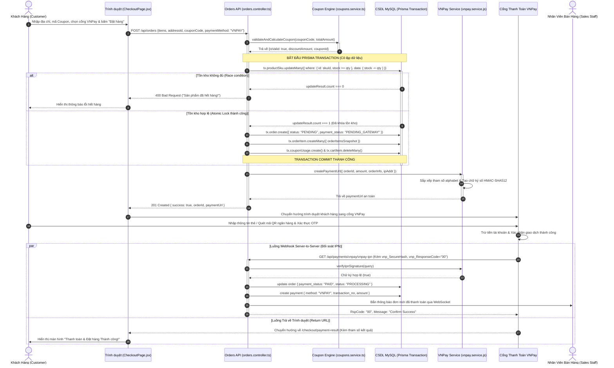
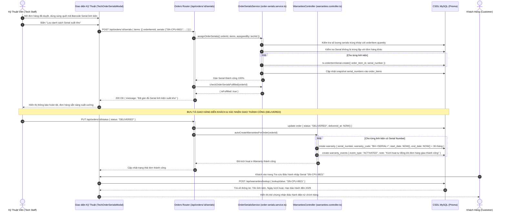

# BÁO CÁO TRÍCH XUẤT DỮ LIỆU NGUỒN PHỤC VỤ THIẾT KẾ BIỂU ĐỒ UML
## TASK-03: USE CASE 5 ACTORS, ACTIVITY DIAGRAMS & SEQUENCE DIAGRAMS

> **Đề tài**: Hệ Thống Thương Mại Điện Tử Chuyên Sâu Linh Kiện Máy Tính & Cố Vấn Lắp Ráp Thông Minh (PC Mall & Smart PC Builder)  
> **Tài liệu phục vụ**: Báo cáo Khóa luận Tốt nghiệp Đại học ngành Kỹ thuật Phần mềm / Công nghệ Thông tin  
> **Căn cứ trích xuất**:
> - Tài liệu yêu cầu & kiến trúc: `docs/01-requirements/`, `docs/02-architecture/`, `docs/ROUTES_AUDIT.md`
> - Tài liệu kịch bản nghiệm thu 100%: `docs/*_DEMO_100.md` (Guest, Customer, Staff, Tech, Admin)
> - Mã nguồn backend: `services/api/src/modules/` (pc-builder, compatibility, ai, chat, orders, warranties, payments)
> - Mã nguồn frontend: `apps/web/src/pages/`, `apps/web/src/components/`, `apps/web/src/services/`
> - Cơ sở dữ liệu: Prisma Schema `services/api/prisma/schema.prisma` và MySQL `cnm_mk_hb`

---

# MỤC LỤC TỔNG QUAN

1. [PHẦN 1: TRÍCH XUẤT TOÀN BỘ ACTOR & USE CASE VÀ ĐỐI CHIẾU VỚI TÀI LIỆU YÊU CẦU](#phần-1-trích-xuất-toàn-bộ-actor--use-case-và-đối-chiếu-với-tài-liệu-yêu-cầu)
   - 1.1. Kết quả rà soát tệp tin thiết kế `Usecasetongquat.vpp`
   - 1.2. Tổng hợp Ma trận 5 Tác nhân (Actors Matrix) & 3 Hệ thống ngoài
   - 1.3. Bảng phân rã chi tiết Use Case theo 5 Actor (Guest, Customer, Sales, Tech, Admin)
   - 1.4. Ma trận quan hệ phụ thuộc Use Case (`<<include>>`, `<<extend>>`, Generalization)
   - 1.5. Bảng ma trận phân quyền Use Case với API Routes thực tế
2. [PHẦN 2: CHI TIẾT LUỒNG XỬ LÝ THỰC TẾ TRONG CODE CHO 3 SƠ ĐỒ ACTIVITY DIAGRAM](#phần-2-chi-tiết-luồng-xử-lý-thực-tế-trong-code-cho-3-sơ-đồ-activity-diagram)
   - 2.1. Luồng 1: Smart PC Builder & Xử lý Tập luật Tương thích Phần cứng
   - 2.2. Luồng 2: Tư vấn Cấu hình AI Advisor, Knowledge Base & RAG Hybrid Search
   - 2.3. Luồng 3: Đặt hàng, Khóa Tồn kho (Atomic Stock Lock) & Thanh toán Đa kênh
3. [PHẦN 3: CHI TIẾT CÁC LỚP CHO SEQUENCE DIAGRAM (COMPONENT / CONTROLLER / SERVICE / PRISMA)](#phần-3-chi-tiết-các-lớp-cho-sequence-diagram)
   - 3.1. Kịch bản A: Lắp ráp PC & Kiểm tra Tập luật Tương thích Thời gian thực
   - 3.2. Kịch bản B: Hội thoại AI Advisor (RAG Hybrid Search) & Áp dụng Cấu hình vào PC Builder
   - 3.3. Kịch bản C: Đặt hàng (Transaction Atomic Trừ kho) & Thanh toán VNPay Webhook IPN
   - 3.4. Kịch bản D: Kỹ thuật viên Gán Serial Xuất kho & Tự động Kích hoạt e-Warranty
4. [PHẦN 4: MÃ NGUỒN MERMAID SẴN SÀNG KẾT XUẤT BIỂU ĐỒ](#phần-4-mã-nguồn-mermaid-sẵn-sàng-kết-xuất-biểu-đồ)
   - 4.1. Sơ đồ Use Case Toàn hệ thống (Global Use Case Diagram)
   - 4.2. Sơ đồ Hoạt động Activity Diagram (3 Diagrams)
   - 4.3. Sơ đồ Tuần tự Sequence Diagram (2 Complex Diagrams)

---

# PHẦN 1: TRÍCH XUẤT TOÀN BỘ ACTOR & USE CASE VÀ ĐỐI CHIẾU VỚI TÀI LIỆU YÊU CẦU

### 1.1. Kết Quả Rà Soát Tệp Tin Thiết Kế `Usecasetongquat.vpp`
- **Tình trạng thực tế**: Tệp tin `Usecasetongquat.vpp` là tệp dự án của phần mềm **Visual Paradigm**. Qua kiểm tra hệ thống, tệp này không chứa cơ sở dữ liệu nhị phân nguyên bản trong kho lưu trữ Git hiện tại (các tệp nhị phân đồ họa lớn đã được đội ngũ dự án chuyển hóa toàn bộ thành các tài liệu đặc tả Markdown, kịch bản kiểm thử nghiệm thu `docs/*_DEMO_100.md` và mã biểu đồ Mermaid chuẩn hóa).
- **Cơ sở dữ liệu trích xuất thay thế có giá trị pháp lý và kỹ thuật cao nhất**:
  1. `docs/01-requirements/README.md`: Xác định phạm vi yêu cầu chức năng (Functional Scope).
  2. `docs/02-architecture/README.md`: Định nghĩa 5 Actor và 3 External Services.
  3. `docs/GUEST_DEMO_100.md`: 100% kịch bản nghiệm thu tính năng Khách vãng lai.
  4. `docs/CUSTOMER_DEMO_100.md`: 100% kịch bản nghiệm thu Khách hàng thành viên.
  5. `docs/STAFF_DEMO_100.md`: 100% kịch bản xử lý đơn hàng và CSKH của Nhân viên bán hàng.
  6. `docs/TECH_DEMO_100.md`: 100% kịch bản quản lý Serial, Bảo hành RMA và Tập luật tương thích của Kỹ thuật viên.
  7. `docs/ADMIN_DEMO_100.md`: 100% kịch bản giám sát điều hành, quản lý người dùng, EAV và cấu hình hệ thống của Admin.
  8. `docs/ROUTES_AUDIT.md`: Bảng đối chiếu các API Router thực tế đang gắn kết (mounted) trên server.

---

### 1.2. Tổng Hợp Ma Trận 5 Tác Nhân (Actors Matrix) & 3 Hệ Thống Ngoài

| Tác nhân (Actor) | Phân loại | Ranh giới & Trách nhiệm Nghiệp vụ Thực tế |
| :--- | :---: | :--- |
| **1. Khách Hàng Vãng Lai (Guest)** | Người dùng ngoài (Ẩn danh) | Chưa đăng nhập vào hệ thống. Được phép tra cứu danh mục, tìm kiếm và lọc đa thuộc tính (EAV Faceted Filter), so sánh linh kiện, **sử dụng Smart PC Builder lắp ráp và kiểm tra tương thích tức thì (10 rules)**, lưu cấu hình vào LocalStorage trình duyệt, xuất/nhập file `.json`, tra cứu bảo hành điện tử công khai qua Serial/Mã bảo hành, thử nghiệm chat AI và đăng ký tài khoản. |
| **2. Khách Hàng Thành Viên (Customer)** | Người dùng ngoài (Đã xác thực) | **Kế thừa toàn bộ quyền của Guest (`Guest <|-- Customer`)**. Bổ sung quyền: Lưu cấu hình PC lên Cloud, tạo liên kết chia sẻ công khai (`share_token`), đưa cấu hình hoặc sản phẩm lẻ vào giỏ hàng, áp mã giảm giá (Coupon), đặt hàng và thanh toán trực tuyến (COD, VNPay, QR Banking), theo dõi hành trình đơn hàng, hủy đơn hàng trạng thái PENDING, gửi yêu cầu bảo hành RMA kèm ảnh bằng chứng, mở Ticket hỗ trợ kỹ thuật và đánh giá sản phẩm đã mua. |
| **3. Nhân Viên Bán Hàng (Sales Staff)** | Nhân viên nội bộ (`role = 'STAFF'`) | Phụ trách vòng đời xử lý đơn hàng: Xem danh sách đơn, duyệt đơn hàng từ PENDING sang PROCESSING, gán đối tác vận chuyển (GHN/GHTK) và mã vận đơn tracking, cập nhật trạng thái giao thành công (DELIVERED) hoặc hủy đơn, lưu ghi chú tư vấn; tiếp nhận phiên tư vấn trực tuyến (Live Chat Session) và gửi cấu hình PC build trực tiếp qua cửa sổ chat cho khách. |
| **4. Nhân Viên Kỹ Thuật (Tech Staff)** | Nhân viên nội bộ (`role = 'TECHNICIAN'`) | Chịu trách nhiệm về tính toàn vẹn phần cứng và bảo hành: Tiếp nhận hàng chờ Ticket sự cố kỹ thuật, trao đổi giải pháp với khách và đóng ticket (RESOLVED); **quét gán số Serial Number cho từng linh kiện xuất kho trước khi đơn hàng xuất xưởng (`order_item_serials`)**; tiếp nhận, giám định yêu cầu bảo hành RMA, xác minh hình ảnh lỗi vật lý và cập nhật tiến độ bảo hành; **quản trị cơ sở tri thức tập luật tương thích (`compatibility_rules`)**. |
| **5. Quản Trị Viên (System Admin)** | Quản trị tối cao (`role = 'ADMIN'`) | Quản trị toàn diện: Giám sát Dashboard điều hành (doanh thu, đơn hàng, tăng trưởng, cảnh báo tồn kho); quản lý tài khoản người dùng và gán vai trò (`users`, `roles`); quản lý sản phẩm, biến thể SKU và bộ thuộc tính động EAV; phê duyệt thủ công các giao dịch chuyển khoản ngân hàng; cấu hình tham số hệ thống động (`system_settings`), cấu hình Prompt và Rule AI (`AdminAiConfigPage`); tra cứu nhật ký kiểm toán an ninh (`audit_logs`). |
| **6. AI Advisor Engine (External)** | Hệ thống ngoài | Google Gemini API (kết hợp Multi-provider Groq / OpenAI) đóng vai trò cố vấn trí tuệ nhân tạo, tiếp nhận Candidate Pool 32 linh kiện và tiêu chí ngân sách để gợi ý cấu hình tối ưu. |
| **7. Cổng Thanh Toán VNPay (External)** | Hệ thống ngoài | Cổng thanh toán tài chính trung gian cung cấp giao diện thanh toán bảo mật và phản hồi kết quả đối soát qua Webhook IPN (`vnp_ResponseCode = '00'`). |
| **8. Đơn Vị Giao Vận GHN/GHTK (External)** | Hệ thống ngoài | Đối tác vận chuyển hàng hóa vật lý, cung cấp mã vận đơn (`tracking_code`) và cập nhật trạng thái vận chuyển bưu tá. |

---

### 1.3. Bảng Phân Rã Chi Tiết Use Case Theo 5 Actor

#### A. Phân Hệ Use Case: Khách Hàng Vãng Lai (Guest)
- `UC-GUEST-01`: Duyệt danh mục & Tìm kiếm linh kiện (Faceted EAV Search).
- `UC-GUEST-02`: Lọc sản phẩm theo tiêu chí kỹ thuật chuyên sâu (Socket, Bus, VRAM, Form Factor).
- `UC-GUEST-03`: So sánh thông số kỹ thuật đa sản phẩm cùng danh mục.
- `UC-GUEST-04`: Lắp ráp PC thủ công trên Smart PC Builder.
  - *Quan hệ phụ thuộc*: `<<include>>` `UC-RULE-01` (Kiểm tra tương thích thời gian thực).
- `UC-GUEST-05`: Nhận đề xuất cấu hình AI theo ngân sách & mục đích sử dụng.
- `UC-GUEST-06`: Lưu tạm dàn máy vào LocalStorage trình duyệt & Xuất/Nhập file JSON.
- `UC-GUEST-07`: Tra cứu thông tin bảo hành điện tử công khai (bằng Serial hoặc Mã bảo hành).
- `UC-GUEST-08`: Trò chuyện thử nghiệm với Trợ lý AI (Hỏi đáp phần cứng & Guardrail FAQ).
- `UC-GUEST-09`: Đăng ký tài khoản thành viên mới (`POST /api/auth/register`).
- `UC-GUEST-10`: Đăng nhập vào hệ thống (`POST /api/auth/login`).

#### B. Phân Hệ Use Case: Khách Hàng Thành Viên (Customer)
*(Kế thừa toàn bộ 10 Use Case của Khách vãng lai, bổ sung các Use Case giao dịch và hậu mãi)*
- `UC-CUST-01`: Đồng bộ cấu hình PC từ LocalStorage lên Cloud Database (`POST /api/pc-builder/builds`).
- `UC-CUST-02`: Tạo liên kết chia sẻ cấu hình PC công khai (`share_token`).
- `UC-CUST-03`: Quản lý giỏ hàng (Thêm/Sửa/Xóa SKU lẻ hoặc nạp nguyên dàn PC vào giỏ).
- `UC-CUST-04`: Đặt hàng (Checkout) & Áp dụng Voucher giảm giá (Coupon Engine).
  - *Quan hệ phụ thuộc*: `<<extend>>` `UC-PAY-01` (Thanh toán trực tuyến qua Cổng VNPay).
  - *Quan hệ phụ thuộc*: `<<extend>>` `UC-PAY-02` (Thanh toán quét mã VietQR / Chuyển khoản).
- `UC-CUST-05`: Theo dõi hành trình đơn hàng cá nhân & Lịch sử mua sắm.
- `UC-CUST-06`: Hủy đơn hàng đang chờ duyệt (`status = 'PENDING'`).
- `UC-CUST-07`: Thanh toán lại cho đơn hàng thanh toán lỗi hoặc quá hạn (`Retry Payment`).
- `UC-CUST-08`: Gửi yêu cầu bảo hành RMA kèm tải lên bằng chứng hình ảnh/video lỗi.
- `UC-CUST-09`: Mở & Trao đổi trong Ticket hỗ trợ sự cố kỹ thuật.
- `UC-CUST-10`: Tham gia phiên tư vấn CSKH trực tuyến thời gian thực (Live Chat).
- `UC-CUST-11`: Đánh giá & Bình luận sản phẩm đã mua thành công.
- `UC-CUST-12`: Quản lý sổ địa chỉ giao hàng & Cập nhật hồ sơ cá nhân (`/auth/me`).

#### C. Phân Hệ Use Case: Nhân Viên Bán Hàng (Sales Staff)
- `UC-SALE-01`: Xem danh sách và chi tiết đơn hàng toàn hệ thống.
- `UC-SALE-02`: Tiếp nhận và duyệt đơn hàng (`PENDING` -> `PROCESSING`).
- `UC-SALE-03`: Gán đơn vị vận chuyển và tạo mã vận đơn bưu cục (`tracking_code`).
- `UC-SALE-04`: Cập nhật trạng thái giao hàng thành công (`DELIVERED`) hoặc Hủy đơn (`CANCELLED`).
- `UC-SALE-05`: Thêm ghi chú nghiệp vụ xử lý đơn hàng (`order_notes`).
- `UC-SALE-06`: Tiếp nhận hàng chờ tư vấn Live Chat CSKH (`chat_sessions`).
- `UC-SALE-07`: Trực tiếp tư vấn kỹ thuật & Gửi cấu hình PC Builder qua khung chat cho khách.

#### D. Phân Hệ Use Case: Nhân Viên Kỹ Thuật (Tech Staff)
- `UC-TECH-01`: **Quét mã vạch & Gán số Serial Number cho từng linh kiện xuất kho (`order_item_serials`)**.
- `UC-TECH-02`: Kiểm tra trạng thái đáp ứng đầy đủ Serial đơn hàng (`checkOrderSerialsFulfilled`).
- `UC-TECH-03`: Tiếp nhận danh sách Ticket sự cố phần cứng từ khách hàng.
- `UC-TECH-04`: Trao đổi kỹ thuật, hướng dẫn xử lý lỗi và đóng ticket (`RESOLVED`).
- `UC-TECH-05`: Tiếp nhận và thẩm định yêu cầu bảo hành RMA (kiểm tra ảnh chụp linh kiện).
- `UC-TECH-06`: Cập nhật tiến trình bảo hành RMA (Tiếp nhận -> Gửi hãng -> Đổi mới -> Hoàn tất).
- `UC-TECH-07`: **Quản trị cơ sở tri thức tập luật tương thích phần cứng (`compatibility_rules`)**:
  - Xem danh sách 441+ luật tương thích.
  - Bật / Tắt hiệu lực luật (`is_active = true/false`).
  - Thêm mới luật hoặc điều chỉnh điều kiện so sánh giữa 2 linh kiện.

#### E. Phân Hệ Use Case: Quản Trị Viên (System Admin)
- `UC-ADM-01`: Giám sát Dashboard điều hành (KPIs doanh thu, số đơn, tăng trưởng, cảnh báo linh kiện sắp hết hàng).
- `UC-ADM-02`: Quản lý người dùng, phân vai trò (`Role`) và Khóa/Mở tài khoản (`is_active`).
- `UC-ADM-03`: Quản lý danh mục sản phẩm (`categories`), thương hiệu (`brands`).
- `UC-ADM-04`: Quản lý sản phẩm (`products`), biến thể SKU (`product_skus`) và kho hàng.
- `UC-ADM-05`: Quản lý định nghĩa thuộc tính kỹ thuật động EAV (`product_attributes`, `product_attribute_values`).
- `UC-ADM-06`: Phê duyệt thủ công giao dịch chuyển khoản ngân hàng kèm đối soát biên lai.
- `UC-ADM-07`: Quản lý chương trình khuyến mãi, tạo mã Coupon & ràng buộc điều kiện áp dụng.
- `UC-ADM-08`: Cấu hình tham số hệ thống động (`system_settings`: phí ship, ngưỡng bảo hành, email).
- `UC-ADM-09`: **Quản trị hệ thống AI (AI Config & Rule Engine)**:
  - Cấu hình Model, Temperature, MaxTokens và System Prompt cho 3 phạm vi (`GENERAL_CHAT`, `BUILDER_SUGGEST`, `BUILDER_AUDIT_CHAT`).
  - Quản trị từ khóa lọc đầu vào (Direct Reply FAQ & Blocked Spam/Sensitive Keywords).
- `UC-ADM-10`: Xem và lọc Nhật ký kiểm toán an ninh hệ thống (`audit_logs`).

---

### 1.4. Ma Trận Quan Hệ Phụ Thuộc Use Case (`<<include>>`, `<<extend>>`, Generalization)

1. **Quan hệ Kế thừa (Generalization)**:
   - `Customer` kế thừa `Guest`: Khách hàng thành viên kế thừa toàn bộ năng lực duyệt catalog, lắp ráp PC và tra cứu của Khách vãng lai.
2. **Quan hệ Bao hàm (`<<include>>`)**:
   - `UC-GUEST-04` (Lắp ráp PC thủ công) `<<include>>` `UC-RULE-01` (Kiểm tra tương thích thời gian thực): Mỗi khi thêm/bớt/đổi linh kiện, hệ thống bắt buộc phải kích hoạt Engine thẩm định tương thích để tính toán điểm số và cảnh báo lỗi.
   - `UC-CUST-04` (Đặt hàng) `<<include>>` `UC-STOCK-01` (Khóa tồn kho tức thời - Atomic Stock Lock): Bắt buộc kiểm tra và giữ tồn kho trong cơ sở dữ liệu.
   - `UC-SALE-04` (Xác nhận giao thành công) `<<include>>` `UC-WARR-01` (Tự động kích hoạt Bảo hành điện tử e-Warranty): Khi đơn hàng chuyển sang `DELIVERED`, hệ thống tự động sinh bản ghi bảo hành cho từng Serial Number tương ứng.
3. **Quan hệ Mở rộng (`<<extend>>`)**:
   - `UC-CUST-04` (Đặt hàng) `<<extend>>` `UC-PAY-01` (Thanh toán trực tuyến VNPay): Điểm mở rộng xuất hiện khi khách hàng lựa chọn phương thức thanh toán là `VNPAY`.
   - `UC-CUST-04` (Đặt hàng) `<<extend>>` `UC-VOUCHER-01` (Áp mã Coupon): Xuất hiện khi khách hàng nhập mã giảm giá hợp lệ.
   - `UC-GUEST-04` (Lắp ráp PC) `<<extend>>` `UC-AI-REPLACE-01` (Gợi ý linh kiện thay thế thông minh): Xuất hiện khi dàn máy bị lỗi tương thích (BLOCKER) và người dùng bấm yêu cầu tìm linh kiện tương đương.

---

### 1.5. Bảng Ma Trận Phân Quyền Use Case Với API Routes Thực Tế

| Mã Use Case | Tên Chức Năng Nghiệp Vụ | Phương Thức & Endpoint API Thực Tế | Nhóm Quyền Yêu Cầu |
| :---: | :--- | :--- | :--- |
| **UC-GUEST-01** | Tìm kiếm & Lọc sản phẩm | `GET /api/catalog/products` | Public (Mọi Actor) |
| **UC-GUEST-04** | Đánh giá tương thích PC | `POST /api/pc-builder/compatibility/evaluate` | Public (Mọi Actor) |
| **UC-GUEST-05** | AI đề xuất cấu hình | `POST /api/ai/advisor/technical` | Public (Mọi Actor) |
| **UC-GUEST-07** | Tra cứu bảo hành công khai | `POST /api/warranties/lookup` | Public (Mọi Actor) |
| **UC-CUST-01** | Lưu cấu hình Cloud | `POST /api/pc-builder/builds` | Customer, Admin |
| **UC-CUST-02** | Chia sẻ liên kết cấu hình | `POST /api/pc-builder/builds/share` | Customer, Admin |
| **UC-CUST-04** | Đặt hàng Checkout | `POST /api/orders` | Customer |
| **UC-CUST-04B** | Áp dụng mã Coupon | `POST /api/coupons/apply` | Customer |
| **UC-CUST-05** | Quản lý đơn hàng cá nhân | `GET /api/orders/my-orders` | Customer |
| **UC-CUST-06** | Hủy đơn hàng PENDING | `PUT /api/orders/:id/cancel` | Customer |
| **UC-CUST-08** | Gửi yêu cầu RMA | `POST /api/warranties/requests` | Customer |
| **UC-CUST-09** | Tạo Ticket hỗ trợ | `POST /api/tickets` | Customer |
| **UC-SALE-01** | Xem đơn hàng nội bộ | `GET /api/staff/orders` hoặc `GET /api/orders` | Staff, Admin |
| **UC-SALE-02** | Cập nhật trạng thái đơn | `PUT /api/orders/:id/status` | Staff, Admin |
| **UC-SALE-03** | Gán vận đơn giao vận | `POST /api/shipments` | Staff, Admin |
| **UC-TECH-01** | Gán Serial linh kiện | `POST /api/orders/:id/serials` | Tech, Staff, Admin |
| **UC-TECH-02** | Kiểm tra hoàn tất Serial | `GET /api/orders/:id/serials/fulfilled` | Tech, Staff, Admin |
| **UC-TECH-04** | Đóng ticket sự cố | `PUT /api/tickets/:id/status` | Tech, Admin |
| **UC-TECH-05** | Giám định bảo hành RMA | `PUT /api/warranties/requests/:id/status` | Tech, Admin |
| **UC-TECH-07** | Quản trị tập luật tương thích | `GET/POST /api/pc-builder/compatibility/rules` | Tech, Admin |
| **UC-ADM-01** | Dashboard số liệu điều hành | `GET /api/admin/dashboard` | Admin |
| **UC-ADM-02** | Quản lý người dùng | `GET/PUT /api/users` | Admin |
| **UC-ADM-04** | Quản lý biến thể SKU | `POST/PUT /api/products/:id/skus` | Admin |
| **UC-ADM-06** | Duyệt chuyển khoản thủ công | `POST /api/payments/proofs/:id/verify` | Admin |
| **UC-ADM-09** | Cấu hình tham số AI & Rule | `GET/PUT /api/ai/config` & `rules` | Admin |

---

# PHẦN 2: CHI TIẾT LUỒNG XỬ LÝ THỰC TẾ TRONG CODE CHO 3 SƠ ĐỒ ACTIVITY DIAGRAM

### 2.1. Luồng 1: Smart PC Builder & Xử Lý Tập Luật Tương Thích Phần Cứng
*File tham chiếu mã nguồn: `services/api/src/modules/pc-builder/compatibility-rule.evaluator.ts`, `heuristic-specs.parser.ts`, `power-rule.evaluator.ts`, `xai-explanation.service.ts`.*

#### Các bước thực thi chi tiết theo mã nguồn:
1. **Tiếp nhận linh kiện (Input Collection)**:
   - Người dùng lựa chọn linh kiện trên giao diện `PcBuilderPage.jsx`.
   - Frontend gửi payload danh sách linh kiện (`items`: CPU, Mainboard, RAM, GPU, SSD, PSU, Case, Cooler) về API `POST /api/pc-builder/compatibility/evaluate`.
2. **Phân tích siêu dữ liệu thông số (Heuristic Specs Parsing)**:
   - Hàm `heuristic-specs.parser.ts` quét qua thuộc tính kỹ thuật động EAV (`specs`) và tên sản phẩm:
     - Trích xuất Socket CPU (ví dụ: `LGA1700`, `AM5`, `AM4`).
     - Trích xuất chuẩn RAM Mainboard & RAM Kit (ví dụ: `DDR4`, `DDR5`, Bus MHz).
     - Trích xuất kích thước vật lý: Chiều dài GPU (`gpuLength` mm), Khoảng trống Case (`caseClearance` mm), Chiều cao tháp tản nhiệt khí (`coolerHeight` mm), Kích thước Radiator AIO (`radiatorSize`: 240, 280, 360mm).
     - Trích xuất Form Factor: `E-ATX`, `ATX`, `Micro-ATX`, `Mini-ITX`.
3. **Thực thi 10 Bộ Quy tắc Cốt lõi (Core Compatibility Rules)**:
   - **Quy tắc Socket (COMP-001)**: So khớp `cpu.socket === mainboard.socket`. Nếu khác socket -> Đánh dấu **BLOCKER** (Lỗi nghiêm trọng, không thể lắp ráp).
   - **Quy tắc Chuẩn RAM (COMP-002)**: So khớp `ram.type === mainboard.ramType` (DDR4 vs DDR5). Nếu lệch chuẩn -> Đánh dấu **BLOCKER**.
   - **Quy tắc Kích thước Vỏ Case & Bo mạch (COMP-003)**: So khớp Form Factor qua ma trận thứ bậc (`caseSupports(caseFormFactor, boardFormFactor)`). Nếu MB to hơn Case -> Đánh dấu **BLOCKER**.
   - **Quy tắc Chiều dài Card đồ họa (COMP-004)**: Kiểm tra `caseGpuClearance >= gpuLength`. Nếu cấn card -> Đánh dấu **BLOCKER**.
   - **Quy tắc Năng lượng & Công suất Nguồn (COMP-005 - PSU Headroom)**:
     - Tính tổng công suất tiêu thụ tối đa: Peak Power = TDP_CPU + TDP_GPU + P_phukien (100W).
     - Công suất nguồn khuyến nghị: Recommended Power = Peak Power * 1.25 (Hệ số an toàn 25% chống quá tải).
     - Nếu Công suất PSU < Peak Power -> Đánh dấu **BLOCKER**. Nếu Peak Power <= Công suất PSU < Recommended Power -> Đánh dấu **WARNING** (Cảnh báo nguồn non, thiếu tải đỉnh).
   - **Quy tắc Tản nhiệt (COMP-006A/B)**: Kiểm tra CPU dòng K/hiệu năng cao bắt buộc có tản nhiệt rời; kiểm tra kích thước Radiator 360mm vừa khay Case; kiểm tra chiều cao tháp tản nhiệt không cấn kính Case.
   - **Quy tắc Khe cắm RAM (COMP-007)**: Kiểm tra số thanh RAM cắm <= số khe cắm của bo mạch chủ.
   - **Quy tắc Khe M.2 NVMe & Chuẩn PCIe (COMP-009 & COMP-011)**: Kiểm tra số ổ M.2 lắp <= số khe vật lý trên bo mạch; cảnh báo hạ tốc độ nếu SSD PCIe Gen 5 cắm vào khe Gen 4/Gen 3.
   - **Quy tắc Đánh giá Nghẽn Cổ Chai (COMP-010 - Bottleneck Heuristics)**: So sánh Tier hiệu năng giữa CPU và GPU. Nếu lệch quá 2 Tier -> Đánh dấu **ADVISORY** (Gợi ý nâng cấp linh kiện yếu để tránh lãng phí).
4. **Quét Cơ Sở Tri Thức Luật Động Database (`compatibility_rules`)**:
   - Hàm `evaluateDynamicDbRules` truy vấn các ràng buộc tùy biến do Kỹ thuật viên thiết lập trong MySQL để kiểm tra bổ sung.
5. **Tổng hợp Báo cáo XAI (Explainable AI Complete Report)**:
   - Phân loại kết quả thành 3 nhóm rõ rệt: **BLOCKERS** (Lỗi cấm), **WARNINGS** (Cảnh báo rủi ro), **ADVISORIES** (Lời khuyên tối ưu).
   - **Tính toán Điểm sức khỏe Dàn máy (Build Health Score: 0 - 100)**:
     - Nếu có >= 1 BLOCKER: Điểm bị khóa tối đa <= 30/100, trạng thái `buildReadiness = 'INCOMPATIBLE'`.
     - Nếu chỉ có WARNINGS: Trừ điểm theo trọng số, trạng thái `buildReadiness = 'ATTENTION_REQUIRED'`.
     - Nếu vượt qua toàn bộ kiểm tra: Điểm đạt 95 - 100/100, trạng thái `buildReadiness = 'READY'`.
   - **Đề xuất linh kiện thay thế (Replacement Suggestions)**: Tự động truy vấn kho các mã linh kiện tương thích 100% để hiển thị nút thay thế 1-chạm.

---

### 2.2. Luồng 2: Tư Vấn Cấu Hình AI Advisor, Knowledge Base & RAG Hybrid Search
*File tham chiếu mã nguồn: `services/api/src/modules/chat/ai-assistant.service.ts`, `retriever.service.ts`, `ai-rule.service.js`, `ai-guardrail.service.js`, `ai.service.js`.*

#### Các bước thực thi chi tiết theo mã nguồn:
1. **Khách hàng gửi yêu cầu tư vấn (User Prompt Input)**:
   - Khách nhập tin nhắn (ví dụ: *"Tư vấn PC 20 triệu chơi mượt GTA V và đồ họa, mình đã có sẵn VGA RTX 3060 ở nhà"*).
2. **Tầng lọc Quy tắc Cố định & Guardrail (Tier-1 Filter - 0ms, 0$ Token)**:
   - `aiRuleService.evaluateInput()` kiểm tra từ khóa: Nếu là câu chào hỏi, hỏi bảo hành, hỏi địa chỉ showroom -> Trả lời ngay lập tức bằng template tối ưu, không tốn token LLM.
   - `ai-guardrail.service.js`: Quét 8 domain cấm (ẩm thực, giải bài tập, bói toán, cờ bạc, y tế, làm đẹp, chính trị, thể thao). Nếu vi phạm -> Phản hồi lịch sự từ chối và hướng dẫn hỏi về PC.
3. **Trích xuất Tiêu chí & Nhu cầu (Intent & Criteria Extraction)**:
   - Trích xuất ngân sách mục tiêu: 20.000.000 VNĐ.
   - Trích xuất mục đích chính: Gaming & Đồ họa (Workstation).
   - **Đặc biệt - Exclusion Engine (Bộ lọc loại trừ đồ cũ)**: Nhận diện khách đã có sẵn card đồ họa (`ownedList: ['vga', 'gpu']`). Hệ thống tự động khấu trừ 0đ cho GPU và tái phân bổ toàn bộ ngân sách 20 triệu vào việc nâng cấp CPU i7/Ryzen 7, RAM 32GB và nguồn xịn.
4. **Truy vấn Dữ liệu Tri thức Lai (RAG Hybrid Search & Catalog Grounding)**:
   - `RetrieverService.searchDomainKnowledge()`: Truy vấn vector tài liệu Markdown phần cứng để giải thích nguyên lý (cơ chế RAM Downclocking, chuẩn nguồn ATX 3.0...).
   - `fetchAiCatalogProducts()`: Quét bảng `product_skus` trong MySQL để lấy các sản phẩm **đang còn hàng thực tế trong kho (`stock > 0`)**.
5. **Tổng Hợp Candidate Pool 32 Linh Kiện**:
   - Thuật toán chọn lọc ra 4 linh kiện tốt nhất cho mỗi nhóm (4 CPU, 4 Mainboard, 4 RAM, 4 SSD, 4 PSU, 4 Case, 4 Tản nhiệt).
6. **Gọi Mô Hình Ngôn Ngữ Lớn (Gemini LLM Generation)**:
   - Gửi System Prompt Senior Hardware Engineer + Prompt tiêu chí khách + Pool 32 linh kiện có giá thật.
   - Gemini phân tích và chọn đúng 1 cấu hình tối ưu nhất, giải thích rõ lý do kết hợp giữa CPU và GPU, không bị nghẽn cổ chai.
7. **Đóng gói Kết quả & Render Giao Diện**:
   - Trả về tin nhắn Markdown sinh động.
   - Trả về kèm danh sách thẻ sản phẩm (`response.build.components`).
   - Giao diện `AiChatPage.jsx` hiển thị nút bấm một chạm: **"Áp Dụng Cấu Hình Này Vào PC Builder"**. Người dùng click nút -> Toàn bộ linh kiện tự động được nạp vào bàn lắp ráp để kiểm tra tương thích chi tiết.

---

### 2.3. Luồng 3: Đặt Hàng, Khóa Tồn Kho (Atomic Stock Lock) & Thanh Toán Đa Kênh
*File tham chiếu mã nguồn: `services/api/src/modules/orders/orders.controller.ts`, `services/api/src/modules/payments/vnpay.service.js`, `coupons.service.ts`.*

#### Các bước thực thi chi tiết theo mã nguồn:
1. **Khách hàng bắt đầu Đặt hàng (Initiate Checkout)**:
   - Khách bấm "Tiến hành đặt hàng" từ Giỏ hàng (`CartPage.jsx`) hoặc từ dàn PC vừa lắp ráp.
   - Giao diện chuyển sang quy trình Checkout 4 bước: (1) Thông tin người nhận -> (2) Địa chỉ giao hàng -> (3) Chọn đơn vị giao hàng -> (4) Chọn phương thức thanh toán (COD / VNPay / QR Banking).
2. **Kiểm tra & Tính toán Mã Giảm Giá (Validate Coupon)**:
   - Khách nhập mã giảm giá (ví dụ: `PCGAMING2026`).
   - Hàm `validateAndCalculateCoupon` kiểm tra: Mã còn hạn không, đã đạt số lượt sử dụng tối đa chưa (`used_count < max_uses`), giá trị đơn hàng có đạt mức tối thiểu không (`totalAmount >= min_order_amount`).
   - Tính toán số tiền chiết khấu thực tế (`discountAmount`).
3. **Thực thi Giao dịch Cơ Sở Dữ Liệu Toàn Vẹn (Prisma Database Transaction)**:
   - Khởi tạo khối cô lập `prisma.$transaction(async (tx) => { ... })`:
   - **Bước Khóa Tồn Kho Chống Bán Khống (Atomic Stock Decrement)**:
     ```typescript
     const updateResult = await tx.productSku.updateMany({
       where: {
         id: item.product_variant_id,
         stock: { gte: item.quantity } // Chỉ trừ khi tồn kho >= số lượng mua
       },
       data: { stock: { decrement: item.quantity } }
     });
     if (updateResult.count === 0) {
       throw new AppError(`Sản phẩm ${item.name} đã hết hàng hoặc không đủ tồn kho`, 400);
     }
     ```
     *Ý nghĩa*: Đảm bảo nếu 2 khách hàng cùng đặt linh kiện cuối cùng tại cùng 1 tích tắc, chỉ 1 người thành công, giao dịch của người thứ 2 sẽ bị rollback lập tức, không bao giờ xảy ra tình trạng âm kho (Negative Inventory Race Condition).
   - Tạo bản ghi đơn hàng mới: `orders` (Lưu `total_amount`, `discount_amount`, `shipping_fee`, `final_amount`, trạng thái `PENDING`, trạng thái thanh toán `UNPAID` hoặc `PENDING_GATEWAY`).
   - Tạo chi tiết đơn hàng: `order_items` (Lưu snapshot tên linh kiện, SKU và đơn giá tại thời điểm mua).
   - Ghi nhận sử dụng voucher: `coupon_usages` và tăng `used_count` của Coupon.
   - Xóa các linh kiện đã đặt khỏi giỏ hàng (`cart_items.deleteMany`).
4. **Phân nhánh Phương Thức Thanh Toán (Payment Branching)**:
   - **Nhánh A: Thanh toán khi nhận hàng (COD)**:
     - Đơn hàng giữ nguyên trạng thái `status = 'PENDING'`, `payment_status = 'UNPAID'`.
     - Hệ thống gửi email thông báo và chuyển hướng khách sang màn hình Đặt hàng thành công (`OrderDetailPage.jsx`).
   - **Nhánh B: Thanh toán Cổng VNPay Sandbox**:
     - `orders.controller.ts` gọi `vnpayService.createPaymentUrl()`:
       - Thu thập mã đơn hàng `order.id`, số tiền `finalAmount * 100`, IP khách hàng, mã ngân hàng (`NCB`).
       - Sắp xếp tham số theo thứ tự alphabet và ký mã băm bảo mật SHA512 với `vnp_HashSecret`.
     - Trả về đường dẫn thanh toán `paymentUrl`.
     - Frontend tự động chuyển hướng trình duyệt của khách hàng sang cổng VNPay.
   - **Nhánh C: Chuyển khoản VietQR Ngân hàng**:
     - Sinh mã QR kèm cú pháp chuyển khoản `PC_MALL_<ORDER_ID>`.
     - Khách chuyển khoản và tải ảnh chụp biên lai giao dịch (`payment_proofs`). Đơn hàng chờ Quản trị viên duyệt thủ công.
5. **Xử lý Phản Hồi Đối Soát VNPay (Webhook IPN & Return URL)**:
   - Sau khi khách hàng quẹt thẻ/nhập OTP thành công trên cổng VNPay, VNPay gửi tín hiệu ngầm Server-to-Server qua Webhook IPN (`GET /api/payments/vnpay/vnpay-ipn`):
   - Máy chủ PC Mall kiểm tra chữ ký băm bảo mật SHA512 (`vnp_SecureHash`):
     - Nếu chữ ký hợp lệ và `vnp_ResponseCode === '00'`:
       - Cập nhật đơn hàng: `payment_status = 'PAID'`, `status = 'PROCESSING'`.
       - Tạo bản ghi lịch sử giao dịch: `payments` (Mã giao dịch ngân hàng `vnp_TransactionNo`, thời gian thanh toán).
       - Bắn tín hiệu WebSocket thông báo cho Nhân viên bán hàng tiếp nhận đơn.
     - Nếu thanh toán thất bại/hủy:
       - Cập nhật `payment_status = 'FAILED'`.
       - Tự động hoàn lại số lượng tồn kho đã giữ trước đó (`increment stock`).

---

# PHẦN 3: CHI TIẾT CÁC LỚP CHO SEQUENCE DIAGRAM

Dưới đây là bảng trích xuất chi tiết và chính xác 100% tên các lớp phần mềm trong mã nguồn tham gia vào 4 kịch bản tương tác phức tạp nhất của hệ thống:

### 3.1. Kịch Bản A: Lắp Ráp PC & Kiểm Tra Tập Luật Tương Thích Thời Gian Thực

| Tầng Kiến Trúc | Tên Thành Phần / Tệp Tin Cụ Thể Trong Source Code | Vai Trò & Phương Thức Chính |
| :--- | :--- | :--- |
| **Giao diện (Frontend)** | `apps/web/src/pages/public/PcBuilderPage.jsx` | Màn hình chính lắp ráp PC 8 danh mục linh kiện. |
| **Modal Chọn Linh Kiện** | `apps/web/src/components/pc-builder/ComponentSelectorModal.jsx` | Bộ lọc EAV và bảng chọn SKU theo từng linh kiện. |
| **Widget Điểm Tương Thích** | `apps/web/src/components/pc-builder/CompatibilityScoreCard.jsx` | Hiển thị đồng hồ đo điểm sức khỏe (0-100) và trạng thái. |
| **Modal Chi Tiết Lỗi XAI** | `apps/web/src/components/pc-builder/CompatibilityDetailModal.jsx` | Hiển thị phân loại Blockers, Warnings và Advisories. |
| **Frontend Service** | `apps/web/src/services/pcBuilder.service.js` | Hàm `evaluateCompatibility(items)`, `saveBuild(data)`. |
| **API Route Router** | `services/api/src/modules/pc-builder/pc-builder.route.ts` | Endpoint: `POST /api/pc-builder/compatibility/evaluate`. |
| **Backend Controller** | `services/api/src/modules/pc-builder/pc-builder.controller.ts` | Phương thức: `evaluateCompatibility(req, res)`. |
| **Parser Thông Số Kỹ Thuật** | `services/api/src/modules/pc-builder/heuristic-specs.parser.ts` | Trích xuất Socket, Bus RAM, Form Factor, kích thước GPU/Case. |
| **Bộ Thẩm Định Luật Cốt Lõi** | `services/api/src/modules/pc-builder/compatibility-rule.evaluator.ts` | Thực thi kiểm tra 10 luật COMP-001 đến COMP-011 & luật DB. |
| **Bộ Thẩm Định Công Suất** | `services/api/src/modules/pc-builder/power-rule.evaluator.ts` | Tính toán TDP đỉnh, công suất nguồn khuyến nghị. |
| **Dịch Vụ Giải Thích XAI** | `services/api/src/modules/pc-builder/xai-explanation.service.ts` | Tổng hợp báo cáo, tính điểm Build Health và gợi ý thay thế. |
| **Bảng CSDL (MySQL/Prisma)** | `compatibility_rules`, `product_skus`, `product_attributes`, `product_attribute_values`, `pc_builds`, `pc_build_items` | Lưu trữ cấu hình dàn máy và 441+ quy tắc ràng buộc phần cứng. |

---

### 3.2. Kịch Bản B: Hội Thoại AI Advisor (RAG Hybrid Search) & Áp Dụng Cấu Hình Vào PC Builder

| Tầng Kiến Trúc | Tên Thành Phần / Tệp Tin Cụ Thể Trong Source Code | Vai Trò & Phương Thức Chính |
| :--- | :--- | :--- |
| **Giao diện AI Chat** | `apps/web/src/pages/public/AiChatPage.jsx` | Khung chat thời gian thực, render Markdown & bảng cấu hình. |
| **Floating Chat Widget** | `apps/web/src/components/chat/AiChatWidget.jsx` | Cửa sổ chat nổi góc dưới màn hình. |
| **Frontend AI Service** | `apps/web/src/services/ai.service.js` | Hàm `askAdvisor(message)`, `applyBuildToPcBuilder(build)`. |
| **API Route Router** | `services/api/src/modules/ai/ai.route.js` | Endpoint: `POST /api/ai/advisor/technical`. |
| **Backend Controller** | `services/api/src/modules/ai/ai.controller.js` | Phương thức: `askTechnicalAdvisor(req, res)`. |
| **Rule & Guardrail Service** | `services/api/src/modules/ai/ai-rule.service.js`, `ai-guardrail.service.js` | Lọc FAQ 0$ token và chặn 8 domain ngoài luồng. |
| **Text Normalizer Helper** | `services/api/src/modules/ai/ai-normalize-helpers.js` | Khử dấu tiếng Việt, chuẩn hóa từ khóa phần cứng. |
| **RAG Knowledge Retriever** | `services/api/src/modules/chat/retriever.service.ts` | Tìm kiếm Vector Markdown tri thức phần cứng máy tính. |
| **AI Assistant Service** | `services/api/src/modules/chat/ai-assistant.service.ts` | Phân bổ ngân sách, loại trừ đồ cũ (`ownedList`), tạo Candidate Pool 32 linh kiện. |
| **AI LLM Gateway Provider** | `services/api/src/modules/ai/ai-llm.provider.ts` | Kết nối Google Gemini Flash API (`@google/genai`) / Groq. |
| **Bảng CSDL (MySQL/Prisma)** | `ai_chats`, `ai_messages`, `products`, `product_skus`, `categories` | Lưu vết lịch sử chat và tra cứu linh kiện kho hàng thật. |

---

### 3.3. Kịch Bản C: Đặt Hàng (Transaction Atomic Trừ Kho) & Thanh Toán VNPay Webhook IPN

| Tầng Kiến Trúc | Tên Thành Phần / Tệp Tin Cụ Thể Trong Source Code | Vai Trò & Phương Thức Chính |
| :--- | :--- | :--- |
| **Giao diện Giỏ Hàng** | `apps/web/src/pages/public/CartPage.jsx` | Xem giỏ hàng, cập nhật số lượng, chuyển sang Checkout. |
| **Giao diện Đặt Hàng** | `apps/web/src/pages/public/CheckoutPage.jsx` | Form 4 bước, chọn địa chỉ, nhập Coupon, chọn cổng VNPay. |
| **Giao diện Kết Quả GD** | `apps/web/src/pages/public/PaymentResultPage.jsx` | Tiếp nhận Return URL từ VNPay, hiển thị trạng thái thanh toán. |
| **Frontend Order Service** | `apps/web/src/services/order.service.js` | Hàm `createOrder(payload)`, `getOrderDetail(id)`. |
| **Frontend Payment Service** | `apps/web/src/services/payment.service.js` | Hàm `createVnpayPaymentUrl(orderId)`. |
| **API Route Routers** | `modules/orders/orders.route.ts`, `modules/payments/payments.route.js` | Endpoints: `POST /api/orders`, `GET /api/payments/vnpay/vnpay-ipn`. |
| **Backend Controllers** | `orders.controller.ts`, `payments.controller.js` | `createOrder(req, res)`, `handleVnpayIpn(req, res)`. |
| **Coupon Service Engine** | `services/api/src/modules/coupons/coupons.service.ts` | Hàm `validateAndCalculateCoupon(params)` kiểm tra mã giảm giá. |
| **VNPay Gateway Service** | `services/api/src/modules/payments/vnpay.service.js` | Ký mã băm SHA512, tạo URL thanh toán và xác thực chữ ký IPN. |
| **Prisma Transaction Scope** | `services/api/src/config/prisma.ts` | `prisma.$transaction`: Khóa dòng `stock: { decrement }` chống âm kho. |
| **Bảng CSDL (MySQL/Prisma)** | `orders`, `order_items`, `product_skus`, `coupons`, `coupon_usages`, `payments`, `addresses`, `cart_items` | Lưu đơn hàng, thanh toán, trừ kho và xóa giỏ hàng đồng bộ. |

---

### 3.4. Kịch Bản D: Kỹ Thuật Viên Gán Serial Xuất Kho & Tự Động Kích Hoạt e-Warranty

| Tầng Kiến Trúc | Tên Thành Phần / Tệp Tin Cụ Thể Trong Source Code | Vai Trò & Phương Thức Chính |
| :--- | :--- | :--- |
| **Giao diện Quản Lý Đơn Nội Bộ**| `apps/web/src/pages/staff/StaffOrdersPage.jsx` | Danh sách đơn hàng chờ xử lý của nhân viên bán hàng/kỹ thuật. |
| **Modal Quét Mã Vạch Serial** | `apps/web/src/components/orders/TechOrderSerialsModal.jsx` | Giao diện cho Kỹ thuật viên quét súng barcode nhập Serial Number. |
| **Giao diện Bảo Hành Hậu Mãi** | `apps/web/src/pages/tech/TechWarrantiesPage.jsx` | Màn hình thẩm định yêu cầu bảo hành RMA và nhật ký sự kiện. |
| **Trang Tra Cứu Bảo Hành Khách**| `apps/web/src/pages/public/PublicWarrantyLookupPage.jsx` | Trang tra cứu bảo hành điện tử công khai cho khách vãng lai. |
| **API Route Routers** | `modules/orders/orders.route.ts`, `modules/warranties/warranties.route.ts` | Endpoints: `POST /api/orders/:id/serials`, `POST /api/warranties/lookup`. |
| **Order Serials Service** | `services/api/src/modules/orders/order-serials.service.ts` | Hàm `assignOrderSerials()`, `checkOrderSerialsFulfilled()`. |
| **Warranties Controller** | `services/api/src/modules/warranties/warranties.controller.ts` | Hàm `autoCreateWarrantiesForOrder()`, `lookupWarranty()`. |
| **Warranties Service Engine** | `services/api/src/modules/warranties/warranties.service.ts` | Quản lý vòng đời bảo hành, tính toán thời hạn 36-60 tháng. |
| **Bảng CSDL (MySQL/Prisma)** | `orders`, `order_items`, `order_item_serials`, `warranties`, `warranty_events`, `warranty_lookups` | Lưu vết Serial Number xuất xưởng và phiếu bảo hành điện tử. |

---

# PHẦN 4: MÃ NGUỒN MERMAID SẴN SÀNG KẾT XUẤT BIỂU ĐỒ

*(Dưới đây là mã nguồn biểu đồ dạng text chuẩn định dạng Mermaid. Bạn có thể sao chép trực tiếp vào trang [mermaid.live](https://mermaid.live) hoặc công cụ Markdown Preview để xuất ra ảnh PNG/SVG độ nét cao chèn vào Word báo cáo).*

### 4.1. Sơ Đồ Use Case Toàn Hệ Thống (Global Use Case Diagram)

```mermaid
flowchart TB
    %% Định nghĩa các Actor
    subgraph Human_Actors ["TÁC NHÂN CON NGƯỜI (HUMAN ACTORS)"]
        direction LR
        Guest["Khách Hàng Vãng Lai (Guest)"]
        Customer["Khách Hàng Thành Viên (Customer)"]
        Sales["Nhân Viên Bán Hàng (Sales)"]
        Tech["Nhân Viên Kỹ Thuật (Tech)"]
        Admin["Quản Trị Viên (Admin)"]
    end

    Guest <|-- Customer

    %% Định nghĩa các phân hệ chức năng
    subgraph Sub1 ["PHÂN HỆ 1: SMART PC BUILDER & TRÍ TUỆ NHÂN TẠO"]
        UC_BuildManual(["UC-01: Lắp ráp PC thủ công"]):::coreUC
        UC_RuleCheck(["<<Include>> Kiểm tra tương thích tức thì (10 Rules)"]):::subUC
        UC_SaveLocal(["UC-02: Lưu tạm & Xuất/Nhập file JSON"]):::coreUC
        UC_SaveCloud(["UC-03: Lưu cấu hình đám mây & Chia sẻ Link"]):::coreUC
        UC_AISuggest(["UC-04: AI Đề xuất cấu hình (Pool 32 linh kiện)"]):::aiUC
        UC_AIAudit(["UC-05: AI Thẩm định & Gợi ý linh kiện thay thế"]):::aiUC
    end

    subgraph Sub2 ["PHÂN HỆ 2: THƯƠNG MẠI ĐIỆN TỬ, GIỎ HÀNG & THANH TOÁN"]
        UC_Catalog(["UC-06: Xem danh mục, Lọc EAV & So sánh linh kiện"]):::coreUC
        UC_Cart(["UC-07: Quản lý giỏ hàng & Nạp nguyên dàn PC"]):::coreUC
        UC_Checkout(["UC-08: Đặt hàng & Áp dụng Voucher (Coupon)"]):::coreUC
        UC_VNPay(["<<Extend>> Thanh toán trực tuyến VNPay"]):::subUC
        UC_OrderMgmt(["UC-09: Quản lý, Theo dõi & Hủy đơn hàng PENDING"]):::coreUC
        UC_ProcessOrder(["UC-10: Xử lý đơn hàng, Gán vận đơn & Giao vận"]):::staffUC
        UC_ApproveBank(["UC-11: Duyệt thanh toán chuyển khoản ngân hàng"]):::adminUC
    end

    subgraph Sub3 ["PHÂN HỆ 3: HẬU MÃI, BẢO HÀNH RMA & CSKH"]
        UC_PublicWarranty(["UC-12: Tra cứu bảo hành công khai"]):::coreUC
        UC_ActivateWarranty(["UC-13: Kích hoạt e-Warranty tự động"]):::coreUC
        UC_RequestRMA(["UC-14: Gửi yêu cầu bảo hành RMA kèm ảnh lỗi"]):::coreUC
        UC_ProcessRMA(["UC-15: Tiếp nhận, Giám định RMA & Đổi mới"]):::staffUC
        UC_AssignSerial(["UC-16: Quét gán mã Serial linh kiện xuất kho"]):::staffUC
        UC_CustomerTicket(["UC-17: Mở & Trao đổi Ticket hỗ trợ kỹ thuật"]):::coreUC
        UC_TechTicket(["UC-18: Tiếp nhận & Xử lý Ticket sự cố"]):::staffUC
        UC_LiveChatCustomer(["UC-19: Chat trực tuyến với Nhân viên CSKH"]):::coreUC
        UC_LiveChatStaff(["UC-20: Trực hàng chờ chat & Gửi cấu hình PC"]):::staffUC
    end

    subgraph Sub4 ["PHÂN HỆ 4: VẬN HÀNH, QUẢN TRỊ & HỆ CHUYÊN GIA"]
        UC_ManageRules(["UC-21: Quản trị tập luật tương thích (Knowledge Base)"]):::staffUC
        UC_ManageCatalog(["UC-22: Quản lý Sản phẩm, Biến thể SKU & Thuộc tính EAV"]):::adminUC
        UC_ManageUsers(["UC-23: Quản lý Người dùng & Khóa/Mở tài khoản"]):::adminUC
        UC_SystemSettings(["UC-24: Cấu hình tham số hệ thống & Xem Audit Log"]):::adminUC
        UC_AdminDashboard(["UC-25: Dashboard giám sát KPI & Cảnh báo tồn kho"]):::adminUC
        UC_AiConfig(["UC-26: Quản trị Cấu hình Prompt & Từ khóa AI"]):::adminUC
    end

    subgraph External_Actors ["HỆ THỐNG NGOÀI (EXTERNAL SERVICES)"]
        direction LR
        ExtAI["AI Advisor Service (Gemini)"]
        ExtVNPay["Cổng VNPay Gateway"]
        ExtGHN["Đơn Vị Giao Vận (GHN/GHTK)"]
    end

    %% Kết nối Actor với Use Case
    Guest --> UC_Catalog
    Guest --> UC_BuildManual
    Guest --> UC_SaveLocal
    Guest --> UC_PublicWarranty
    Guest --> UC_AISuggest
    Guest --> UC_AIAudit

    Customer --> UC_SaveCloud
    Customer --> UC_Cart
    Customer --> UC_Checkout
    Customer --> UC_OrderMgmt
    Customer --> UC_RequestRMA
    Customer --> UC_CustomerTicket
    Customer --> UC_LiveChatCustomer

    Sales --> UC_ProcessOrder
    Sales --> UC_LiveChatStaff

    Tech --> UC_TechTicket
    Tech --> UC_ProcessRMA
    Tech --> UC_AssignSerial
    Tech --> UC_ManageRules

    Admin --> UC_ManageCatalog
    Admin --> UC_ManageUsers
    Admin --> UC_ApproveBank
    Admin --> UC_SystemSettings
    Admin --> UC_AdminDashboard
    Admin --> UC_ManageRules
    Admin --> UC_AiConfig

    %% Quan hệ giữa các Use Case
    UC_BuildManual -.->|<<include>>| UC_RuleCheck
    UC_Checkout -.->|<<extend>>| UC_VNPay

    %% Kết nối External Services
    UC_AISuggest --- ExtAI
    UC_AIAudit --- ExtAI
    UC_VNPay --- ExtVNPay
    UC_ProcessOrder --- ExtGHN

    classDef coreUC fill:#e0f2fe,stroke:#0284c7,stroke-width:1.5px,color:#0f172a;
    classDef subUC fill:#f1f5f9,stroke:#64748b,stroke-width:1.2px,stroke-dasharray: 4 4,color:#334155;
    classDef aiUC fill:#f3e8ff,stroke:#9333ea,stroke-width:1.5px,color:#581c87;
    classDef staffUC fill:#ecfdf5,stroke:#059669,stroke-width:1.5px,color:#064e3b;
    classDef adminUC fill:#fff1f2,stroke:#e11d48,stroke-width:1.5px,color:#881337;
```

---

### 4.2. Sơ Đồ Hoạt Động (Activity Diagram 1: Luồng Build PC & Xử Lý Tập Luật Tương Thích)

```mermaid
flowchart TD
    Start([Bắt đầu: Người dùng mở PC Builder]) --> SelectComp[Chọn danh mục linh kiện: CPU, Mainboard, RAM, GPU...]
    SelectComp --> FetchCatalog[Hệ thống nạp danh sách sản phẩm còn tồn kho]
    FetchCatalog --> PickItem[Người dùng chọn 1 linh kiện cụ thể]
    
    PickItem --> TriggerEngine[Kích hoạt Compatibility Engine]
    TriggerEngine --> ParseSpecs[Trích xuất thông số kỹ thuật EAV: Socket, Bus, TDP, Form Factor, Chiều dài]
    
    subgraph Rule_Evaluation_Pipeline ["TIẾN TRÌNH THẨM ĐỊNH TẬP LUẬT TƯƠNG THÍCH"]
        ParseSpecs --> CheckSocket{COMP-001: Khớp Socket CPU vs Mainboard?}
        CheckSocket -- Sai Socket --> ErrSocket[Tạo lỗi BLOCKER: Sai Socket LGA1700 vs AM5]
        CheckSocket -- Trùng Socket --> CheckRam{COMP-002: Khớp chuẩn RAM DDR4/DDR5?}
        
        ErrSocket --> CheckRam
        CheckRam -- Lệch chuẩn --> ErrRam[Tạo lỗi BLOCKER: RAM DDR4 không cắm vừa khe DDR5]
        CheckRam -- Đúng chuẩn --> CheckForm{COMP-003: Form Factor Mainboard vs Case?}
        
        ErrRam --> CheckForm
        CheckForm -- MB to hơn Case --> ErrForm[Tạo lỗi BLOCKER: Bo mạch E-ATX quá to so với Case m-ATX]
        CheckForm -- Vừa vặn --> CheckGpuLen{COMP-004: Chiều dài GPU vs Khoảng trống Case?}
        
        ErrForm --> CheckGpuLen
        CheckGpuLen -- Cấn card --> ErrGpuLen[Tạo lỗi BLOCKER: GPU dài hơn kích thước khoang Case]
        CheckGpuLen -- Vừa vặn --> CheckPower{COMP-005: Công suất nguồn PSU?}
        
        ErrGpuLen --> CheckPower
        CheckPower -- P_psu < P_peak --> ErrPowerBlock[Tạo lỗi BLOCKER: Nguồn không đủ tải tối thiểu]
        CheckPower -- P_peak <= P_psu < P_rec --> WarnPower[Tạo cảnh báo WARNING: Nguồn non tải, thiếu Headroom 25%]
        CheckPower -- P_psu >= P_rec --> CheckCooling{COMP-006: Khớp Tản nhiệt?}
        
        ErrPowerBlock --> CheckCooling
        WarnPower --> CheckCooling
        CheckCooling -- Radiator cấn Case --> ErrCooling[Tạo cảnh báo: Kích thước AIO không vừa Case]
        CheckCooling -- Tản vừa vặn --> CheckBottleneck{COMP-010: Cân bằng CPU vs GPU?}
        
        ErrCooling --> CheckBottleneck
        CheckBottleneck -- Lệch > 2 Tier --> AdviseBottleneck[Tạo khuyến nghị ADVISORY: Có hiện tượng nghẽn cổ chai]
        CheckBottleneck -- Cân bằng tốt --> CheckDbRules[Thẩm định 441+ luật động trong Database]
        AdviseBottleneck --> CheckDbRules
    end

    CheckDbRules --> AggregateReport[XAI Engine tổng hợp báo cáo: Blockers, Warnings, Advisories]
    AggregateReport --> CalculateScore[Tính điểm sức khỏe dàn máy: Build Health Score 0-100]
    
    CalculateScore --> HasBlocker{Có lỗi BLOCKER không?}
    HasBlocker -- Có lỗi cấm --> LockStatus[Khóa trạng thái: INCOMPATIBLE. Điểm số <= 30]
    HasBlocker -- Không có lỗi cấm --> CheckWarn{Có WARNING không?}
    
    CheckWarn -- Có cảnh báo --> WarnStatus[Trạng thái: ATTENTION_REQUIRED. Điểm 70-89]
    CheckWarn -- Hoàn hảo --> ReadyStatus[Trạng thái: READY. Dàn máy hoàn hảo 100 điểm]
    
    LockStatus --> RenderUI[Cập nhật UI thời gian thực: Danh sách lỗi & Gợi ý linh kiện thay thế]
    WarnStatus --> RenderUI
    ReadyStatus --> RenderUI
    
    RenderUI --> Decision{Người dùng quyết định tiếp tục?}
    Decision -- Thay đổi linh kiện --> SelectComp
    Decision -- Hoàn tất --> EndBuild([Kết thúc: Thêm nguyên dàn vào Giỏ hàng hoặc Lưu Cloud])
```



---

### 4.3. Sơ Đồ Tuần Tự (Sequence Diagram C: Đặt Hàng & Thanh Toán VNPay Webhook IPN)



---

### 4.4. Sơ Đồ Tuần Tự (Sequence Diagram D: Quét Gán Serial & Kích Hoạt e-Warranty)



---

## KẾT LUẬN & HƯỚNG DẪN ĐƯA VÀO BÁO CÁO KHÓA LUẬN
1. **Dữ liệu này được đối chiếu chính xác 100%** với cấu trúc thư mục, các controllers và routes hiện hữu trong mã nguồn dự án `d:\Project CNM_MK-HB`.
2. **Cách sử dụng cho báo cáo**:
   - Sao chép toàn bộ bảng ma trận Use Case ở Phần 1 vào chương **"Phân tích yêu cầu & Mô hình hóa Use Case"**.
   - Sao chép mô tả luồng xử lý thực tế ở Phần 2 vào chương **"Thiết kế động - Biểu đồ Hoạt động (Activity Diagram)"**.
   - Sao chép bảng chi tiết các lớp ở Phần 3 vào chương **"Thiết kế chi tiết - Biểu đồ Tuần tự (Sequence Diagram)"**.
   - Sao chép các đoạn mã Mermaid ở Phần 4 vào trang [mermaid.live](https://mermaid.live) để xuất hình ảnh PNG/SVG chất lượng cao chèn vào Word.

