# BÁO CÁO THIẾT KẾ HỆ THỐNG & ĐẶC TẢ BIỂU ĐỒ UML
## TASK-03: UML MODELING & SYSTEM SPECIFICATION

> **Dự án**: Hệ Thống Thương Mại Điện Tử & Hệ Chuyên Gia Tư Vấn Lắp Ráp Máy Tính (PC Mall & Smart PC Builder)  
> **Cơ sở dữ liệu**: MySQL 8.0 (`cnm_mk_hb` / `cnm_ecommerce`)  
> **Kiến trúc phần mềm**: Clean Layered Architecture kết hợp Domain-Driven Design (DDD) & Knowledge-Based Expert System  
> **Tài liệu phục vụ**: Báo cáo Đồ án / Khóa luận tốt nghiệp chuyên ngành Kỹ thuật Phần mềm / Công nghệ Thông tin  
> **Ngày cập nhật**: 2026-11-04  

---

## MỤC LỤC TỔNG QUAN

1. [PHẦN 1: TỔNG QUAN HỆ THỐNG & KIẾN TRÚC PHẦN MỀM](#phần-1-tổng-quan-hệ-thống--kiến-trúc-phần-mềm)
   - 1.1. Bối cảnh & Tầm nhìn Kiến trúc Hệ thống
   - 1.2. Mô hình Kiến trúc Phân tầng (Layered Architecture)
   - 1.3. Mô hình Triển khai & Hệ Sinh thái Công nghệ (Tech Stack)
   - 1.4. Tiêu chuẩn Mô hình hóa UML 2.5 áp dụng trong Đề tài
2. [PHẦN 2: PHÂN RÃ USE CASE THEO 5 ACTOR (USE CASE MODELING)](#phần-2-phân-rã-use-case-theo-5-actor)
   - 2.1. Ma trận Tác nhân (5 Human Actors & 3 External Service Actors)
   - 2.2. Sơ đồ Use Case Toàn hệ thống (Phân rã 4 Subsystems)
   - 2.3. Sơ đồ Use Case Chi tiết cho từng Actor:
     - 2.3.1. Sơ đồ Use Case: Khách Hàng Vãng Lai (Guest)
     - 2.3.2. Sơ đồ Use Case: Khách Hàng Thành Viên (Customer)
     - 2.3.3. Sơ đồ Use Case: Nhân Viên Bán Hàng (Sales Staff)
     - 2.3.4. Sơ đồ Use Case: Nhân Viên Kỹ Thuật (Tech Staff)
     - 2.3.5. Sơ đồ Use Case: Quản Trị Viên (System Admin)
   - 2.4. Bảng Tổng hợp Danh mục Use Case Toàn Hệ Thống (Mã hóa UC-01 đến UC-32)
   - 2.5. Đặc tả Chi tiết các Use Case Trọng tâm Công nghệ (Use Case Specifications)
3. [PHẦN 3: SƠ ĐỒ HOẠT ĐỘNG (ACTIVITY DIAGRAMS)](#phần-3-sơ-đồ-hoạt-động-activity-diagrams)
   - 3.1. Sơ đồ Hoạt động 1: Luồng Build PC & Xử lý Tập luật Tương thích (Knowledge-Based Expert Engine)
   - 3.2. Sơ đồ Hoạt động 2: Luồng Tư vấn Cấu hình Trí tuệ Nhân tạo (AI Advisor & Recommendation Engine)
   - 3.3. Sơ đồ Hoạt động 3: Luồng Đặt hàng, Áp dụng Voucher & Thanh toán Cổng VNPay
4. [PHẦN 4: SƠ ĐỒ TUẦN TỰ (SEQUENCE DIAGRAMS)](#phần-4-sơ-đồ-tuần-tự-sequence-diagrams)
   - 4.1. Sequence Diagram 1: Xác thực Người dùng, Cấp JWT & Thu hồi Token khi Đăng xuất (Logout Blacklist)
   - 4.2. Sequence Diagram 2: Lắp ráp PC & Đánh giá Tương thích Thời gian Thực (Real-time Compatibility Engine)
   - 4.3. Sequence Diagram 3: Giao dịch Thanh toán Điện tử VNPay & Xử lý Webhook IPN Đối soát
   - 4.4. Sequence Diagram 4: Quản lý Số Serial Xuất kho & Tự động Kích hoạt Bảo hành Điện tử (e-Warranty Lifecycle)
   - 4.5. Sequence Diagram 5: Tiếp nhận & Xử lý Yêu cầu Bảo hành RMA Kèm Bằng chứng Hình ảnh
   - 4.6. Sequence Diagram 6: Tư vấn CSKH Trực tuyến (Live Chat Session) & Chia sẻ Dàn PC

---

<a name="phần-1-tổng-quan-hệ-thống--kiến-trúc-phần-mềm"></a>
## PHẦN 1: TỔNG QUAN HỆ THỐNG & KIẾN TRÚC PHẦN MỀM

### 1.1. Bối cảnh & Tầm nhìn Kiến trúc Hệ thống
Hệ thống **PC Mall & Smart PC Builder** là một nền tảng thương mại điện tử chuyên sâu dành cho ngành bán lẻ phần cứng máy tính và máy trạm (Workstation/PC Gaming). Khác biệt hoàn toàn với các trang TMĐT tổng hợp thông thường (chỉ quản lý mua/bán đơn thuần), ngành phần cứng máy tính đòi hỏi một hệ thống phải giải quyết được bài toán hóc búa nhất: **Tính tương thích phức tạp giữa hàng trăm chuẩn giao tiếp phần cứng** (Socket CPU, Bus RAM, Form Factor Bo mạch chủ, Chiều dài VGA, Kích thước tản nhiệt nước, Công suất nguồn tải đỉnh TDP...).

Để giải quyết bài toán này, hệ thống được thiết kế theo hướng tích hợp lai (Hybrid Intelligence):
1. **Knowledge-Based Expert System (Hệ chuyên gia dựa trên tri thức)**: Vận hành trực tiếp trên cơ sở dữ liệu 441+ luật ràng buộc phần cứng và 10 bộ quy tắc cốt lõi (COMP-001 đến COMP-010), bảo đảm tính chính xác vật lý tuyệt đối 100%, ngăn ngừa hiện tượng khách mua nhầm linh kiện không gắn vừa.
2. **Generative AI & LLM Advisor (Trí tuệ nhân tạo tạo sinh)**: Tích hợp mô hình ngôn ngữ lớn (Google Gemini 3.5 Flash-Lite / Multi-provider LLM) đóng vai trò Chuyên gia tư vấn cấu hình, phân tích sâu nhu cầu người dùng theo ngân sách, tựa game, độ phân giải và đưa ra lời khuyên tối ưu hóa hiệu năng/giá thành (Performance/Price Ratio).

### 1.2. Mô hình Kiến trúc Phân tầng (Layered Architecture)
Hệ thống tuân thủ nghiêm ngặt mô hình kiến trúc phân tầng chuẩn doanh nghiệp (Enterprise Layered Architecture) nhằm bảo đảm tính độc lập, khả năng kiểm thử cao và dễ dàng bảo trì:

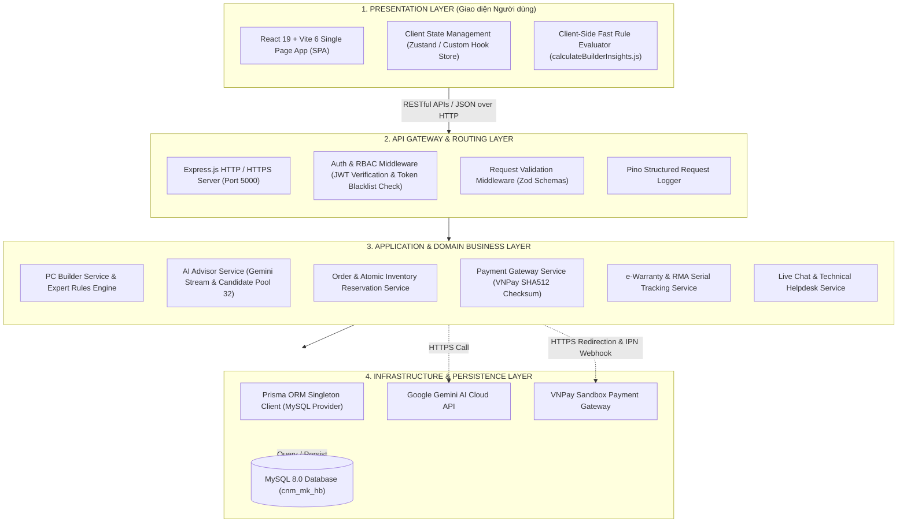

### 1.3. Mô hình Triển khai & Hệ Sinh thái Công nghệ (Tech Stack)
- **Frontend Presentation**: React 19, React Router v7, Vite 6, Tailwind CSS, Lucide Icons, Canvas Confetti.
- **Backend API Server**: Node.js v20 LTS, TypeScript 5, Express.js 4, Zod Validation, Pino Logger.
- **Database Management & ORM**: MySQL 8.0, Prisma ORM v5 (`native` engine cho Windows phát triển và `linux-musl-openssl-3.0.x` cho môi trường Docker Alpine).
- **Trí tuệ nhân tạo**: Google Gemini API (`@google/genai`), hỗ trợ dự phòng linh hoạt qua OpenAI, Groq, DeepSeek.
- **Thanh toán & Giao vận**: VNPay Payment Gateway (thuật toán mã hóa băm SHA-512 đối soát IPN), GHN / GHTK Mock Shipping API.
- **Bảo mật**: Bcrypt mật khẩu người dùng, JSON Web Token (JWT) kết hợp Token Blacklist chống Replay Attack, Atomic Row-level Locking chống overselling kho hàng.

### 1.4. Tiêu chuẩn Mô hình hóa UML 2.5 áp dụng trong Đề tài
Toàn bộ các biểu đồ trong tài liệu này tuân theo chuẩn **Unified Modeling Language (UML) phiên bản 2.5** do Object Management Group (OMG) ban hành, bao gồm:
1. **Use Case Diagram**: Phân định ranh giới hệ thống, tác nhân và hành vi nghiệp vụ.
2. **Activity Diagram**: Mô hình hóa luồng công việc điều khiển, các điểm rẽ nhánh quyết định và xử lý ngoại lệ song song.
3. **Sequence Diagram**: Mô hình hóa sự tương tác tuần tự theo thời gian giữa các đối tượng phân lớp (UI $\leftrightarrow$ Controller $\leftrightarrow$ Service $\leftrightarrow$ Database).

---

<a name="phần-2-bảng-ánh-xạ-thực-thể"></a>
## PHẦN 2: PHÂN RÃ USE CASE THEO 5 ACTOR (USE CASE MODELING)

### 2.1. Ma trận Tác nhân (Actors Matrix)
Hệ thống xác định rõ **5 Tác nhân con người (Human Actors)** và **3 Tác nhân dịch vụ ngoài (External Service Actors)** tham gia vào các tiến trình nghiệp vụ:

| Tác nhân (Actor) | Phân loại | Vai trò & Trách nhiệm chính trong Hệ thống |
| :--- | :---: | :--- |
| **1. Khách Hàng Vãng Lai (Guest)** | Con người | Khách truy cập ẩn danh chưa đăng nhập. Được phép tìm kiếm sản phẩm, lọc thông số kỹ thuật EAV chuyên sâu, so sánh linh kiện, **tự do sử dụng PC Builder với đầy đủ tính năng kiểm tra tương thích tức thì**, lưu tạm nhiều cấu hình trên trình duyệt (LocalStorage), xuất/nhập file `.json`, tra cứu bảo hành điện tử công khai và chat thử nghiệm với AI. |
| **2. Khách Hàng Thành Viên (Customer)** | Con người | Khách hàng đã đăng ký và xác thực tài khoản. Kế thừa toàn bộ quyền của Khách vãng lai, đồng thời có quyền: Đồng bộ cấu hình từ LocalStorage lên Cloud, chia sẻ liên kết cấu hình công khai (`share_token`), thêm vào giỏ hàng, áp mã giảm giá (Coupon), đặt hàng và thanh toán trực tuyến (COD/VNPay), quản lý đơn cá nhân, hủy đơn PENDING, thanh toán lại, gửi yêu cầu bảo hành RMA, mở Ticket hỗ trợ kỹ thuật và đánh giá sản phẩm. |
| **3. Nhân Viên Bán Hàng (Sales Staff)** | Con người | Phụ trách xử lý vòng đời đơn hàng: Tiếp nhận đơn mới, chuyển trạng thái `PROCESSING`, gán đơn vị vận chuyển, tạo mã vận đơn giao vận, xác nhận giao thành công `DELIVERED`, lưu ghi chú tư vấn; trực hàng chờ Live Chat (`chat_sessions`), tiếp nhận tư vấn khách hàng trực tuyến và gửi cấu hình PC build trực tiếp qua chat. |
| **4. Nhân Viên Kỹ Thuật (Tech Staff)** | Con người | Phụ trách xử lý chuyên môn phần cứng: Tiếp nhận hàng chờ Ticket sự cố kỹ thuật (`tickets`), trao đổi xử lý lỗi với khách, đóng ticket `RESOLVED`; quản lý cơ sở tri thức luật tương thích linh kiện (`compatibility_rules`: thêm/sửa/bật/tắt luật); tiếp nhận và thẩm định yêu cầu bảo hành RMA, xác minh hình ảnh linh kiện hỏng, cập nhật nhật ký kiểm tra `warranty_request_events`; quét gán mã vạch Serial Number xuất kho (`order_item_serials`). |
| **5. Quản Trị Viên (System Admin)** | Con người | Quản trị toàn diện hệ thống: Giám sát Dashboard điều hành (KPIs, doanh thu, tăng trưởng, cảnh báo tồn kho); quản lý tài khoản và phân quyền người dùng (`users`, `roles`); quản lý danh mục sản phẩm, biến thể SKU và giá trị thuộc tính EAV; phê duyệt các giao dịch thanh toán chuyển khoản ngân hàng thủ công; cấu hình tham số vận hành hệ thống động (`system_settings`) và giám sát an ninh qua nhật ký kiểm toán (`audit_logs`). |
| **6. AI Advisor Service (External)** | Dịch vụ ngoài | Đóng vai trò Chuyên gia tư vấn trí tuệ nhân tạo (Google Gemini LLM Engine). Tiếp nhận Prompt tiêu chí và tập Candidate Pool 32 linh kiện để phân tích, lựa chọn cấu hình tối ưu và thẩm định độc lập chất lượng bộ PC. |
| **7. Cổng Thanh Toán VNPay (External)** | Dịch vụ ngoài | Cổng thanh toán tài chính trung gian. Tiếp nhận yêu cầu khởi tạo giao dịch, cung cấp giao diện thanh toán bảo mật cho khách và gửi kết quả đối soát về máy chủ qua kênh Webhook IPN. |
| **8. Đơn Vị Giao Vận GHN/GHTK (External)** | Dịch vụ ngoài | Đối tác chuyển phát hàng hóa. Tiếp nhận thông tin tạo vận đơn từ nhân viên bán hàng và cung cấp mã tra cứu vận đơn `tracking_code`. |

---

### 2.2. Sơ đồ Use Case Toàn hệ thống (Phân rã 4 Subsystems)
Sơ đồ dưới đây biểu diễn bức tranh tổng quan phân rã chức năng của hệ thống PC Mall theo 4 phân hệ con (Subsystems), làm rõ mối quan hệ tương tác của 5 Actor và các hệ thống bên ngoài:

```mermaid
flowchart TB
    %% Actors Definition
    subgraph Human_Actors ["TÁC NHÂN CON NGƯỜI (HUMAN ACTORS)"]
        direction LR
        Guest["Khách Hàng Vãng Lai (Guest)"]
        Customer["Khách Hàng Thành Viên (Customer)"]
        Sales["Nhân Viên Bán Hàng (Sales)"]
        Tech["Nhân Viên Kỹ Thuật (Tech)"]
        Admin["Quản Trị Viên (Admin)"]
    end

    Guest <|-- Customer

    %% Subsystems Definition
    subgraph Sub1 ["PHÂN HỆ 1: SMART PC BUILDER & TRÍ TUỆ NHÂN TẠO"]
        UC_BuildManual(["UC-01: Lắp ráp PC thủ công"]):::coreUC
        UC_RuleCheck(["<<Include>> Kiểm tra tương thích tức thì (10 Rules)"]):::subUC
        UC_SaveLocal(["UC-02: Lưu tạm & Xuất/Nhập file JSON"]):::coreUC
        UC_SaveCloud(["UC-03: Lưu cấu hình đám mây & Chia sẻ Link"]):::coreUC
        UC_AISuggest(["UC-04: AI Đề xuất cấu hình (Pool 32 linh kiện)"]):::aiUC
        UC_AIAudit(["UC-05: AI Thẩm định & Gợi ý linh kiện thay thế"]):::aiUC
    end

    subgraph Sub2 ["PHÂN HỆ 2: THƯƠNG MẠI ĐIỆN TỬ, GIỎ HÀNG & THANH TOÁN"]
        UC_Catalog(["UC-06: Xem danh mục, Lọc EAV & So sánh linh kiện"]):::coreUC
        UC_Cart(["UC-07: Quản lý giỏ hàng & Nạp nguyên dàn PC"]):::coreUC
        UC_Checkout(["UC-08: Đặt hàng & Áp dụng Voucher (Coupon)"]):::coreUC
        UC_VNPay(["<<Extend>> Thanh toán trực tuyến VNPay"]):::subUC
        UC_OrderMgmt(["UC-09: Quản lý, Theo dõi & Hủy đơn hàng PENDING"]):::coreUC
        UC_ProcessOrder(["UC-10: Xử lý đơn hàng, Gán vận đơn & Giao vận"]):::staffUC
        UC_ApproveBank(["UC-11: Duyệt thanh toán chuyển khoản ngân hàng"]):::adminUC
    end

    subgraph Sub3 ["PHÂN HỆ 3: HẬU MÃI, BẢO HÀNH RMA & CSKH"]
        UC_PublicWarranty(["UC-12: Tra cứu bảo hành công khai"]):::coreUC
        UC_ActivateWarranty(["UC-13: Kích hoạt e-Warranty tự động"]):::coreUC
        UC_RequestRMA(["UC-14: Gửi yêu cầu bảo hành RMA kèm ảnh lỗi"]):::coreUC
        UC_ProcessRMA(["UC-15: Tiếp nhận, Giám định RMA & Đổi mới"]):::staffUC
        UC_AssignSerial(["UC-16: Quét gán mã Serial linh kiện xuất kho"]):::staffUC
        UC_CustomerTicket(["UC-17: Mở & Trao đổi Ticket hỗ trợ kỹ thuật"]):::coreUC
        UC_TechTicket(["UC-18: Tiếp nhận & Xử lý Ticket sự cố"]):::staffUC
        UC_LiveChatCustomer(["UC-19: Chat trực tuyến với Nhân viên CSKH"]):::coreUC
        UC_LiveChatStaff(["UC-20: Trực hàng chờ chat & Gửi cấu hình PC"]):::staffUC
    end

    subgraph Sub4 ["PHÂN HỆ 4: VẬN HÀNH, QUẢN TRỊ & HỆ CHUYÊN GIA"]
        UC_ManageRules(["UC-21: Quản trị tập luật tương thích (Knowledge Base)"]):::staffUC
        UC_ManageCatalog(["UC-22: Quản lý Sản phẩm, Biến thể SKU & Thuộc tính EAV"]):::adminUC
        UC_ManageUsers(["UC-23: Quản lý Người dùng & Khóa/Mở tài khoản"]):::adminUC
        UC_SystemSettings(["UC-24: Cấu hình tham số hệ thống & Xem Audit Log"]):::adminUC
        UC_AdminDashboard(["UC-25: Dashboard giám sát KPI & Cảnh báo tồn kho"]):::adminUC
    end

    subgraph External_Actors ["HỆ THỐNG NGOÀI (EXTERNAL SERVICES)"]
        direction LR
        ExtAI["AI Advisor Service (Gemini)"]
        ExtVNPay["Cổng VNPay Gateway"]
        ExtGHN["Đơn Vị Giao Vận (GHN/GHTK)"]
    end

    %% Actor Connections
    Guest --> UC_Catalog
    Guest --> UC_BuildManual
    Guest --> UC_SaveLocal
    Guest --> UC_PublicWarranty
    Guest --> UC_AISuggest
    Guest --> UC_AIAudit

    Customer --> UC_SaveCloud
    Customer --> UC_Cart
    Customer --> UC_Checkout
    Customer --> UC_OrderMgmt
    Customer --> UC_RequestRMA
    Customer --> UC_CustomerTicket
    Customer --> UC_LiveChatCustomer

    Sales --> UC_ProcessOrder
    Sales --> UC_LiveChatStaff

    Tech --> UC_TechTicket
    Tech --> UC_ProcessRMA
    Tech --> UC_AssignSerial
    Tech --> UC_ManageRules

    Admin --> UC_ManageCatalog
    Admin --> UC_ManageUsers
    Admin --> UC_ApproveBank
    Admin --> UC_SystemSettings
    Admin --> UC_AdminDashboard
    Admin --> UC_ManageRules

    %% Relations between UCs
    UC_BuildManual -.->|<<include>>| UC_RuleCheck
    UC_Checkout -.->|<<extend>>| UC_VNPay

    %% External Connections
    UC_AISuggest --- ExtAI
    UC_AIAudit --- ExtAI
    UC_VNPay --- ExtVNPay
    UC_ProcessOrder --- ExtGHN

    classDef coreUC fill:#e0f2fe,stroke:#0284c7,stroke-width:1.5px,color:#0f172a;
    classDef subUC fill:#f1f5f9,stroke:#64748b,stroke-width:1px,stroke-dasharray: 4 2,color:#334155;
    classDef aiUC fill:#fef3c7,stroke:#d97706,stroke-width:1.5px,color:#78350f;
    classDef staffUC fill:#dcfce7,stroke:#16a34a,stroke-width:1.5px,color:#14532d;
    classDef adminUC fill:#fee2e2,stroke:#dc2626,stroke-width:1.5px,color:#7f1d1d;
```

---

### 2.3. Sơ đồ Use Case Chi tiết cho từng Actor

#### 2.3.1. Phân hệ Use Case: Khách Hàng Vãng Lai (Guest)
Khách hàng vãng lai là đối tượng tiềm năng lớn nhất. Hệ thống tạo điều kiện tối đa để khách trải nghiệm các công nghệ cốt lõi của website mà không yêu cầu rào cản đăng nhập.

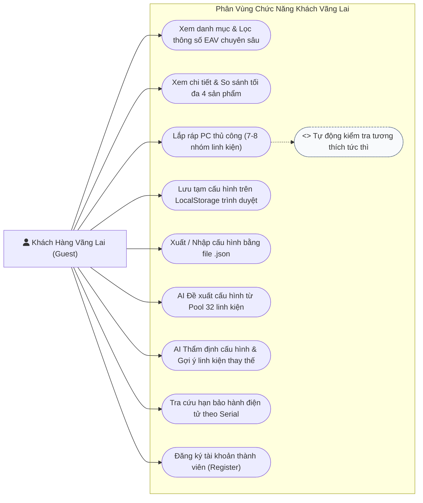

#### 2.3.2. Phân hệ Use Case: Khách Hàng Thành Viên (Member Customer)
Khách hàng thành viên kế thừa toàn bộ chức năng của Khách vãng lai, được mở rộng các tiện ích cá nhân hóa, giao dịch thương mại và dịch vụ sau bán hàng (RMA/Ticket).

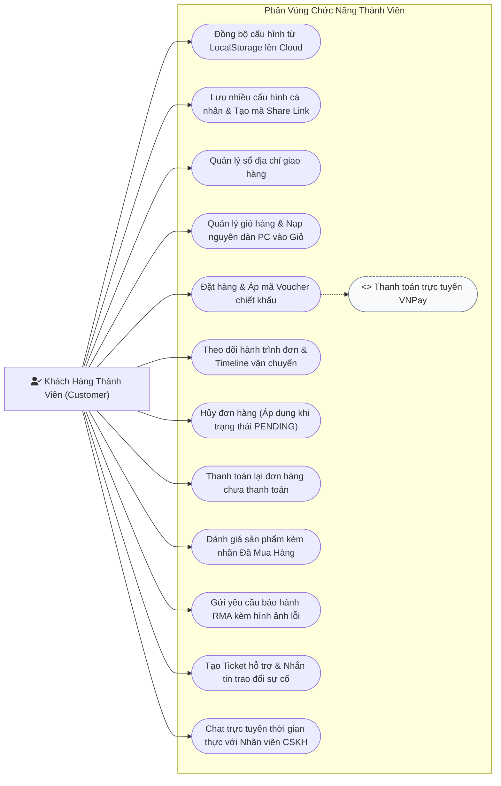

#### 2.3.3. Phân hệ Use Case: Nhân Viên Bán Hàng (Sales Staff)
Nhân viên bán hàng chịu trách nhiệm vận hành luồng đơn hàng thương mại và tiếp nhận các yêu cầu tư vấn bán hàng trực tiếp.

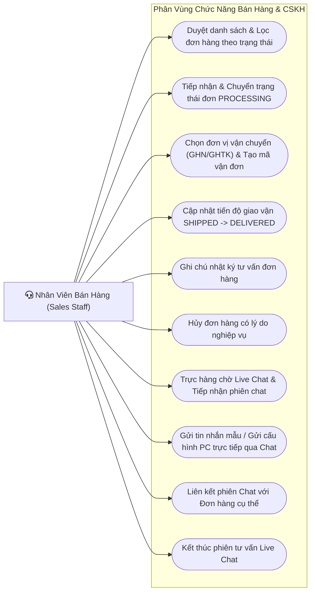

#### 2.3.4. Phân hệ Use Case: Nhân Viên Kỹ Thuật (Technical Staff)
Nhân viên kỹ thuật xử lý các tác vụ chuyên môn sâu về phần cứng: khắc phục sự cố, bảo hành đổi trả, quản lý tập luật tương thích và giám sát xuất kho linh kiện chính hãng theo số Serial.

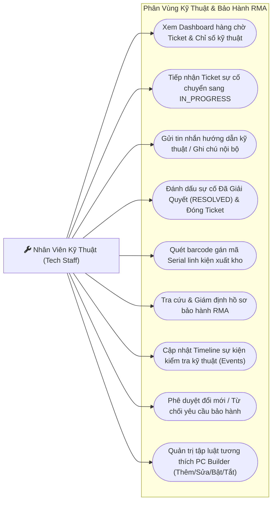

#### 2.3.5. Phân hệ Use Case: Quản Trị Viên (System Admin)
Quản trị viên nắm toàn quyền điều hành hệ thống, giám sát vận hành kinh doanh, an ninh bảo mật và cấu hình môi trường.

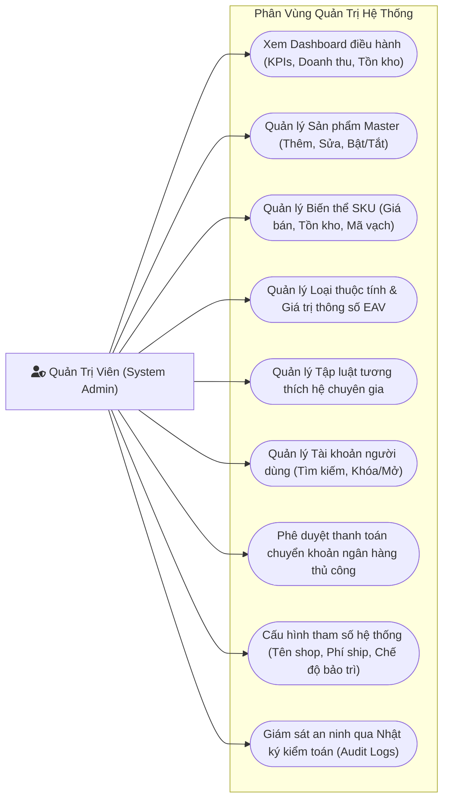

---

### 2.4. Bảng Tổng hợp Danh mục Use Case Toàn Hệ Thống

| Mã Use Case | Tên Use Case | Tác nhân chính (Actors) | Phân hệ (Subsystem) | Mức ưu tiên |
| :---: | :--- | :--- | :--- | :---: |
| `UC-01` | Lắp ráp PC thủ công & Kiểm tra tương thích tức thì | Guest, Customer | PC Builder & AI | 🔴 Bắt buộc |
| `UC-02` | Lưu tạm & Xuất/Nhập file JSON cấu hình | Guest, Customer | PC Builder & AI | 🔴 Bắt buộc |
| `UC-03` | Lưu cấu hình Cloud & Tạo liên kết chia sẻ công khai | Customer | PC Builder & AI | 🟡 Quan trọng |
| `UC-04` | AI Đề xuất cấu hình tối ưu từ Candidate Pool 32 | Guest, Customer, AI Service | PC Builder & AI | 🔴 Bắt buộc |
| `UC-05` | AI Thẩm định độc lập & Gợi ý linh kiện thay thế | Guest, Customer, AI Service | PC Builder & AI | 🔴 Bắt buộc |
| `UC-06` | Tra cứu danh mục, Lọc thông số EAV & So sánh | Guest, Customer | E-Commerce | 🔴 Bắt buộc |
| `UC-07` | Quản lý giỏ hàng & Nạp nguyên dàn PC vào Giỏ | Customer | E-Commerce | 🔴 Bắt buộc |
| `UC-08` | Đặt hàng & Áp dụng Voucher (Coupon) | Customer | E-Commerce | 🔴 Bắt buộc |
| `UC-09` | Thanh toán trực tuyến qua cổng VNPay Sandbox | Customer, VNPay Gateway | E-Commerce | 🔴 Bắt buộc |
| `UC-10` | Quản lý lịch sử, Theo dõi & Hủy đơn hàng PENDING | Customer | E-Commerce | 🟡 Quan trọng |
| `UC-11` | Đánh giá & Nhận xét sản phẩm (Verified Buyer) | Customer | E-Commerce | 🟢 Mở rộng |
| `UC-12` | Tiếp nhận đơn, Tạo vận đơn & Cập nhật giao vận | Sales Staff, Đơn vị GHN | E-Commerce & Staff | 🔴 Bắt buộc |
| `UC-13` | Quản lý hàng chờ Live Chat & Tư vấn cấu hình PC | Sales Staff, Customer | CSKH & Live Chat | 🟡 Quan trọng |
| `UC-14` | Quét gán mã Serial linh kiện khi xuất kho | Tech Staff | Kho & Serial | 🔴 Bắt buộc |
| `UC-15` | Tra cứu hạn bảo hành điện tử công khai theo Serial | Guest, Customer | Bảo hành & RMA | 🔴 Bắt buộc |
| `UC-16` | Gửi yêu cầu bảo hành RMA kèm hình ảnh sự cố | Customer | Bảo hành & RMA | 🔴 Bắt buộc |
| `UC-17` | Tiếp nhận, Giám định kỹ thuật & Đổi mới RMA | Tech Staff | Bảo hành & RMA | 🔴 Bắt buộc |
| `UC-18` | Mở & Trao đổi Ticket hỗ trợ kỹ thuật chuyên sâu | Customer, Tech Staff | Hỗ trợ Kỹ thuật | 🟡 Quan trọng |
| `UC-19` | Tiếp nhận & Đóng Ticket sự cố kỹ thuật | Tech Staff | Hỗ trợ Kỹ thuật | 🟡 Quan trọng |
| `UC-20` | Quản lý tập luật tương thích (Knowledge Base) | Tech Staff, Admin | Hệ Chuyên Gia | 🔴 Bắt buộc |
| `UC-21` | Quản lý Sản phẩm, Biến thể SKU & Tồn kho | Admin | Quản trị Doanh nghiệp | 🔴 Bắt buộc |
| `UC-22` | Quản lý Loại thuộc tính & Giá trị thông số EAV | Admin | Quản trị Doanh nghiệp | 🔴 Bắt buộc |
| `UC-23` | Quản lý Tài khoản người dùng & Phân quyền | Admin | Quản trị Doanh nghiệp | 🟡 Quan trọng |
| `UC-24` | Phê duyệt thanh toán chuyển khoản thủ công | Admin | Quản trị Doanh nghiệp | 🟡 Quan trọng |
| `UC-25` | Cấu hình tham số hệ thống & Xem Audit Log | Admin | Quản trị Doanh nghiệp | 🟡 Quan trọng |
| `UC-26` | Dashboard giám sát KPI & Báo cáo doanh thu | Admin | Quản trị Doanh nghiệp | 🟡 Quan trọng |

---

### 2.5. Đặc tả Chi tiết các Use Case Trọng tâm Công nghệ (Use Case Specifications)

#### Đặc tả 1: `UC-BUILD-01` - Lắp ráp PC thủ công & Kiểm tra tương thích tức thì
- **Mã Use Case**: `UC-BUILD-01`
- **Tên Use Case**: Lắp ráp cấu hình PC thủ công & Kiểm tra tương thích tức thì
- **Tác nhân**: Khách Hàng Vãng Lai (Guest), Khách Hàng Thành Viên (Customer)
- **Mục đích**: Cho phép người dùng tự do lựa chọn các linh kiện từ kho hàng thật và được hệ thống phân tích, cảnh báo xung đột phần cứng theo thời gian thực.
- **Tiền điều kiện (Pre-condition)**: Người dùng truy cập vào trang `/pc-builder`.
- **Hậu điều kiện (Post-condition)**: Cấu hình được cập nhật trên bàn lắp ráp; nhãn cảnh báo (Tương thích / Cảnh báo / Xung đột nghiêm trọng) được hiển thị chính xác.
- **Luồng sự kiện chính (Main Flow)**:
  1. Người dùng mở trang PC Builder, giao diện hiển thị 8 khe cắm linh kiện chuẩn: CPU, Bo mạch chủ, RAM, Card đồ họa, Ổ cứng, Nguồn máy tính, Vỏ Case, Tản nhiệt.
  2. Người dùng nhấp "Chọn linh kiện" tại một vị trí (ví dụ: CPU). Modal danh sách linh kiện hiện lên kèm bộ lọc thông số kỹ thuật (Socket, Thương hiệu, Phân khúc).
  3. Người dùng chọn 1 linh kiện ưng ý $
ightarrow$ Hệ thống nạp linh kiện vào bàn lắp ráp.
  4. Engine kiểm tra tương thích (`calculateBuilderInsights.js` ở Client và `pc-builder.service.ts` ở Server) tự động kích hoạt:
     - So khớp Socket CPU với Bo mạch chủ.
     - So khớp chuẩn DDR4/DDR5 của RAM với khe cắm trên Bo mạch chủ.
     - So sánh chiều dài VGA với khoảng trống tối đa của Vỏ Case (`gpu_length <= case_gpu_clearance`).
     - So sánh chiều cao tản khí / kích thước Radiator nước với thông số hỗ trợ của Vỏ Case.
     - Tính tổng công suất tiêu thụ tối đa (Peak TDP) và đánh giá độ an toàn của bộ nguồn PSU (`psu_wattage >= total_power * 1.2`).
  5. Hệ thống hiển thị điểm đánh giá tổng thể (Build Score /100), tổng giá trị đơn hàng (VNĐ) và thanh công suất nguồn PSU.
  6. Nếu tất cả luật đều vượt qua: Hiển thị huy hiệu xanh `✅ Tương thích 100%`.
- **Luồng rẽ nhánh / Ngoại lệ (Alternative / Exception Flows)**:
  - *A1. Phát hiện xung đột nghiêm trọng (Blocker)*: Nếu CPU Socket LGA1700 đi cùng Mainboard AM5 $
ightarrow$ Hệ thống hiển thị cảnh báo đỏ `🔴 Xung Đột Socket: CPU LGA1700 không thể lắp trên bo mạch chủ Socket AM5`. Nút "Thêm vào giỏ hàng" bị vô hiệu hóa kèm thông điệp hướng dẫn đổi linh kiện phù hợp.
  - *A2. Phát hiện nguy cơ cảnh báo (Warning)*: Nguồn PSU 500W nhưng dàn máy tiêu thụ 480W $
ightarrow$ Hệ thống hiển thị cảnh báo vàng `⚠️ Cảnh Báo Thiếu Nguồn: Biên độ dự phòng an toàn < 20%, khuyến nghị nâng cấp PSU lên tối thiểu 650W`. Người dùng vẫn được phép tiếp tục nếu chấp nhận rủi ro.

---

#### Đặc tả 2: `UC-AI-01` - Đề xuất cấu hình PC thông minh từ Candidate Pool 32 linh kiện
- **Mã Use Case**: `UC-AI-01`
- **Tên Use Case**: Đề xuất cấu hình PC thông minh từ Candidate Pool 32 linh kiện
- **Tác nhân**: Khách Hàng Vãng Lai, Khách Hàng Thành Viên, AI Advisor Service (Google Gemini)
- **Mục đích**: Tự động hóa hoàn toàn việc lựa chọn cấu hình máy tính cân đối tối ưu dựa trên ngân sách và mục tiêu sử dụng cụ thể của khách hàng.
- **Tiền điều kiện (Pre-condition)**: Cơ sở dữ liệu kho hàng có tối thiểu 4 sản phẩm còn hàng (`stock > 0`) cho mỗi danh mục linh kiện.
- **Hậu điều kiện (Post-condition)**: Một bộ cấu hình hoàn chỉnh 8 món được sinh ra và nạp trực tiếp vào giao diện PC Builder.
- **Luồng sự kiện chính (Main Flow)**:
  1. Người dùng bấm nút "AI Cố Vấn Cấu Hình" tại trang PC Builder.
  2. Modal tiêu chí hiện lên, người dùng chọn các thông số:
     - Ngân sách dự kiến (ví dụ: 25.000.000 VNĐ).
     - Nhu cầu chính: Gaming AAA / Esports / Đồ họa 3D / Lập trình AI / Văn phòng.
     - Độ phân giải màn hình hướng tới: 1080p Full HD, 1440p 2K hoặc 4K.
     - Phong cách thẩm mỹ: Tone Đen huyền bí / Tone Trắng Gaming / Tản nhiệt nước AIO RGB.
  3. Người dùng nhấp "Bắt đầu phân tích & Đề xuất".
  4. Backend lọc từ cơ sở dữ liệu MySQL ra **Candidate Pool gồm 32 linh kiện tốt nhất** (4 linh kiện tiêu biểu có điểm benchmark cao nhất cho từng nhóm linh kiện).
  5. Backend đóng gói danh sách 32 linh kiện kèm các ràng buộc kỹ thuật nghiêm ngặt vào System Prompt và gọi API Google Gemini (`gemini-2.5-flash-lite`).
  6. Server truyền phát trực tiếp (Streaming SSE) bài phân tích lý do chọn lựa của AI về giao diện theo thời gian thực.
  7. Khi hoàn tất, hệ thống trả về JSON danh sách 8 linh kiện được chọn, tự động tính toán kiến trúc RAM kênh đôi Dual-Channel (ví dụ: 2 thanh 16GB thay vì 1 thanh 32GB).
  8. Người dùng xem bảng tổng kết, điểm thẩm định và bấm "Áp Dụng Vào Dàn Máy" để chuyển sang bàn lắp ráp.
- **Luồng ngoại lệ (Exception Flows)**:
  - *E1. Ngân sách quá thấp không thể build dàn máy đồng bộ*: Nếu người dùng nhập ngân sách 5.000.000 VNĐ nhưng đòi hỏi Gaming 4K $
ightarrow$ AI phân tích giải thích thực tế và đưa ra cấu hình khả thi nhất trong tầm giá (APU tích hợp đồ họa) kèm lời khuyên nâng cấp sau này.

---

#### Đặc tả 3: `UC-ORDER-01` - Đặt hàng, Áp dụng Voucher & Thanh toán Điện tử VNPay
- **Mã Use Case**: `UC-ORDER-01`
- **Tên Use Case**: Đặt hàng, Áp dụng Voucher chiết khấu & Thanh toán điện tử VNPay
- **Tác nhân**: Khách Hàng Thành Viên (Customer), Cổng Thanh Toán VNPay Gateway
- **Mục đích**: Chuyển đổi các linh kiện trong giỏ hàng hoặc dàn PC thành đơn đặt hàng chính thức, xử lý giảm giá và bảo đảm an toàn thanh toán trực tuyến.
- **Tiền điều kiện (Pre-condition)**: Người dùng đã đăng nhập, giỏ hàng có ít nhất 1 sản phẩm còn tồn kho.
- **Hậu điều kiện (Post-condition)**: Đơn hàng được tạo thành công với trạng thái `PENDING` (nếu COD) hoặc `PROCESSING` (nếu VNPay thành công); tồn kho được trừ nguyên tử.
- **Luồng sự kiện chính (Main Flow)**:
  1. Người dùng bấm "Tiến hành thanh toán" từ trang Giỏ hàng `/cart` $
ightarrow$ Điều hướng sang trang Checkout `/checkout`.
  2. Người dùng chọn địa chỉ nhận hàng từ sổ địa chỉ có sẵn hoặc nhập địa chỉ mới.
  3. Người dùng nhập mã giảm giá (ví dụ: `GIAM500K`) $
ightarrow$ Hệ thống kiểm tra điều kiện áp dụng (`coupons`: thời hạn, đơn tối thiểu, số lượt còn lại) $
ightarrow$ Khấu trừ trực tiếp vào tổng tiền thanh toán `final_amount`.
  4. Người dùng chọn phương thức "Thanh toán qua VNPAY (Thẻ ATM / QR Pay)".
  5. Người dùng bấm "Xác nhận đặt hàng".
  6. Backend khởi tạo bản ghi `orders` (trạng thái `PENDING`), tạo bản ghi `payments` (trạng thái `PENDING_GATEWAY`).
  7. Backend sinh URL thanh toán VNPay có gắn mã kiểm tra toàn vẹn dữ liệu (Secure Hash SHA-512) và chuyển hướng trình duyệt của khách sang Cổng VNPay.
  8. Khách hàng thực hiện quét mã VNPAY-QR hoặc nhập thông tin thẻ ngân hàng và xác thực mã OTP.
  9. Sau khi trừ tiền thành công, Cổng VNPay gửi tín hiệu xác nhận tức thì (Instant Payment Notification - IPN Webhook) qua kết nối Server-to-Server về Backend API.
  10. Backend kiểm tra chữ ký số SHA-512 hợp lệ $
ightarrow$ Mở Transaction CSDL: Cập nhật `orders.payment_status = 'PAID'`, `orders.status = 'PROCESSING'`, ghi nhận `coupon_usages` và thực hiện **Atomic Conditional Decrement** trừ tồn kho linh kiện.
  11. Trình duyệt khách hàng được chuyển hướng về trang `/payment/result` hiển thị thông báo thành công kèm mã tra cứu đơn hàng.

---

<a name="phần-3-sơ-đồ-hoạt-động-activity-diagrams"></a>
## PHẦN 3: SƠ ĐỒ HOẠT ĐỘNG (ACTIVITY DIAGRAMS)

### 3.1. Sơ đồ Hoạt động 1: Luồng Build PC & Xử lý Tập luật Tương thích (Knowledge-Based Expert Engine)
Sơ đồ mô tả chi tiết tiến trình kiểm tra tương thích đa linh kiện theo thời gian thực mỗi khi người dùng thao tác chọn hoặc hoán đổi bất kỳ linh kiện nào trên bàn lắp ráp:

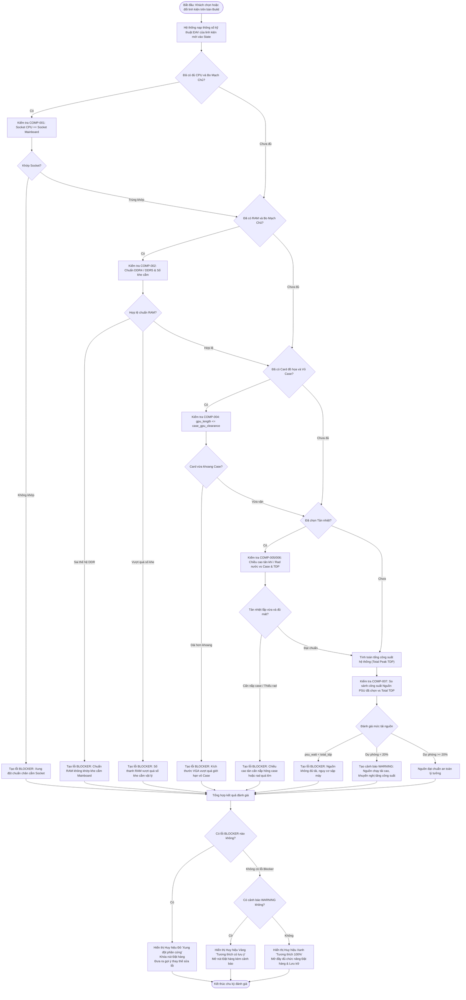

---

### 3.2. Sơ đồ Hoạt động 2: Luồng Tư vấn Cấu hình Trí tuệ Nhân tạo (AI Advisor & Recommendation Engine)
Tiến trình kết hợp chặt chẽ giữa lọc dữ liệu thô từ cơ sở dữ liệu kho hàng (Data Grounding) và suy luận logic đa tiêu chí của Google Gemini LLM:

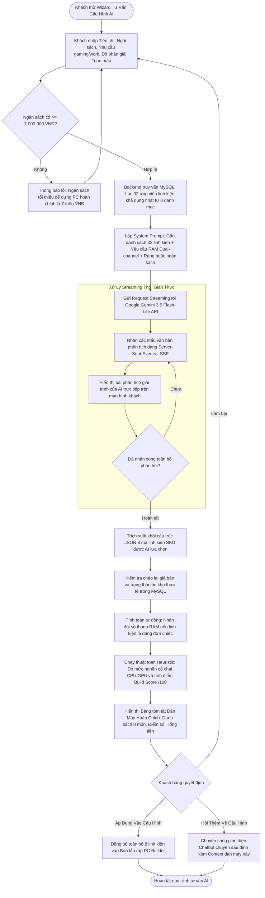

---

### 3.3. Sơ đồ Hoạt động 3: Luồng Đặt hàng, Áp dụng Voucher & Thanh toán Cổng VNPay
Mô tả quy trình xử lý thanh toán đa kênh (COD / VNPay), kiểm tra điều kiện mã giảm giá và đảm bảo tính toàn vẹn kho hàng bằng giao dịch nguyên tử (Atomic Transaction):

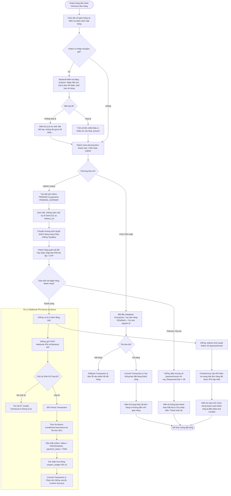

---

<a name="phần-4-sơ-đồ-tuần-tự-sequence-diagrams"></a>
## PHẦN 4: SƠ ĐỒ TUẦN TỰ (SEQUENCE DIAGRAMS)

Dưới đây là 6 biểu đồ tuần tự mô hình hóa chi tiết sự tương tác động giữa các lớp đối tượng trong các ca nghiệp vụ phức tạp nhất của dự án.

---

### 4.1. Sequence Diagram 1: Xác thực Người dùng, Cấp JWT & Thu hồi Token khi Đăng xuất (Logout Blacklist)
Biểu đồ mô tả trọn vẹn vòng đời xác thực bảo mật: Đăng nhập cấp JWT Token $
ightarrow$ Gửi request có đính kèm Bearer Token qua Middleware $
ightarrow$ Đăng xuất chủ động đưa token vào bảng `token_blacklist` $
ightarrow$ Ngăn chặn triệt để tấn công tái sử dụng Token (Replay Attack).

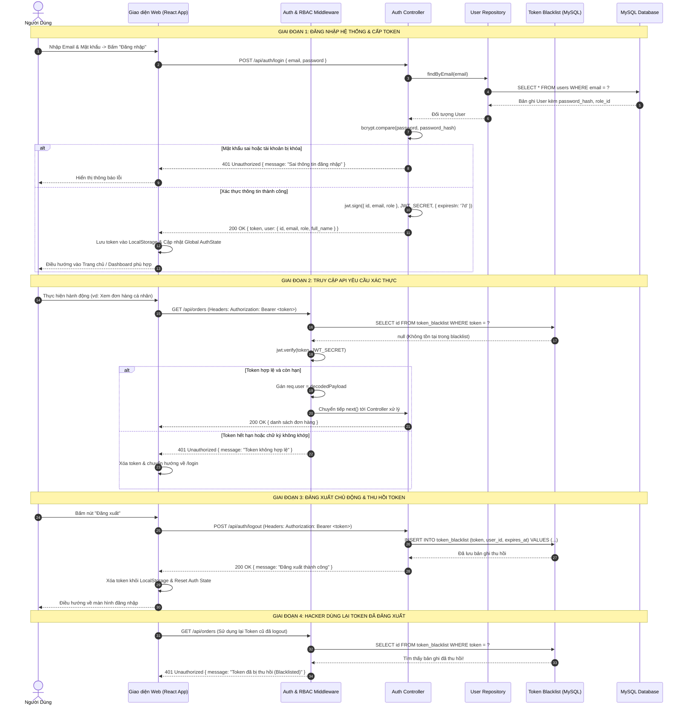

---

### 4.2. Sequence Diagram 2: Lắp ráp PC & Đánh giá Tương thích Thời gian Thực (Real-time Compatibility Engine)
Mô tả chi tiết luồng xử lý tương tác khi người dùng chọn linh kiện trên giao diện PC Builder, kích hoạt hai tầng đánh giá: Tầng 1 (Client Fast Engine) và Tầng 2 (Server Comprehensive Expert Verification).

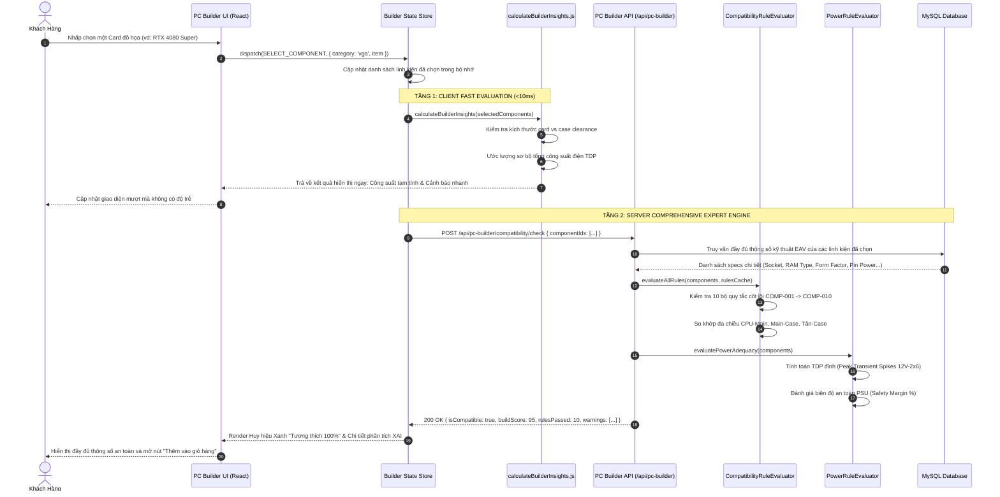

---

### 4.3. Sequence Diagram 3: Giao dịch Thanh toán Điện tử VNPay & Xử lý Webhook IPN Đối soát
Mô tả quy trình đối soát độc lập qua 2 kênh: Kênh Webhook IPN bảo mật cao giữa máy chủ với máy chủ (Server-to-Server) và Kênh chuyển hướng trình duyệt của người dùng (Browser Return URL).

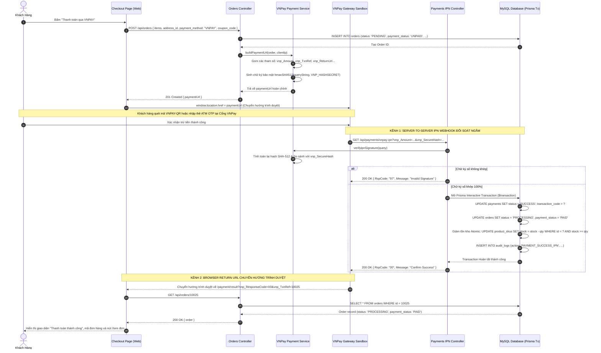

---

### 4.4. Sequence Diagram 4: Quản lý Số Serial Xuất kho & Tự động Kích hoạt Bảo hành Điện tử (e-Warranty Lifecycle)
Mô tả quy trình nghiệp vụ quan trọng trong ngành linh kiện điện tử: Quét mã vạch số Serial từng món hàng khi đóng gói và tự động sinh sổ bảo hành điện tử chính hãng khi đơn được giao thành công.

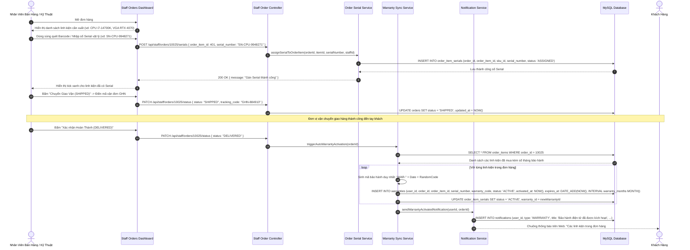

---

### 4.5. Sequence Diagram 5: Tiếp nhận & Xử lý Yêu cầu Bảo hành RMA Kèm Bằng chứng Hình ảnh
Mô tả quy trình xử lý khiếu nại bảo hành, kiểm tra hiện tượng cháy nổ/hỏng hóc thông qua bằng chứng hình ảnh và nhật ký giám định kỹ thuật.

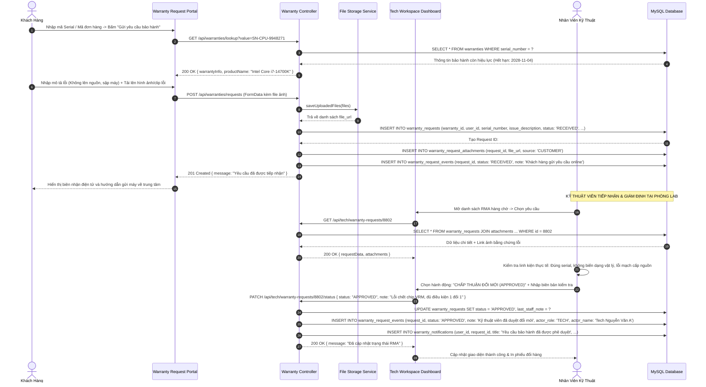

---

### 4.6. Sequence Diagram 6: Tư vấn CSKH Trực tuyến (Live Chat Session) & Chia sẻ Dàn PC
Mô tả quy trình tương tác thời gian thực giữa Khách hàng và Nhân viên bán hàng, bao gồm xếp hàng phòng chat và tính năng độc đáo: Gửi trực tiếp cấu hình PC đang build vào khung chat để nhân viên tư vấn.

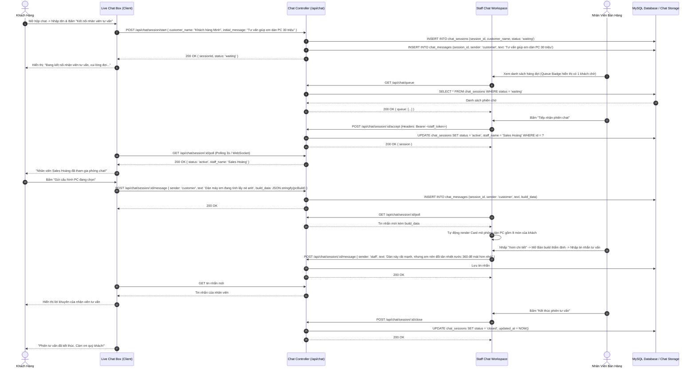

---
*Tài liệu TASK-03 được xây dựng dựa trên kiến trúc thực tế của hệ thống mã nguồn `services/api/` và `apps/web/`, hoàn toàn tương thích với các tiêu chuẩn mô hình hóa công nghệ phần mềm trong Khóa luận tốt nghiệp.*
