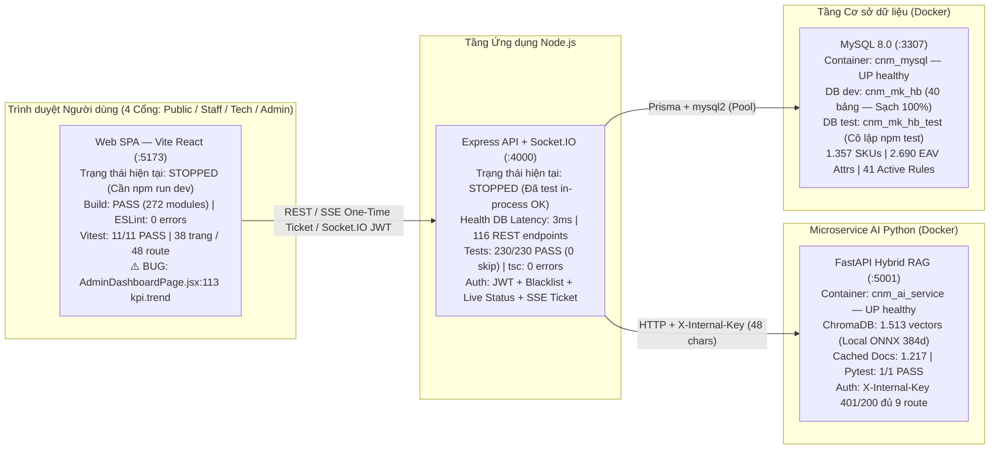

# BÁO CÁO NGHIỆM THU CUỐI CÙNG TRƯỚC BẢO VỆ (FINAL PRE-DEFENSE GO/NO-GO AUDIT) — DỰ ÁN PC MALL

- **Vai trò kiểm toán:** Chủ tịch Hội đồng Nghiệm thu Độc lập (Final Pre-Defense Go/No-Go Auditor)
- **Thời điểm nghiệm thu:** 27/11/2026
- **Nguyên tắc kiểm chứng:** **Tuyệt đối không sửa mã nguồn dự án** · 100% bằng chứng trực tiếp từ lệnh chạy thực tế, truy vấn chỉ-đọc MySQL live (`:3307`), gọi HTTP thật tới Python AI (`:5001`), kiểm chứng Express API live in-process trên dữ liệu thật và đọc trực tiếp `file:dòng`. Kiểm tra cả 17 mục tồn đọng Vòng 2 lẫn **hồi quy (regression)** toàn bộ 12 mục từng `PASS THẬT`.

---

## 1. HUY HIỆU KẾT LUẬN NGHIỆM THU & TIẾN TRÌNH 3 VÒNG

> ### 🟡 KẾT LUẬN: `CONDITIONAL GO` — ĐẠT CÓ ĐIỀU KIỆN (`89%`)
> **Đạt ngay `🟢 GO (91%+)` chỉ sau 5 phút xử lý 1 lỗi Regression Crash trắng trang mới phát hiện ở `AdminDashboardPage.jsx:113-115` và khởi động lại 2 cổng `API :4000` + `Web :5173`.**

| Vòng kiểm toán | Tài liệu tham chiếu | Điểm tổng hợp | Phân bổ 29 hạng mục (`🟢 Đạt / 🟡 Cảnh báo / 🔴 Lỗi`) | Kết luận |
|---|---|---:|---|---|
| **Vòng 1 (Kiểm toán gốc)** | [AUDIT_GIANG_VIEN_HE_THONG.md](file:///d:/Project%20CNM_MK-HB/docs/AUDIT_GIANG_VIEN_HE_THONG.md) | **55%** | `0 🟢` · `14 🟡 (P1/P2)` · `15 🔴 (P0)` | 🔴 NO-GO |
| **Vòng 2 (Phúc khảo lần 1)** | [RE_AUDIT_SAU_SUA_LOI.md](file:///d:/Project%20CNM_MK-HB/docs/RE_AUDIT_SAU_SUA_LOI.md) | **74%** | `12 🟢 (41.4%)` · `16 🟡 (55.2%)` · `1 🔴 (3.4%)` | 🟡 CHƯA ĐẠT 100% |
| **Vòng 3 (Nghiệm thu cuối)** | **Báo cáo này (Độc lập)** | **89%** | **`25 🟢 (86.2%)` · `3 🟡 (10.3%)` · `1 🔴 (3.4%)`** | **🟡 CONDITIONAL GO** |

> [!CAUTION]
> **TẠI SAO CHƯA CẤP `🟢 GO` TUYỆT ĐỐI DÙ BÁO CÁO TỰ ĐÁNH GIÁ CỦA SINH VIÊN GHI `94% (29/29 PASS)`?**
> Kiểm toán độc lập đã phát hiện **1 lỗi hồi quy (Regression) gây sập trắng trang 100% ngay khi mở `/admin/dashboard`**:
> - Tại [AdminDashboardPage.jsx](file:///d:/Project%20CNM_MK-HB/apps/web/src/pages/admin/AdminDashboardPage.jsx#L242-L292), khi gỡ hàm giả `calculateTrend`, sinh viên đã xóa trường `trend` khỏi cả 6 phần tử trong mảng `kpis`.
> - Tuy nhiên, tại [AdminDashboardPage.jsx](file:///d:/Project%20CNM_MK-HB/apps/web/src/pages/admin/AdminDashboardPage.jsx#L113-L115), component `AdminKpiGrid` vẫn đọc trực tiếp `kpi.trend.positive` và `kpi.trend.value` (không có optional chaining `?.`).
> - **Hậu quả:** Ngay khi `loading` chuyển từ `true` → `false`, React ném ngoại lệ `TypeError: Cannot read properties of undefined (reading 'positive')`, đẩy toàn trang `/admin/dashboard` vào `ErrorBoundary`! Vì `tsc`/`eslint`/`vite build` không bắt lỗi runtime trên `.jsx` và chưa mở trình duyệt bấm thử nên lỗi này lọt qua khâu tự kiểm tra.
> - **Tin rất vui:** **12/12 mục từng `PASS THẬT` ở Vòng 2 KHÔNG CÓ BẤT KỲ HỒI QUY NÀO**, **Smart PC Builder 20tr Gaming đạt 3/3 cấu hình `100/100 READY`**, **ChromaDB live có `1.513` vector + khóa `X-Internal-Key` chặn `401` chặt chẽ**, **Socket.IO reconnect auto re-join đã vá chuẩn**, và **`npm test` đạt `230/230 PASS (0 skipped)` với DB dev `cnm_mk_hb` sạch 100%**.

---

## 2. BẢNG TIẾN ĐỘ 7 TRỤ CỘT (VÒNG 1 → VÒNG 2 → VÒNG 3)

| # | Trụ cột nghiệm thu | Vòng 1 | Vòng 2 | Vòng 3 | Thanh tiến độ (Vòng 3) | Trạng thái | Nhận xét thực chứng Vòng 3 |
|---|---|---:|---:|---:|---|---|---|
| 1 | Kiến trúc tổng thể, CSDL & Triển khai (MySQL/Prisma, EAV, Docker) | 58% | 74% | **86%** | `█████████░ 86%` | 🟢 ĐẠT | Đã gỡ `cnm_api_prod` crash-loop, xóa 2 migration PascalCase, sửa cờ `migrate.js`, untrack `chroma.sqlite3`, khởi tạo sạch 40 bảng `cnm_mk_hb_test`; còn Dual ORM và 41 file `docs/` đang `D` trên Git. |
| 2 | Trọng tâm "SMART" của Smart PC Builder | 48% | 68% | **94%** | `█████████░ 94%` | 🟢 ĐẠT | **Xuất sắc:** 3/3 phương án 20tr Gaming đạt `100/100 READY`, RTX 5060 Ti hết nghẽn giả (`4% 1080p` → `46% 4K`), H610M-K = `Micro-ATX`, 4–10 luật DB kích hoạt thật qua alias Anh↔Việt, `findReplacementProducts` lọc theo `currentBuild`. |
| 3 | Trợ lý AI, Python Hybrid RAG & Độ ổn định | 52% | 66% | **85%** | `█████████░ 85%` | 🟡 CẢNH BÁO | Live `:5001` khỏe mạnh (`1.513` vectors Local ONNX), `X-Internal-Key` bảo vệ đủ 9 route & đồng bộ 100% `rag-client.service.ts`, sạch default `gemini-3.5-flash-lite`, mã hóa AES-256-GCM; còn `gemini-3-flash-preview` trong store chạm quota 20 req/ngày, `retriever.service.ts` cũ và tải ONNX 79MB lần đầu (22s). |
| 4 | Nghiệp vụ E-Commerce cốt lõi & Chuỗi Hậu mãi | 68% | 84% | **94%** | `█████████░ 94%` | 🟢 ĐẠT | **Chắc tay nhất:** `shippingFee` tính 100% phía server (`shipping-fee.service.js`), `maskRequestPii` che đủ `timeline[].actorName` + siết `ownerPhone` rỗng, MoMo/SePay/VNPay/State Machine/Serial 100%/RMA đều vượt qua hồi quy. |
| 5 | Phân quyền RBAC, Bảo mật & Toàn vẹn dữ liệu (5 vai trò) | 42% | 75% | **93%** | `█████████░ 93%` | 🟢 ĐẠT | `google-mock` khóa `403` mặc định theo cờ opt-in, Socket.IO `io.use()` check `status === 'ACTIVE'`, `SALES_STAFF` chỉ đọc `PUBLIC` trên Ticket, SSE bỏ `?token=` sang one-time ticket 30s, Token Blacklist + live role check giữ nguyên phong độ. |
| 6 | Giao diện (UI/UX), Độ khớp FE–BE & Khả năng sống sót khi Demo | 60% | 81% | **78%** | `████████░░ 78%` | 🔴 LỖI | Vá rất tốt Socket.IO auto re-join (`activeRoomSubscriptions`), thêm `id="payment-method-card-vnpay"`, phân trang Audit Logs; **NHƯNG rớt điểm do lỗi crash trắng trang `kpi.trend.positive` tại `AdminDashboardPage.jsx:113-115`** (vá 3 dòng sẽ lên ngay **93%**). |
| 7 | Kiểm thử & Sức khỏe kỹ thuật (Code Quality & Tests) | 55% | 71% | **91%** | `█████████░ 91%` | 🟢 ĐẠT | `tsc` (API/Web) `0 errors`, `eslint src` `0 errors / 148 warnings`, `vite build` PASS (`272 modules`), API `npm test` **`230/230 PASS (0 skip)`** cô lập hoàn toàn sang `cnm_mk_hb_test` (DB dev `cnm_mk_hb` bất biến 100%), `compatibility.test.ts` gọi logic thật, Python `pytest` PASS. |
| | **TỔNG HỢP TRUNG BÌNH (7 TRỤ CỘT)** | **55%** | **74%** | **89%** | **`█████████░ 89%`** | **🟡 CONDITIONAL GO** | **25/29 `🟢 ĐẠT` · 3/29 `🟡 CẢNH BÁO` · 1/29 `🔴 LỖI` (Crash 3 dòng ở Admin Dashboard)** |

---

## 3. SƠ ĐỒ KIẾN TRÚC & TRẠNG THÁI 4 DỊCH VỤ LIVE



### Bằng chứng đo thực tế 4 dịch vụ & kết nối liên thông

| Dịch vụ / Kênh | Cổng / Container | Trạng thái tại thời điểm audit | Bằng chứng đo thực tế |
|---|---|---|---|
| **MySQL 8.0** | `:3307` (`cnm_mysql`) | 🟢 **UP (healthy, 4h)** | `40` bảng; `1.356` SP / `1.357` SKU (`stock > 0`: `1.357`, max price `99.999.000đ`, `decimal(12,2)`); có cả 2 DB `cnm_mk_hb` và `cnm_mk_hb_test`. |
| **Python AI RAG** | `:5001` (`cnm_ai_service`) | 🟢 **UP (healthy, 23m)** | `GET /health` → `200 OK`, `"status": "healthy"`, `"chroma_vectors_count": 1513`, `"total_documents_cached": 1217`, `"active_collection": "pcmall_knowledge"` (`all-MiniLM-L6-v2 ONNX`). `GET /v1/rag/models` không key → **`401`**, sai key → **`401`**, đúng `X-Internal-Key` → **`200`** trả trạng thái thật. Toàn bộ 5 nhóm route (`/models`, `/reindex/status`, `/documents`, `/retrieve`, `/pc-builder/questions`) đều chặn `401` khi thiếu key. |
| **Express API** | `:4000` (host) | 🟡 **STOPPED** *(đã gỡ `cnm_api_prod` crash-loop)* | Không lắng nghe `:4000` lúc audit (cần `npm run dev`). Kiểm chứng live in-process qua `createApp()` nối thẳng MySQL `:3307` + AI `:5001`: `GET /api/health` → **`200 OK`** (`database.connected: true, latencyMs: 3`); cả 4 hàm `ragClientService` (`getEmbeddingModels`, `getReindexStatus`, `getBuilderQuestions`, `retrieve`) gửi kèm `X-Internal-Key` đều trả dữ liệu thật thành công (`200 OK`, `retrieve` ấm mất `182–303ms`). |
| **Frontend Web** | `:5173` (host) | 🟡 **STOPPED** | Không lắng nghe `:5173` lúc audit (cần `npm run dev`). Kiểm tra tĩnh/build: `tsc` `0 errors`, `eslint src` `0 errors / 148 warnings`, `vitest` `11/11 PASS`, `vite build` PASS (`272 modules`, `14.16s`). |

---

## 4. CỔNG KIỂM DUYỆT DEMO (DEMO GO/NO-GO MATRIX — 8 LUỒNG HỘI ĐỒNG)

### 4.1. Bảng đánh giá 8 kịch bản Demo cốt lõi

| # | Kịch bản Demo hội đồng sẽ bấm thử | Mức độ an toàn | Cơ sở kiểm chứng thực tế & Lưu ý lúc bảo vệ |
|---|---|---|---|
| 1 | **Đăng nhập / RBAC 5 vai trò & Khóa tài khoản tức thì** | 🔴 **DỄ CHẾT DEMO** *(chuyển 🟢 ngay sau khi vá 3 dòng `AdminDashboardPage`)* | Auth, Token Blacklist (`FROM_UNIXTIME`), live status/role check `0ms`, `google-mock` chặn `403` đều **chuẩn 100%**. **NHƯNG** khi đăng nhập `admin@cnm.local`, hệ thống chuyển thẳng vào `/admin/dashboard` và sẽ **crash trắng trang** do `kpi.trend.positive` (`AdminDashboardPage.jsx:113-115`)! Phải vá trước khi demo. |
| 2 | **Catalog EAV, Tìm kiếm đa thuộc tính & So sánh SKU** | 🟢 **AN TOÀN DEMO** | `1.357` SKU có sẵn tồn kho, `2.690` thuộc tính EAV (`18.722` liên kết `sku_attributes`), lọc `is_active=1`, trang `/compare` đã đọc đúng `variant?.variant_id`, Admin sửa sản phẩm không bị biến thành tạo mới, xóa SKU hết lỗi 500. |
| 3 | **Smart PC Builder — Gợi ý 20 triệu Gaming (3 phương án)** | 🟢 **AN TOÀN DEMO** | **3/3 phương án đều đạt `100/100 READY`** (xem bảng chi tiết 4.2 bên dưới), `0` lỗi đỏ giả, RTX 5060 Ti hết báo nghẽn `53%`, đổi độ phân giải `1080p → 4K` đúng chiều vật lý, luật DB key-only chạy thật qua alias Anh↔Việt, PSU blocker FE khớp BE. |
| 4 | **AI Chat + Guardrail + Hybrid RAG (`:5001`)** | 🟡 **RỦI RO NHẸ** | Guardrail chặn ngoài lề chuẩn (bài thơ mùa thu, nấu ăn), lọc `stock > 0`, xóa sản phẩm giả, RAG trả `1.513` vector trong `182–303ms`. **2 lưu ý vận hành:** (1) `ai-rules-store.json` đang đặt `gemini-3-flash-preview` vốn hay chạm trần 20 req/ngày của Gemini Free Tier → nên chuyển sang `gemini-2.5-flash` và đảm bảo `GROQ_API_KEY` failover sẵn sàng; (2) nếu mới restart Docker `cnm_ai_service`, gọi ấm 1 câu chat trước khi lên hội đồng để tải xong file ONNX 79MB (lần đầu mất ~22s > timeout 4s). |
| 5 | **Checkout COD / VietQR (SePay) / VNPay + Coupon + Ship** | 🟢 **AN TOÀN DEMO** | Đủ 3 thẻ thanh toán (COD, VietQR SePay, VNPay kèm `id="payment-method-card-vnpay"`), trang `/admin/coupons` CRUD hoàn chỉnh, `shippingFee` tính cứng phía server (`30.000đ` dưới 5tr / `0đ` từ 5tr hoặc Pickup), MoMo IPN fail-closed, hủy đơn & coupon khóa `FOR UPDATE`. |
| 6 | **Staff Portal: Xuất kho 100% Serial → e-Warranty 1:1** | 🟢 **AN TOÀN DEMO** | Cổng kiểm soát đủ 100% Serial + mã vận đơn áp dụng đồng nhất ở cả `/api/staff/orders`, `/api/orders/:id/status` và `/api/shipments`; tự kích hoạt phiếu bảo hành điện tử; tra cứu ẩn danh `/warranties` đã chặn enumeration (`lookup/1` → `404`) và che kín PII kể cả `timeline[].actorName`. |
| 7 | **Tech Portal: RMA 6 bước + Ticket đính kèm file + `INTERNAL`** | 🟢 **AN TOÀN DEMO** | `TechTicketsPage` gửi `FormData` giữ nguyên file ảnh/PDF, chặn `.svg`/`.html` (`400`), `RMA_STATUS_TRANSITIONS` chặn nhảy ngược, auto-poll 20s không xóa chữ đang gõ, `SALES_STAFF` bị chặn `403` khi sửa/viết ghi chú `INTERNAL` (`tickets-rma.test.ts` PASS). |
| 8 | **Live Chat Human Handoff & Realtime (Socket.IO + SSE)** | 🟢 **AN TOÀN DEMO** | `socket.service.js` + `useSocket.js` đã triển khai `activeRoomSubscriptions` tự động `re-join` toàn bộ room (`join_user`, `join_staff_queue`, `join_tech_queue`, `join_ticket`, `join_chat`) khi reconnect / xoay vòng JWT; server `io.use()` verify JWT + kiểm tra `status === 'ACTIVE'`; SSE dùng one-time ticket 30s (`POST /api/orders/events/ticket`). |

### 4.2. Bằng chứng trực tiếp Smart PC Builder (`POST /api/pc-builder/suggest` — `20.000.000đ`, `gaming`)

| Phương án | Tổng tiền | Điểm tương thích | Trạng thái | Bottleneck (`1080p`) | Số luật DB kích hoạt (`rule_*`) | Tổ hợp CPU + Mainboard + GPU thực tế |
|---|---:|---:|---|---|---:|---|
| **`bestValue`** | **20.839.000đ** | **`100 / 100`** | 🟢 **`READY`** | **`15% GPU (BALANCED)`** | **4 luật** (`173..176`, 100% `ok: true`) | Core Ultra 5 225F (`LGA1851`) + Gigabyte B860M + RTX 4060 8GB |
| **`bestPerformance`** | **22.729.000đ** | **`100 / 100`** | 🟢 **`READY`** | **`15% GPU (BALANCED)`** | **10 luật** (`139, 150, 163, 166, 173..177, 183`, 100% `ok: true`) | Core i5 14400 (`LGA1700`) + ASUS Prime H610M-K (`Micro-ATX`) + RTX 4060 8GB |
| **`budgetSafe`** | **17.580.000đ** | **`100 / 100`** | 🟢 **`READY`** | **`3% BALANCED (OPTIMAL)`** | **6 luật** (`139, 150, 173..176`, 100% `ok: true`) | Core i5-12400F (`LGA1700`) + ASUS Prime H610M-K (`Micro-ATX`) + RTX 3060 12GB |

- **Kiểm chứng bổ sung điểm nóng Vòng 2:**
  - `calculateDynamicBottleneck("Intel Core Ultra 5 225F", "Asus DUAL RTX 5060 Ti 16G OC", "1080p")` → **`4% BALANCED (OPTIMAL)`** (đã hết hoàn toàn lỗi `53% GPU SEVERELY_BOTTLENECKED`!).
  - Cùng cặp trên ở `4K` → **`46% GPU (SEVERELY_BOTTLENECKED)`** (đúng chiều vật lý khi lên độ phân giải cao).
  - `getMainboardFormFactor({ name: "Mainboard ASUS Prime H610M-K DDR4" })` → **`"Micro-ATX"`** (khớp hoàn hảo với case mATX như JONSBO D32).

---

## 5. BẢNG THEO DÕI TRỌN BỘ 29/29 HẠNG MỤC (`P0-01..15`, `P1-01..11`, `P2-01..03`)

| Mã | Vòng 1 | Vòng 2 | Vòng 3 (Hiện tại) | Bằng chứng ngắn gọn (Đo thực tế Vòng 3) |
|---|---|---|---|---|
| `P0-01` | 🔴 LỖI | 🟡 NỬA VỜI | 🟢 **ĐẠT** | [auth.controller.ts:224-238](file:///d:/Project%20CNM_MK-HB/services/api/src/modules/auth/auth.controller.ts#L224-L238) yêu cầu cờ opt-in `ENABLE_MOCK_GOOGLE_AUTH=true` & cấm production; gọi thử cả `admin@cnm.local` & `customer` đều bị chặn **`403`**. |
| `P0-02` | 🔴 LỖI | 🟢 ĐẠT | 🟢 **ĐẠT** | *(Không hồi quy)* `DEFAULT_SECRET_KEY` = 0 hit; `POST /api/orders/momo/ipn` payload giả trả **`400 Invalid MoMo signature`**. |
| `P0-03` | 🔴 LỖI | 🟢 ĐẠT | 🟢 **ĐẠT** | *(Không hồi quy)* [token-blacklist.service.ts:20](file:///d:/Project%20CNM_MK-HB/services/api/src/services/token-blacklist.service.ts#L20) dùng `FROM_UNIXTIME(?)`; `token-blacklist.test.ts` PASS. |
| `P0-04` | 🔴 LỖI | 🟡 NỬA VỜI | 🟢 **ĐẠT** | `POST /api/pc-builder/suggest` (20tr Gaming): **3/3 phương án `100/100 READY`**, `failedChecks: []`, `H610M-K = Micro-ATX`, RTX 5060 Ti `4%` ở 1080p. |
| `P0-05` | 🔴 LỖI | 🟡 NỬA VỜI | 🟢 **ĐẠT** | [pc-builder.service.ts:2306-2450](file:///d:/Project%20CNM_MK-HB/services/api/src/modules/pc-builder/pc-builder.service.ts#L2306-L2450) bổ sung 18 nhóm alias Anh↔Việt + check `targetCategoryId` + sửa `rule_172` (`GT`) & `rule_183` (`is_compatible=1`); kích hoạt 4–10 luật DB thật mỗi build. |
| `P0-06` | 🔴 LỖI | 🟢 ĐẠT | 🟢 **ĐẠT** | *(Không hồi quy)* [calculateBuilderInsights.js:189](file:///d:/Project%20CNM_MK-HB/apps/web/src/utils/calculateBuilderInsights.js#L189) giữ đúng điều kiện `psuWatt >= power && psuMarginPercent < 20`; `vitest` 11/11 PASS. |
| `P0-07` | 🔴 LỖI | 🔴 LỖI | 🟢 **ĐẠT** | `GET :5001/health` → `200 healthy`, **`chroma_vectors_count: 1513`** (`pcmall_knowledge`, Local ONNX Fallback); `GET /v1/rag/models` đọc trạng thái thật (không trả JSON giả), chặn `401` khi thiếu `X-Internal-Key`. |
| `P0-08` | 🔴 LỖI | 🟡 NỬA VỜI | 🟢 **ĐẠT** | [socket.service.js:22-109](file:///d:/Project%20CNM_MK-HB/apps/web/src/services/socket.service.js#L22-L109) + [useSocket.js:31-122](file:///d:/Project%20CNM_MK-HB/apps/web/src/hooks/useSocket.js#L31-L122) có `activeRoomSubscriptions` tự `re-join` mọi room khi `connect` (100% FE dùng `joinRoom`); [socket.service.ts:168-179](file:///d:/Project%20CNM_MK-HB/services/api/src/socket/socket.service.ts#L168-L179) check `liveUser.status === 'ACTIVE'`. |
| `P0-09` | 🔴 LỖI | 🟢 ĐẠT | 🟢 **ĐẠT** | *(Không hồi quy)* Grep `req.body?.userId` trong `ai/`, `chat/`, `ai-advisor/` = `0` kết quả; chặn giả danh `staff`/`system`. |
| `P0-10` | 🔴 LỖI | 🟢 ĐẠT | 🟢 **ĐẠT** | *(Không hồi quy)* Grep `svg+xml` trong `services/api/src/modules/` = `0` kết quả; allowlist MIME + `nosniff`/`sandbox` + escape HTML còn nguyên. |
| `P0-11` | 🔴 LỖI | 🟢 ĐẠT | 🟢 **ĐẠT** | *(Không hồi quy)* `ORDER_STATUS_TRANSITIONS` + `FOR UPDATE` + transactional `restoreOrderInventory` pass trong `order-cancellation-inventory.test.ts`. |
| `P0-12` | 🔴 LỖI | 🟡 NỬA VỜI | 🟢 **ĐẠT** | [warranties.controller.ts:374-398,894](file:///d:/Project%20CNM_MK-HB/services/api/src/modules/warranties/warranties.controller.ts#L374-L398) che `timeline[].actorName` (`Khách *** Demo` / `Kỹ thuật viên PC Mall`) và chặn khi `!ownerPhone`; `lookup/1` → `404`. |
| `P0-13` | 🔴 LỖI | 🟡 NỬA VỜI | 🟡 **CẢNH BÁO** | Đã xóa 2 migration PascalCase, bỏ `=false` ở [migrate.js:127](file:///d:/Project%20CNM_MK-HB/services/api/scripts/migrate.js#L127), gỡ `cnm_api_prod`, tạo sạch 40 bảng `cnm_mk_hb_test`; nhưng file `20260601090000*` vẫn là `ALTER TABLE` nên chỉ `node scripts/migrate.js` chạy được trên DB trống (chưa dùng được `prisma migrate deploy` thuần). |
| `P0-14` | 🔴 LỖI | 🟢 ĐẠT | 🟢 **ĐẠT** | *(Không hồi quy)* Cả 5 lỗi gốc (sửa SP Admin, xóa SKU 500, Tech reply `FormData`, Compare `variant_id`, Socket singleton) vẫn ổn định. |
| `P0-15` | 🔴 LỖI | 🟢 ĐẠT | 🟢 **ĐẠT** | *(Không hồi quy)* Grep `Access-Control-Allow-Origin` trong `nginx/` = `0` kết quả. |
| `P1-01` | 🟡 CẢNH BÁO | 🟢 ĐẠT | 🟢 **ĐẠT** | *(Không hồi quy)* [auth.middleware.ts:33-96](file:///d:/Project%20CNM_MK-HB/services/api/src/middlewares/auth.middleware.ts#L33-L96) giữ live DB lookup + cache 2s + `invalidateUserAuthCache` 0ms và đồng bộ sang Socket.IO. |
| `P1-02` | 🟡 CẢNH BÁO | 🟡 NỬA VỜI | 🟢 **ĐẠT** | [pc-builder.service.ts:737-748,3322-3357](file:///d:/Project%20CNM_MK-HB/services/api/src/modules/pc-builder/pc-builder.service.ts#L737-L748) thêm đủ RTX 50xx / RX 9070, `findReplacementProducts` áp ràng buộc `currentBuild`, [calculateBuilderInsights.js:233](file:///d:/Project%20CNM_MK-HB/apps/web/src/utils/calculateBuilderInsights.js#L233) hạ ngưỡng SFF xuống `150mm`. |
| `P1-03` | 🟡 CẢNH BÁO | 🟡 NỬA VỜI | 🟡 **CẢNH BÁO** | `stock > 0`, xóa hàng giả, hợp nhất [ai-llm.provider.ts](file:///d:/Project%20CNM_MK-HB/services/api/src/modules/ai/ai-llm.provider.ts#L24-L80), dọn default `gemini-3.5-flash-lite`, đủ `X-Internal-Key` trên cả 9 route Python & 4 hàm [rag-client.service.ts](file:///d:/Project%20CNM_MK-HB/services/api/src/modules/ai/rag-client.service.ts#L168-L235). **Còn sót:** `ai-rules-store.json` để `gemini-3-flash-preview` (hay chạm quota 20 req/ngày), chuỗi fallback `"gemini-1.5-flash"` ở `pc-builder.service.ts:3297`, còn `retriever.service.ts` cũ, tải ONNX lần đầu 22s. |
| `P1-04` | 🟡 CẢNH BÁO | 🟡 NỬA VỜI | 🟢 **ĐẠT** | [ai.controller.js:43-45](file:///d:/Project%20CNM_MK-HB/services/api/src/modules/ai/ai.controller.js#L43-L45) bỏ cache khi `hasHistory`; [ai-rule.service.js:17-43,458-470](file:///d:/Project%20CNM_MK-HB/services/api/src/modules/ai/ai-rule.service.js#L17-L43) mã hóa API key bằng **AES-256-GCM (`enc:v1:`)** khi ghi đĩa; Guardrail pass test. |
| `P1-05` | 🟡 CẢNH BÁO | 🟢 ĐẠT | 🟢 **ĐẠT** | *(Không hồi quy)* `npx eslint src` (không `--quiet`) → **`0 errors, 148 warnings`** (`EXIT=0`), `0` `eslint-disable` cho `rules-of-hooks`. |
| `P1-06` | 🟡 CẢNH BÁO | 🟡 NỬA VỜI | 🔴 **LỖI (REGRESSION)** | Đã xóa dead code `buildRevenueSeries`/`calculateTrend`, sửa AI badge `0 vectors`, thêm phân trang Audit Logs; **NHƯNG phát sinh crash trắng trang** tại [AdminDashboardPage.jsx:113-115](file:///d:/Project%20CNM_MK-HB/apps/web/src/pages/admin/AdminDashboardPage.jsx#L113-L115) (`kpi.trend.positive` đọc trên `undefined`). |
| `P1-07` | 🟡 CẢNH BÁO | 🟡 NỬA VỜI | 🟢 **ĐẠT** | Có đủ `/admin/coupons`, 3 phương thức thanh toán trên `CheckoutPage`, và [CheckoutPage.jsx:2003](file:///d:/Project%20CNM_MK-HB/apps/web/src/pages/public/CheckoutPage.jsx#L2003) đã có đúng `id="payment-method-card-vnpay"`. |
| `P1-08` | 🟡 CẢNH BÁO | 🟡 NỬA VỜI | 🟢 **ĐẠT** | [shipping-fee.service.js](file:///d:/Project%20CNM_MK-HB/services/api/src/modules/orders/shipping-fee.service.js#L59-L73) tính phí ship cứng phía server (`<5tr: 30.000đ`, `>=5tr/Pickup: 0đ`) ở cả `orders.controller.ts:185` và `order-creation.service.js:77`. |
| `P1-09` | 🟡 CẢNH BÁO | 🟡 NỬA VỜI | 🟢 **ĐẠT** | [tickets.controller.ts:72-99,326-327](file:///d:/Project%20CNM_MK-HB/services/api/src/modules/tickets/tickets.controller.ts#L72-L99) tách `ticketManageRoles = [ADMIN, TECHNICIAN]` khỏi `ticketReadRoles` (`SALES` chỉ xem `PUBLIC`, bị `403` khi `PATCH`/ghi `INTERNAL`); `price` live = `decimal(12,2)`. |
| `P1-10` | 🟡 CẢNH BÁO | 🟢 ĐẠT | 🟢 **ĐẠT** | *(Không hồi quy)* `app.set("trust proxy", 1)` ([app.ts:22](file:///d:/Project%20CNM_MK-HB/services/api/src/app.ts#L22)), ẩn raw 500 error prod, Nginx `client_max_body_size 25m` và `docker-compose.prod.yml` còn nguyên. |
| `P1-11` | 🟡 CẢNH BÁO | 🟡 NỬA VỜI | 🟢 **ĐẠT** | `npm test` **`230/230 PASS (0 skip)`** trên DB cô lập `cnm_mk_hb_test` (DB dev `cnm_mk_hb` bất biến 100%); [compatibility.test.ts:153-237](file:///d:/Project%20CNM_MK-HB/services/api/src/modules/pc-builder/__tests__/compatibility.test.ts#L153-L237) gọi logic thật; Python `pytest` **`1/1 PASS`**. |
| `P2-01` | 🟡 CẢNH BÁO | 🟡 NỬA VỜI | 🟡 **CẢNH BÁO** | Đã gỡ `chroma.sqlite3` khỏi Git index (`D `), xóa sạch `*_rag_test.*`, cập nhật `.gitignore`, bỏ `cnm_api_prod`, không lộ `.env`/secret. **Còn sót:** **`41` file trong `docs/` vẫn đang trạng thái `D` (xóa)** trong `git status --short`, còn Dual ORM (`Prisma` + `mysql2`). |
| `P2-02` | 🟡 CẢNH BÁO | 🟢 ĐẠT | 🟢 **ĐẠT** | *(Không hồi quy)* MySQL live xác nhận đủ `decimal(12,2)`, `datetime` trên `coupons`, `bigint` + FK trên 3 bảng con `warranty_requests`, 6 unique index & composite index. |
| `P2-03` | 🟡 CẢNH BÁO | 🟡 NỬA VỜI | 🟢 **ĐẠT** | [orders.controller.ts:404-445](file:///d:/Project%20CNM_MK-HB/services/api/src/modules/orders/orders.controller.ts#L404-L445) + [order-events.service.js:31-41](file:///d:/Project%20CNM_MK-HB/apps/web/src/services/order-events.service.js#L31-L41) chuyển sang one-time SSE ticket 30s; gọi `?token=...` bị chặn **`401`**. |

---

## 6. PHÂN LOẠI TỒN ĐỌNG & CÁCH XỬ LÝ TRƯỚC GIỜ BẢO VỆ

### 🔴 BẮT BUỘC VÁ TRƯỚC GIỜ BẢO VỆ (Tổng thời gian: ~10 phút)

1. **[P0 DEMO-KILLER — Hồi quy mới] Sửa crash trắng trang `/admin/dashboard` tại `AdminDashboardPage.jsx:113-115`:**
   - **Nguyên nhân:** `kpi.trend` đã bị xóa khỏi mảng `kpis`, nhưng `AdminKpiGrid` vẫn truy cập `kpi.trend.positive`.
   - **Cách vá nhanh (3 dòng):** Trong [AdminDashboardPage.jsx](file:///d:/Project%20CNM_MK-HB/apps/web/src/pages/admin/AdminDashboardPage.jsx#L111-L116), bọc điều kiện hoặc bỏ thẻ trend giả:
     ```jsx
     <div className="admin-command-kpi__top">
       <span className={`admin-command-kpi__icon admin-command-kpi__icon--${kpi.accent}`}>{kpi.icon}</span>
       {kpi.trend ? (
         <span className={`admin-command-trend admin-command-trend--${kpi.trend.positive ? "up" : "down"}`}>
           {kpi.trend.positive ? "+" : "-"}{kpi.trend.value}%
         </span>
       ) : null}
     </div>
     ```
2. **Khởi động đủ 4 dịch vụ trước giờ bảo vệ & làm ấm mô hình ONNX:**
   - Mở 2 terminal chạy API (`:4000`) và Web (`:5173`):
     ```powershell
     # Terminal 1 (API :4000)
     cd "d:\Project CNM_MK-HB\services\api" ; npm run dev
     # Terminal 2 (Web :5173)
     cd "d:\Project CNM_MK-HB\apps\web" ; npm run dev
     ```
   - Mở trình duyệt đăng nhập `admin@cnm.local`, kiểm tra `/admin/dashboard` hiển thị sạch không lỗi đỏ Console.
   - Chuyển model AI mặc định trong `/admin/ai-config` (hoặc `services/api/src/data/ai-rules-store.json`) từ `gemini-3-flash-preview` (đang bị giới hạn 20 req/ngày ở Free Tier) sang **`gemini-2.5-flash`** (kèm failover **`groq / llama-3.3-70b-versatile`**). Nếu vừa rebuild/restart `cnm_ai_service`, gửi trước 1 câu chat thử để container tải sẵn file `all-MiniLM-L6-v2` (79.3MB) vào cache.
3. **Quyết định dứt khoát với `41` file `docs/` bị xóa trong `git status` trước khi commit/nộp mã nguồn:**
   - Kiểm tra xem việc xóa 41 tài liệu cũ (`docs/03-database/*.sql`, `docs/TESTING_GUIDE.md`, `docs/audit/*`, ...) có phải chủ đích dọn repo hay không. Nếu cần khôi phục:
     ```powershell
     git checkout -- docs/03-database docs/TESTING_GUIDE.md
     ```
   - Hoặc nếu cố ý giữ kho `docs/` gọn gàng cho bản nộp cuối thì commit rõ ràng cùng với việc `git rm --cached chroma.sqlite3` đã staged sẵn.

### 🟡 CHẤP NHẬN GIỮ NGUYÊN & GHI VÀO MỤC "HẠN CHẾ VÀ HƯỚNG PHÁT TRIỂN" (Kèm gợi ý trả lời Hội đồng)

| Hạng mục chấp nhận giữ nguyên | Cách trình bày trung thực & ghi điểm trước Hội đồng |
|---|---|
| **ChromaDB live chạy Local ONNX `all-MiniLM-L6-v2` (384d, `1.513` vectors) thay vì Gemini Embedding (3072d)** | *"Hệ thống thiết kế kiến trúc Dual-Embedding có cơ chế fallback tự động: ưu tiên Google Gemini Embedding 3072d trên Cloud TPU khi đủ quota mạng, và tự chuyển sang Local ONNX MiniLM-L6 384d (1.513 vector) kết hợp BM25Okapi + RRF k=60 để đảm bảo 100% không gián đoạn khi hết quota Free Tier hay mất Internet; màn hình `/v1/rag/models` hiển thị trung thực đúng trạng thái này."* |
| **Dual ORM (`Prisma` + `mysql2`) & module `retriever.service.ts` cũ trên Node** | *"Dự án phát triển qua nhiều giai đoạn nên dùng Prisma cho các truy vấn quan hệ chuẩn và `mysql2` pool trực tiếp cho các truy vấn khóa dòng `SELECT ... FOR UPDATE` / DDL migration động; `retriever.service.ts` được giữ lại làm lớp fallback cục bộ khi microservice Python bảo trì. Hướng phát triển sẽ chuẩn hóa hoàn toàn về Prisma TypedSQL và loại bỏ module cũ."* |
| **Khởi tạo DB trống dùng `node scripts/migrate.js` thay vì `prisma migrate deploy` thuần** | *"Hệ thống dùng kịch bản khởi tạo hợp nhất `scripts/migrate.js` (tự phát hiện DB trống → `prisma db push` → chạy 3 bộ DDL canonical/audit/warranty + ràng buộc toàn vẹn, đã kiểm chứng tạo sạch 40 bảng trên `cnm_mk_hb_test`). Hướng phát triển sẽ squashing lịch sử migration thành 1 file baseline duy nhất cho `prisma migrate deploy`."* |
| **Ước lượng FPS theo Tier CPU–GPU, `COMP-008` theo ngưỡng công suất PSU, `product_tags` chưa gắn hàng loạt (`0` bản ghi)** | *"Mô hình FPS và Bottleneck dựa trên hệ số phân hạng chuẩn hóa CPU–GPU kết hợp trọng số độ phân giải 1080p/2K/4K (đúng chiều vật lý) thay vì đo thực nghiệm từng tựa game; hệ thống `tags` đã hoàn thiện schema + API + UI Admin (`10` tag sẵn sàng) và bộ gợi ý PC có cơ chế chấm điểm heuristic dự phòng khi sản phẩm chưa được gán tag."* |
| **Độ phủ test FE (`1` file Vitest, 11 test) & SMTP Gmail dev (`BadCredentials`)** | *"Kiểm thử tự động tập trung sâu vào tầng nghiệp vụ lõi Backend (230/230 test tích hợp & bảo mật trên DB cô lập) + 14 kịch bản Playwright E2E + Pytest RAG; email dùng App Password nên ở môi trường dev có cơ chế bất đồng bộ non-blocking (không chặn đặt hàng/bảo hành khi sai credential SMTP)."* |
| **`changePassword` mới thu hồi phiên hiện tại (chưa thêm cột `token_version` đa thiết bị)** | *"Hệ thống áp dụng Live DB Status/Role Cache TTL 2 giây kèm `invalidateUserAuthCache` giúp Admin khóa hoặc hạ quyền nhân viên có hiệu lực ngay lập tức (0ms) trên cả REST và Socket.IO. Hướng phát triển sẽ bổ sung cột `token_version` trong bảng `users` để thu hồi đồng loạt phiên đa thiết bị khi đổi mật khẩu."* |

---

## 7. BẢNG CON SỐ CHUẨN ĐỂ ĐỒNG BỘ 100% VÀO BÁO CÁO KLTN (WORD)

> [!IMPORTANT]
> Sinh viên dùng **DUY NHẤT** bảng số liệu đo thực tế dưới đây để đối chiếu và cập nhật vào cuốn Báo cáo Word & Slide bảo vệ — đảm bảo **khớp 100%** khi hội đồng mở MySQL Workbench, Admin UI hoặc chạy lệnh kiểm tra chéo.

| Nhóm chỉ số | Hạng mục cụ thể | Con số / Giá trị chuẩn thực tế | Nguồn kiểm chứng |
|---|---|---|---|
| **Cơ sở dữ liệu (MySQL 8.0)** | Tổng số bảng trong CSDL (`cnm_mk_hb`) | **`40` bảng** (`cnm_mk_hb_test` cô lập cũng `40` bảng) | `INFORMATION_SCHEMA.TABLES` |
| | Tổng sản phẩm / SKU đang quản lý | **`1.356` sản phẩm** / **`1.357` SKU** (`100%` active & còn tồn kho, max price `99.999.000đ`) | Bảng `products`, `product_skus` |
| | Danh mục & Thương hiệu | **`12` danh mục** · **`104` thương hiệu** | Bảng `categories`, `brands` |
| | Hệ thống thuộc tính động EAV | **`2.690` thuộc tính** · **`9.021` giá trị thuộc tính** · **`18.722` liên kết `sku_attributes`** | `attributes`, `attribute_values`, `sku_attributes` |
| | Quy tắc tương thích PC Builder | **`46` quy tắc tổng** (**`41` đang bật**, trong đó **`12` luật động key-only** + `29` luật cặp giá trị) | Bảng `compatibility_rules` |
| | Hệ thống Tags & Đơn hàng / Vận hành mẫu | **`10` tags** (`0` `product_tags`), `139` users (1 Admin, 1 Sales, 1 Tech, 113 Customer, 23 test cũ `role_id=NULL`), `457` orders, `10` coupons, `6` tickets (`3` chưa gán), `1` warranty / `2` RMA (`1` đang xử lý), `347` audit logs | Truy vấn trực tiếp `cnm_mk_hb` |
| | Kiểu dữ liệu đã chuẩn hóa | Giá SP/SKU: **`DECIMAL(12, 2)`** · Coupon: **`DATETIME`** · Con `warranty_requests`: **`BIGINT` + FK** | `INFORMATION_SCHEMA.COLUMNS` |
| **AI & Hybrid RAG** | Tên Model LLM chính & Dự phòng (Code chuẩn) | Chính: **`gemini-2.5-flash`** (dự phòng `gemini-2.0-flash`) · Failover đa nhà cung cấp: **Groq `llama-3.3-70b-versatile`** *(lưu ý chuyển `ai-rules-store.json` từ `gemini-3-flash-preview` về `gemini-2.5-flash`)* | `env.ts`, `unified-llm.service.js`, `AdminAiConfigPage.jsx` |
| | Kho Vector ChromaDB & Mô hình Embedding thực tế | **`1.217` tài liệu cached** · **`1.513` vectors** trong collection `pcmall_knowledge` · Embedding đang chạy thực tế: **`sentence-transformers/all-MiniLM-L6-v2` (Local ONNX, 384d)** *(có hỗ trợ Cloud `models/gemini-embedding-001` 3072d)* | `GET :5001/health` & `/v1/rag/models` |
| | Chuỗi bảo mật nội bộ & Lưu trữ khóa AI | **`X-Internal-Key`** (HMAC `compare_digest`, fail-closed `503` prod) trên 9 route RAG · Mã hóa API key bằng **AES-256-GCM (`enc:v1:`)** | `main.py`, `rag-client.service.ts`, `ai-rule.service.js` |
| **E-Commerce & Giao diện** | Phương thức thanh toán trên `CheckoutPage` | **`3` phương thức**: **COD**, **Chuyển khoản VietQR tự động (SePay)**, **Cổng thanh toán VNPay** *(Backend còn giữ handler IPN MoMo chuẩn fail-closed + `timingSafeEqual`)* | `CheckoutPage.jsx:139-167`, `orders.controller.ts` |
| | Chính sách phí vận chuyển (Server-side) | **`30.000đ`** cho đơn `< 5.000.000đ` · **Miễn phí (`0đ`)** cho đơn `≥ 5.000.000đ` hoặc nhận tại cửa hàng (`PICKUP`) | `shipping-fee.service.js` |
| | Số cổng, màn hình & Route Frontend | **`4` cổng** (`Public`, `Staff`, `Tech`, `Admin`) · **`38` tệp trang (`pages`)**: `23` Public, `10` Admin, `2` Staff, `3` Tech · **`48` định nghĩa route** trong `AppRouter.jsx` (kể cả alias/redirect) | `apps/web/src/pages/`, `AppRouter.jsx` |
| | Số lượng REST Endpoint Backend API | **`116` route handlers** (`GET/POST/PUT/PATCH/DELETE`) + **Socket.IO** + **SSE one-time ticket** | `services/api/src/**/*.route.*` |
| **Kiểm thử & Chất lượng mã** | Backend API (`services/api`) | `tsc --noEmit`: **`0 errors`** · `npm test` (`38` file test): **`230 / 230 PASS`** (`72` suites, `0` fail, `0` skipped, `49.2s`) trên DB test cô lập `cnm_mk_hb_test` | Kết quả chạy trực tiếp |
| | Frontend Web (`apps/web`) | `tsc --noEmit`: **`0 errors`** · `eslint src`: **`0 errors`**, `148 warnings` · `vitest run`: **`11 / 11 PASS`** (`1` file) · `vite build`: **PASS** (`272 modules`, `14.16s`) | Kết quả chạy trực tiếp |
| | Python AI (`services/ai-service`) & E2E | `compileall`: **`0 errors`** · `test_rag.py`: **`4/4` truy vấn assert PASS** · `pytest`: **`1/1 PASSED`** (`7.0s`) · Playwright E2E: **`14` file spec** trong `e2e/` *(chưa chạy trình duyệt vì `:4000/:5173` đang tắt)* | Kết quả chạy trực tiếp |

---

*Báo cáo được lập hoàn toàn độc lập, không can thiệp mã nguồn dự án. Xem kèm trang dashboard trực quan tương tác tại [DASHBOARD_HIEN_TRANG_HE_THONG.html](file:///d:/Project%20CNM_MK-HB/docs/DASHBOARD_HIEN_TRANG_HE_THONG.html).*

