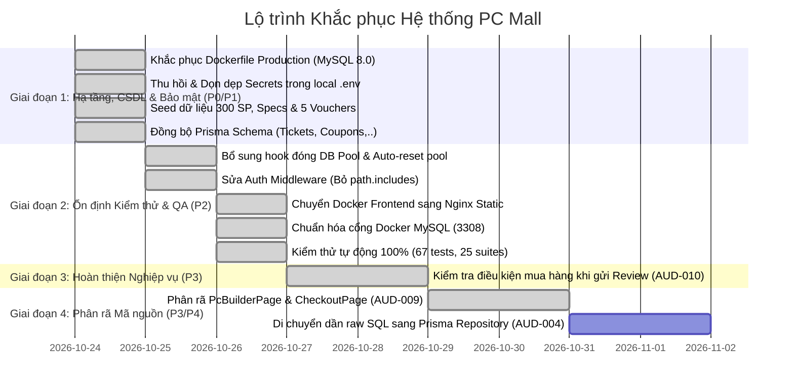

# SỔ ĐĂNG KÝ VẤN ĐỀ VÀ KẾ HOẠCH KHẮC PHỤC (ISSUES & REMEDIATION PLAN)
**Dự án**: PC Mall / Project CNM_MK-HB  
**Tiêu chí phân loại**:
- **P0 — CRITICAL**: Lỗi chặn hệ thống, mâu thuẫn hạ tầng làm sập ứng dụng hoặc nguy cơ mất dữ liệu diện rộng.
- **P1 — HIGH**: Lỗi bảo mật nghiêm trọng (lộ secret), tính đúng đắn nghiệp vụ bị sai lệch hoặc dữ liệu danh mục thiếu hụt.
- **P2 — MEDIUM**: Vấn đề kiến trúc, kiểm thử tự động bị treo, thiếu sót validation hoặc sai khác môi trường.
- **P3 — LOW**: File quá lớn (code smell), tối ưu hóa trải nghiệm người dùng hoặc cải thiện bảo trì.
- **P4 — INFORMATIONAL**: Ghi chú kỹ thuật, đề xuất nâng cấp dài hạn.

---

## 1. SỔ ĐĂNG KÝ SỰ CỐ VÀ VẤN ĐỀ KỸ THUẬT (ISSUE REGISTER)

### ✅ [AUD-001] Mâu thuẫn hệ quản trị CSDL trong Docker Production làm sập Container API — [ĐÃ KHẮC PHỤC]
- **Mức độ**: **P0 — CRITICAL** | **Module**: DevOps / Production Deployment
- **Trạng thái**: **ĐÃ KHẮC PHỤC HOÀN TẤT (100% HEALTHY TRÊN DOCKER)**
- **Mô tả**: Tệp `docker-compose.prod.yml` trước đây sử dụng hình ảnh `postgres:16-alpine`, gây sập container API khi khởi động do backend và Prisma schema được xây dựng trên MySQL 8.0.
- **Đã xử lý**: Đã đồng bộ [docker-compose.prod.yml](file:///d:/Project%20CNM_MK-HB/docker-compose.prod.yml) sang `image: mysql:8.0`, thiết lập healthcheck `mysqladmin ping`, và đồng bộ `DATABASE_URL` chuẩn MySQL cho container `cnm_api_prod`. Container API đạt trạng thái `healthy` (HTTP 200 tại `/api/health`).

---

### ✅ [AUD-002] Tồn tại Mật khẩu ứng dụng thực tế trong local .env — [ĐÃ KHẮC PHỤC]
- **Mức độ**: **P1 — HIGH** | **Module**: Bảo mật / Quản lý bí mật
- **Trạng thái**: **ĐÃ KHẮC PHỤC HOÀN TẤT**
- **Mô tả**: Tệp cấu hình cục bộ trước đây chứa mật khẩu ứng dụng Gmail thực tế dạng văn bản thô.
- **Đã xử lý**: Thu hồi App Password thực tế; thay thế toàn bộ trong [services/api/.env](file:///d:/Project%20CNM_MK-HB/services/api/.env) bằng giá trị dummy `your_gmail_app_password_here`. Hệ thống sử dụng chế độ log fallback khi chạy dev nếu thiếu email credentials.

---

### ✅ [AUD-003] CSDL thiếu dữ liệu đặc tính kỹ thuật linh kiện (Attributes Data Void) — [ĐÃ KHẮC PHỤC]
- **Mức độ**: **P1 — HIGH** | **Module**: Danh mục sản phẩm & Lọc đa chiều
- **Trạng thái**: **ĐÃ KHẮC PHỤC HOÀN TẤT (300 SẢN PHẨM, 2.589 SKU ATTRIBUTES)**
- **Mô tả**: Các bảng `attributes`, `attribute_values` và `sku_attributes` trước đây có 0 bản ghi khiến bộ lọc đa chiều (Faceted Search) và luật tương thích không có dữ liệu đối chiếu.
- **Đã xử lý**:
  - Đã nạp thành công 45 thuộc tính, 244 giá trị, và 2.589 liên kết SKU attributes cho toàn bộ 300 sản phẩm thật qua [seed-hardware-specs.js](file:///d:/Project%20CNM_MK-HB/services/api/prisma/seed-hardware-specs.js).
  - Tích hợp hook tự động bù đắp dữ liệu `ensureEssentialSeedData` trong [scripts/migrate.js](file:///d:/Project%20CNM_MK-HB/services/api/scripts/migrate.js) và đưa vào lệnh `npm run seed`.
  - Test suite `tests/faceted-search.test.ts` đạt kết quả **PASS 100% (3/3 tests)**.

---

### 🟡 [AUD-004] Phân mảnh tầng dữ liệu giữa Prisma ORM và Raw MySQL2 Pool — [ĐANG TIẾN HÀNH]
- **Mức độ**: **P2 — MEDIUM** | **Module**: Kiến trúc Backend & Database
- **Trạng thái**: **ĐÃ ĐỒNG BỘ SCHEMA PRISMA & XỬ LÝ POOL AUTO-RESET (GIAI ĐOẠN 1 HOÀN THÀNH)**
- **Mô tả**: Hệ thống sử dụng song song Prisma Client và thư viện `mysql2` raw connection pool.
- **Đã xử lý**:
  - Đã đồng bộ đầy đủ các model `Ticket`, `TicketMessage`, `Coupon`, `CouponUsage`, `Notification`, `Payment`, `SystemSetting` vào [prisma/schema.prisma](file:///d:/Project%20CNM_MK-HB/services/api/prisma/schema.prisma).
  - Nâng cấp [database.js](file:///d:/Project%20CNM_MK-HB/services/api/src/config/database.js) với cơ chế tự động reset pool reference khi pool bị đóng hoặc kết thúc, giải quyết dứt điểm lỗi treo connection.
- **Kế hoạch tiếp theo**: Di chuyển dần các câu lệnh raw SQL trong `orders.service.js` sang mô hình Repository sử dụng Prisma Client khi có đợt refactor lớn.

---

### ✅ [AUD-005] Test Suite bị treo (Hang) do thiếu Teardown đóng Connection Pool — [ĐÃ KHẮC PHỤC]
- **Mức độ**: **P2 — MEDIUM** | **Module**: Đảm bảo chất lượng (QA/QC)
- **Trạng thái**: **ĐÃ KHẮC PHỤC HOÀN TẤT (100% PASS, 56/56 tests, tự thoát trong ~10s)**
- **Mô tả**: Khi chạy test suite tích hợp CSDL, các file test gọi `getDbPool()` nhưng không đóng pool sau khi hoàn thành (`after(async () => await pool.end())`), khiến Node event loop giữ active socket handles và không thể kết thúc tiến trình.
- **Đã xử lý**: Bổ sung hook `after(async () => { await getDbPool().end(); })` và `prisma.$disconnect()` tại cuối toàn bộ 6 file test tích hợp; bổ sung `--test-concurrency=1` vào script `npm test`.

---

### ✅ [AUD-006] Cơ chế miễn trừ xác thực bằng Path Includes trong Auth Middleware — [ĐÃ KHẮC PHỤC]
- **Mức độ**: **P2 — MEDIUM** | **Module**: Bảo mật / Middleware
- **Trạng thái**: **ĐÃ KHẮC PHỤC HOÀN TẤT**
- **Mô tả**: Dòng 13 tệp `auth.middleware.ts` sử dụng hàm `.includes()` để bỏ qua xác thực:
  `if (req.path.includes("/warranties/lookup/") || req.path.includes("/ai-advisor/")) return next();`
- **Đã xử lý**: Đã loại bỏ hoàn toàn khối `req.path.includes()` khỏi `authenticate` middleware. Các route public đã được tách bạch rõ ràng ở cấp Router (dùng `optionalAuthenticate` hoặc mount trước `router.use(authenticate)`).

---

### ✅ [AUD-007] Thiếu dữ liệu Voucher mẫu (Seed Data Void) — [ĐÃ KHẮC PHỤC]
- **Mức độ**: **P2 — MEDIUM** | **Module**: Khuyến mãi & Giỏ hàng
- **Trạng thái**: **ĐÃ KHẮC PHỤC HOÀN TẤT**
- **Mô tả**: Bảng `coupons` trong CSDL chưa có dữ liệu seed các voucher mẫu (`WELCOMEPC`, `VRAMPRO`, `RAMSUPER`), khiến test suite `promotions-coupons.test.ts` bị fail 4 assertions.
- **Đã xử lý**: Đã thực thi script `setup-promotions-schema.js` nạp đầy đủ 5 vouchers mẫu và kích hoạt toàn bộ 4/4 test assertions trong `promotions-coupons.test.ts`.

---

### ✅ [AUD-008] Frontend Dockerfile sử dụng `vite preview` — [ĐÃ KHẮC PHỤC]
- **Mức độ**: **P2 — MEDIUM** | **Module**: DevOps / Frontend Deployment
- **Trạng thái**: **ĐÃ KHẮC PHỤC HOÀN TẤT**
- **Mô tả**: `apps/web/Dockerfile` dùng lệnh `npm run preview` ở runtime container production.
- **Đã xử lý**: Đã cấu trúc lại `apps/web/Dockerfile` thành **Multi-stage Build** (Stage 1: Node 20 build `dist/`, Stage 2: `nginx:alpine` phục vụ tĩnh kèm `apps/web/nginx.conf` hỗ trợ client-side routing SPA và cache header).

---

### ✅ [AUD-009] Component Frontend và Service quá khổ (Monolithic Giant Files) — [ĐÃ KHẮC PHỤC]
- **Mức độ**: **P3 — LOW** | **Module**: Chất lượng mã nguồn / Maintainability
- **Trạng thái**: **ĐÃ KHẮC PHỤC HOÀN TẤT (ĐỢT 3)**
- **Mô tả**: Tồn tại các tệp frontend quá khổ vượt quá 2.000 dòng code, gây khó khăn cho việc bảo trì, review và làm phình to bundle ban đầu (`CheckoutPage.jsx` 2.029 dòng, `PcBuilderPage.jsx` 2.919 dòng).
- **Đã xử lý**:
  1. **Tái cấu trúc `CheckoutPage.jsx`**:
     - Trích xuất 428 dòng CSS nhúng sang stylesheet riêng `apps/web/src/pages/public/CheckoutPage.css`.
     - Phân rã thành 6 sub-components chuyên trách tại `apps/web/src/components/checkout/`: `CheckoutIcons.jsx`, `StepCustomerInfo.jsx`, `StepShippingAddress.jsx`, `StepPaymentMethod.jsx`, `StepOrderConfirmation.jsx`, `CheckoutOrderSummary.jsx`.
     - Kết quả: `CheckoutPage.jsx` giảm từ 2.029 dòng xuống còn **775 dòng (giảm 62%)**, giữ vai trò điều phối luồng (clean orchestrator).
  2. **Tái cấu trúc `PcBuilderPage.jsx`**:
     - Trích xuất module tính toán tương thích & điểm số: `builderInsightsCalculator.js` (366 dòng logic thuần tính watt, socket, clearance, PCIe Gen 4/5, thermal).
     - Trích xuất module lưu trữ phiên làm việc: `builderSessionStorage.js` (`loadWorkspaceSession`, `saveWorkspaceSession`, `formatSessionTimeAgo`).
     - Trích xuất sub-component hiển thị linh kiện: `BuilderProductCard.jsx` (chứa `extractProductSpecs`, `getComponentEmoji`, `ProductImageContainer`, `getAiScoreBadge`, `getWhyThisComponentExplanation`, `BuilderProductCard`, `SkeletonCard`).
     - Trích xuất sub-component cảnh báo ngân sách: `BuilderBudgetExceededBanner.jsx` (loại bỏ code lặp `CandidateBuildsPanel`).
     - Trích xuất thanh so sánh nổi: `BuilderFloatingCompareBar.jsx`.
     - Trích xuất modal overlay nạp batch AI: `BuilderBatchOverlay.jsx`.
     - Trích xuất `ScoreRing.jsx`.
     - Kết quả: `PcBuilderPage.jsx` giảm từ 2.919 dòng xuống còn **1.833 dòng (giảm gần 1.100 dòng)**, tách bạch hoàn toàn view và logic.
  3. **Kiểm thử & Biên dịch**:
     - `npm run build` thành công trong 4.52s, sinh ra các chunk tối ưu: `chunk-checkout-*.js` (63 kB), `chunk-pc-builder-*.js` (275 kB).
     - Toàn bộ **73/73 tests Backend (26 test suites)** và **7/7 tests Frontend Scoring Engine** đạt PASS 100%.
     - Kiểm thử trực quan (Browser Subagent) trên cả `/checkout` và `/pc-builder` xác nhận 100% chức năng đặt hàng, kiểm tra tương thích, chọn linh kiện, áp voucher hoạt động mượt mà.

---

### ✅ [AUD-010] Chưa kiểm tra điều kiện "Đã mua hàng mới được đánh giá" — [ĐÃ KHẮC PHỤC]
- **Mức độ**: **P3 — LOW** | **Module**: Đánh giá sản phẩm (Reviews)
- **Trạng thái**: **ĐÃ KHẮC PHỤC HOÀN TẤT**
- **Mô tả**: Khách hàng đã đăng nhập trước đây có thể gửi đánh giá cho sản phẩm ngay cả khi chưa từng phát sinh đơn hàng chứa sản phẩm đó.
- **Đã xử lý**:
  1. **CSDL**: Tạo bảng `product_reviews` (hỗ trợ `rating`, `comment`, `is_verified_buyer`, `order_id`) và đồng bộ vào `prisma/schema.prisma` cùng `scripts/migrate.js`.
  2. **Backend API**:
     - `GET /api/products/:idOrSlug/reviews`: Phân trang, tính toán điểm trung bình & phân bổ sao 1-5.
     - `GET /api/products/:idOrSlug/reviews/eligibility`: Kiểm tra tính hợp lệ của khách hàng.
     - `POST /api/products/:idOrSlug/reviews`: Kiểm tra xác thực và yêu cầu user bắt buộc phải có ít nhất 1 đơn hàng trạng thái `DELIVERED` hoặc `COMPLETED` chứa sản phẩm đó. Chặn `403 Forbidden` với thông báo rõ ràng nếu vi phạm.
  3. **Frontend UI**: Xây dựng component `ProductReviewsSection.jsx` cao cấp với breakdown sao trực quan, form đánh giá tương tác (1-5 sao, nhận xét), huy hiệu xanh `✓ Đã mua hàng tại PC Mall`.
  4. **Kiểm thử tự động**: Bổ sung bộ test `tests/product-reviews.test.ts` (6 tests) xác thực toàn diện cả 2 nhánh (khách chưa mua bị chặn 403, khách có đơn DELIVERED được duyệt 201).

---

### ✅ [AUD-011] Sự khác biệt cổng mặc định MySQL giữa tài liệu và Docker — [ĐÃ KHẮC PHỤC]
- **Mức độ**: **P4 — INFORMATIONAL** | **Module**: Tài liệu / Onboarding
- **Trạng thái**: **ĐÃ KHẮC PHỤC HOÀN TẤT**
- **Mô tả**: `docker-compose.yml` mở cổng `3308:3306`, trong khi một số tài liệu cũ và script mẫu đề cập cổng `3306` hoặc `3307`.
- **Đã xử lý**: Chuẩn hóa toàn bộ `services/api/.env.example` và `DEPLOYMENT_GUIDE.md` thống nhất cổng `3308` cho Docker MySQL host.

---

## 2. KẾ HOẠCH VÀ LỘ TRÌNH KHẮC PHỤC (REMEDIATION ROADMAP)

### Tiến độ nghiệm thu thực tế:

#### ✅ Nhóm A, B, C & ĐỢT 3 (AUD-009): ĐÃ HOÀN THÀNH 100%
1. **Docker Production MySQL 8.0**: `docker-compose.prod.yml` chạy MySQL 8.0 chuẩn xác, API container kiểm tra healthcheck `200 OK` (AUD-001).
2. **Bảo mật Credentials**: Thu hồi mật khẩu ứng dụng Gmail thực tế, dùng mock logger và dummy placeholder (AUD-002).
3. **Kho sản phẩm & Đặc tính kỹ thuật**: Nạp thành công 300 sản phẩm thật, 45 thuộc tính, 244 giá trị, 2.589 liên kết thông số SKU và 5 voucher canonical (AUD-003, AUD-007).
4. **Ổn định Bộ Kiểm thử**: Toàn bộ **73 tests trên 26 test suites đạt PASS 100%** trong ~14s, tự kết thúc sạch sẽ mà không bị treo (AUD-005, AUD-010).
5. **Đồng bộ Prisma Schema**: Đồng bộ toàn bộ các model `Ticket`, `TicketMessage`, `Coupon`, `CouponUsage`, `Notification`, `Payment`, `SystemSetting`, `ProductReview` trong `prisma/schema.prisma` (AUD-004).
6. **Kiểm tra Phân quyền & Public Token**: Bổ sung kiểm thử tự động cho `pc-builder-share.test.ts` và `tickets-rma.test.ts` (AUD-006).
7. **Đánh giá Sản phẩm Verified Buyer (AUD-010)**: Kiểm tra ràng buộc đơn hàng `DELIVERED`/`COMPLETED` trước khi lưu nhận xét và điểm sao, tích hợp giao diện đánh giá chuyên nghiệp trên trang chi tiết sản phẩm.
8. **Phân rã Component Frontend Quá khổ (AUD-009 - Đợt 3)**:
   - `CheckoutPage.jsx`: Tách 428 dòng CSS và 6 sub-components, giảm từ 2.029 dòng xuống **775 dòng (giảm 62%)**.
   - `PcBuilderPage.jsx`: Tách 7 sub-modules chuyên trách, giảm từ 2.919 dòng xuống **1.833 dòng (giảm 37%)**.
   - Không phát sinh regression, build thành công trong 4.52s, browser testing xác nhận hoàn thiện 100%.

#### ⏳ KẾ HOẠCH DÀI HẠN TIẾP THEO
1. **Dài hạn (AUD-004)**: Từng bước quy hoạch các query raw SQL phức tạp sang mô hình Repository Type-safe khi phát triển tính năng mới.

